# IntegrityWatch Field

**Idioma / Language:** [English](README.md) · [Español (Latinoamérica)](README.es.md)

**Centro de operaciones de integridad y cumplimiento, offline-first, para trabajos de campo en petróleo y gas.**

IntegrityWatch Field es una aplicación que se ejecuta **completamente en su computadora o dispositivo, sin internet y sin un servidor obligatorio**. Reúne las tareas de integridad más habituales del campo: corrosión, válvulas de alivio de presión, oleoductos, gestión de activos, inspecciones, recomendaciones e informes. Todo se almacena localmente en su navegador (IndexedDB) y puede instalarla como aplicación web progresiva (PWA) para usarla sin conexión.

> **Herramienta de apoyo. Valide siempre los resultados contra las ediciones vigentes de las normas y contra los datos del fabricante de los equipos.** Los cálculos se basan en fórmulas publicadas de normas reconocidas (NACE/AMPP, API, ASME, ASTM, ISO); consulte `docs/STANDARDS.md` para las referencias exactas y las aproximaciones.

---

## Portada

**IntegrityWatch Field**

**Propuesta de valor:** centro de operaciones de integridad y cumplimiento, offline-first, para trabajos de campo en petróleo y gas

**Insignias:**      [](LICENSE)

**Aviso de ingeniería:** herramienta de apoyo. Valide siempre contra las ediciones vigentes de las normas y los datos del fabricante. Los resultados de cálculo son indicativos y deben ser revisados por personal calificado.

---

## Qué es y para quién es

**Ingeniería de integridad de campo en petróleo y gas:** corrosión, PSV, oleoductos, APM, cumplimiento

IntegrityWatch Field es una aplicación web progresiva (PWA) offline-first diseñada específicamente para profesionales de integridad de campo en petróleo y gas. Combina en una sola interfaz las principales tareas de integridad que se realizan a diario en los sitios de producción:

- **Corrosión y protección contra la corrosión** (corrosión por pérdida de peso, inhibidores, protección catódica)
- **Válvulas de seguridad y de alivio** (dimensionamiento según API 520/526, registros de pruebas)
- **Oleoductos y activos de línea** (mantenimiento de ductos, inspecciones ILD/UT, activos por kilómetro de estación)
- **Gestión de activos y confiabilidad** (APM, RBI según API 580/581, intervalos de inspección)
- **Recolección de datos** (importación de CSV, WITSML-lite, validación)
- **Motor de recomendaciones** (R1-R17 para la toma de decisiones)
- **Informes y cumplimiento** (trimestrales, técnicos, legales)

**Público objetivo:** operadores de campo, ingenieros de integridad, técnicos de mantenimiento y supervisores de campo que necesitan acceso rápido y confiable a los datos de integridad sin depender de la conexión a internet ni de servidores externos.

---

## Arquitectura del sistema

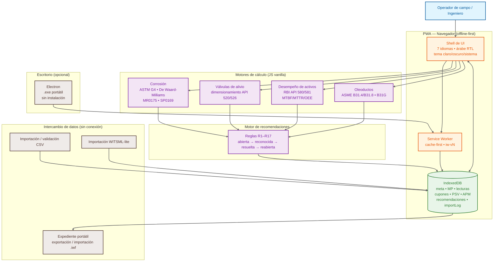

### Flujo de ingesta de datos

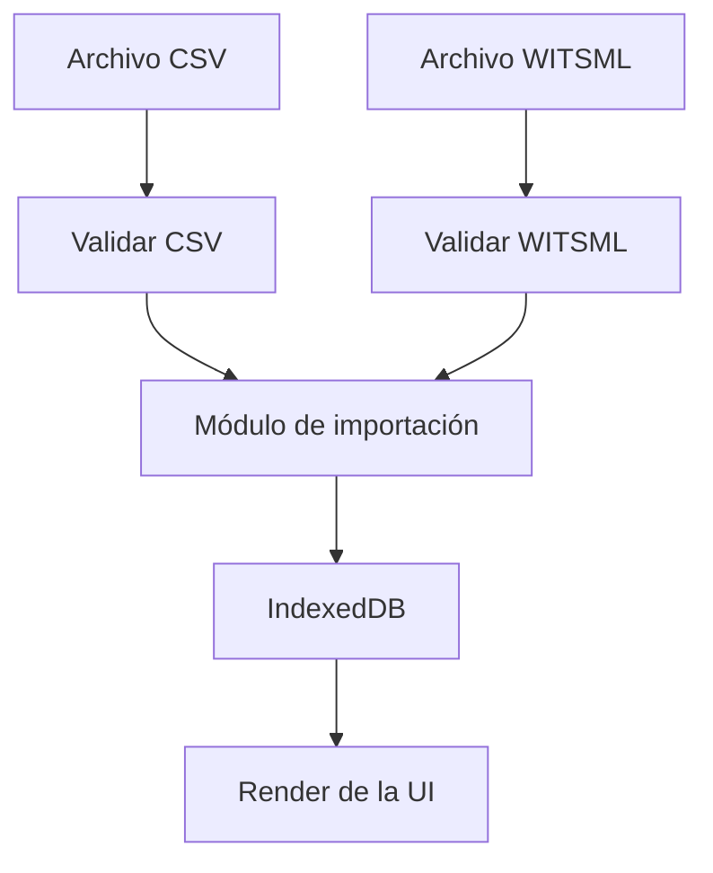

### Flujo del motor de reglas

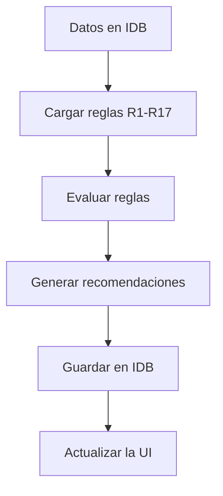

---

## Capturas de pantalla

Galería de evidencia visual organizada por módulo. Todas las capturas viven en `docs/evidence/` y corresponden a vistas reales renderizadas con datos de demostración.

### Panel y operación

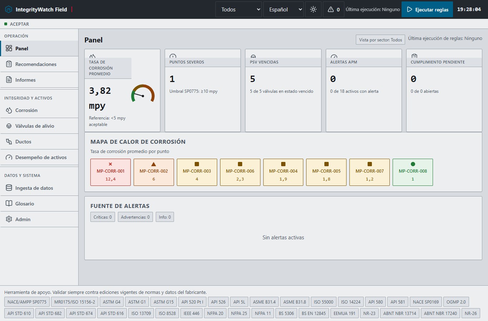
*Panel principal con indicadores clave, mapa de calor y alertas recientes (tema claro).*

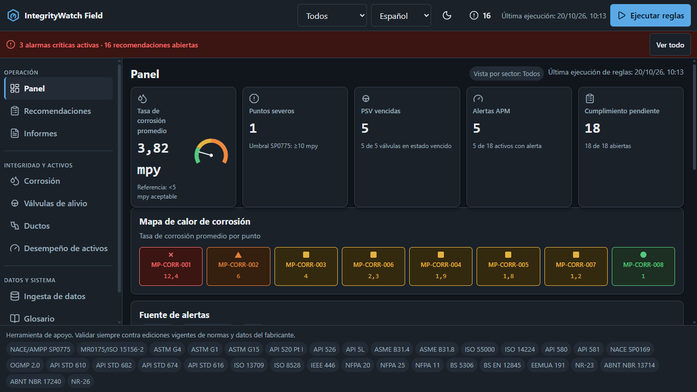
*Panel principal en tema oscuro.*

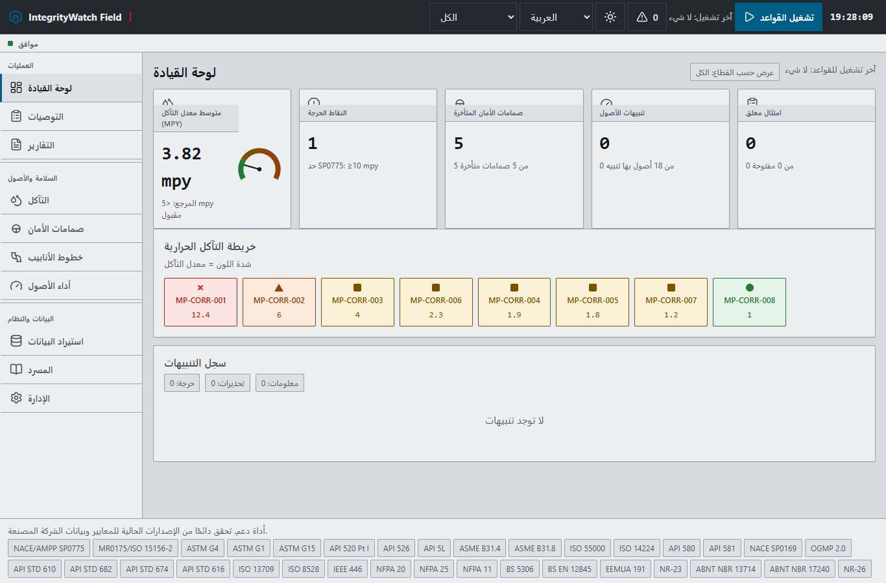
*Panel principal en árabe con dirección de lectura RTL.*

### Corrosión

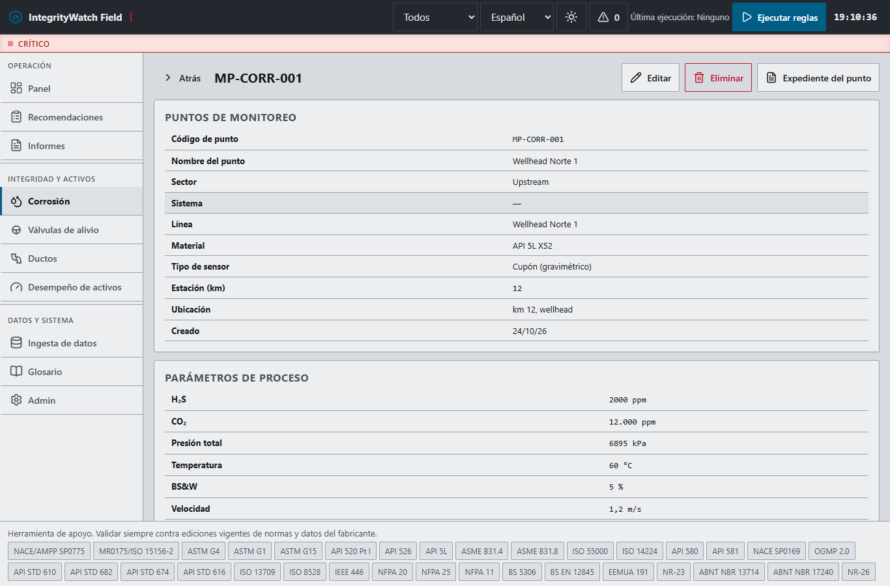
*Detalle del punto de monitoreo con lecturas, cupones y velocidad de corrosión (tema claro).*

### Válvulas de alivio de presión (PSV) · API 520/526

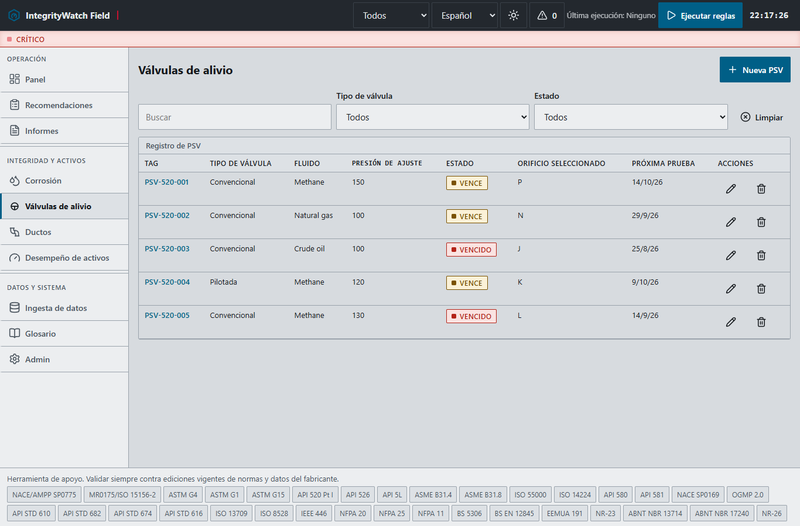
*Lista de válvulas de seguridad y de alivio con estado de pruebas.*

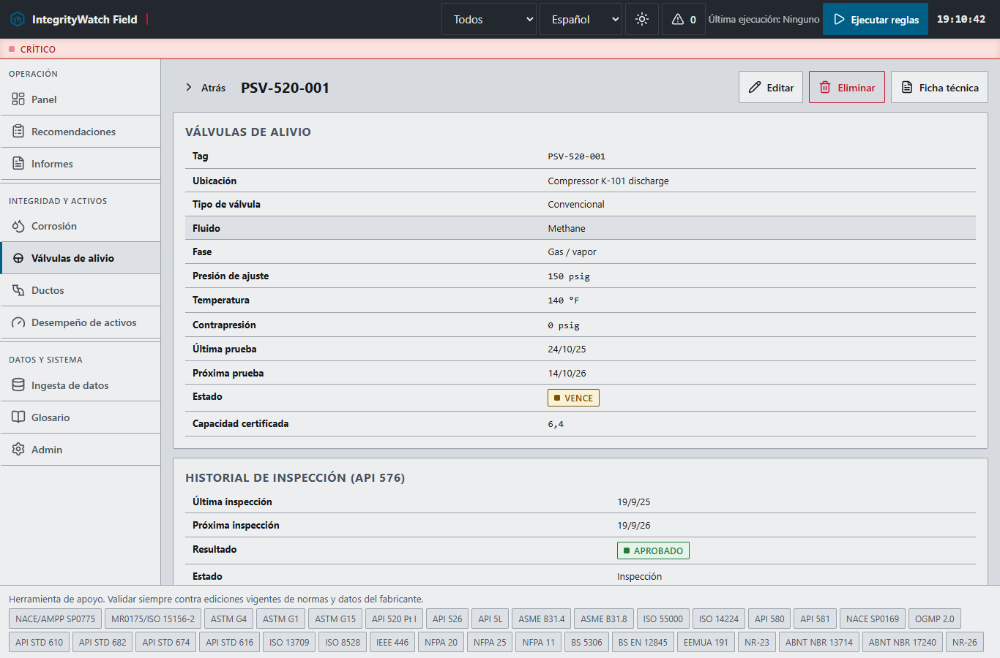
*Dimensionamiento de válvulas según API 520/526 (tema claro).*

### Oleoductos y activos de línea

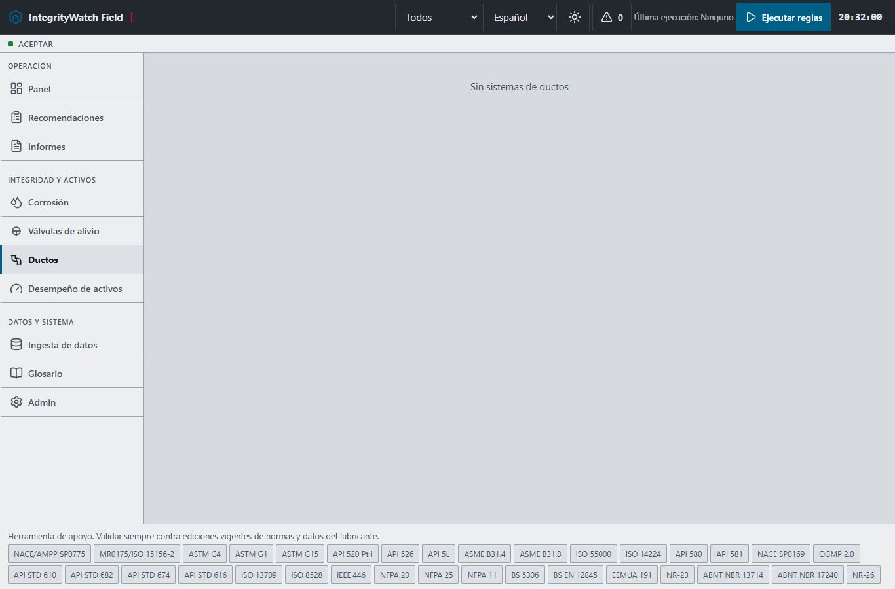
*Mapa esquemático de oleoductos con activos posicionados por kilómetro (tema claro).*

### Gestión del desempeño de activos (APM)

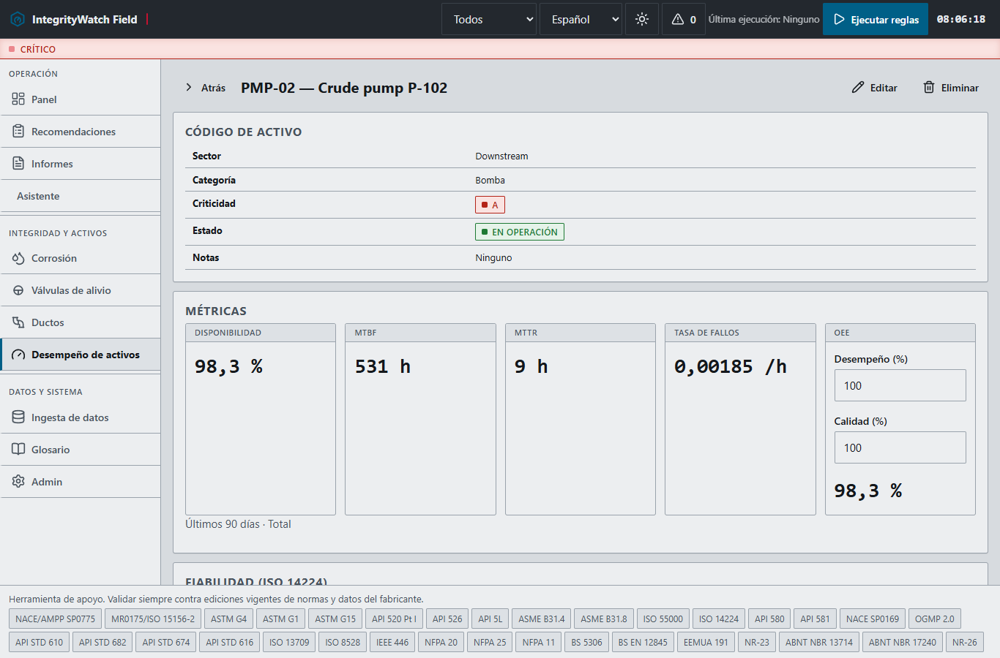
*Detalle de activo APM con análisis de riesgo RBI (tema claro).*

### Ingesta de datos

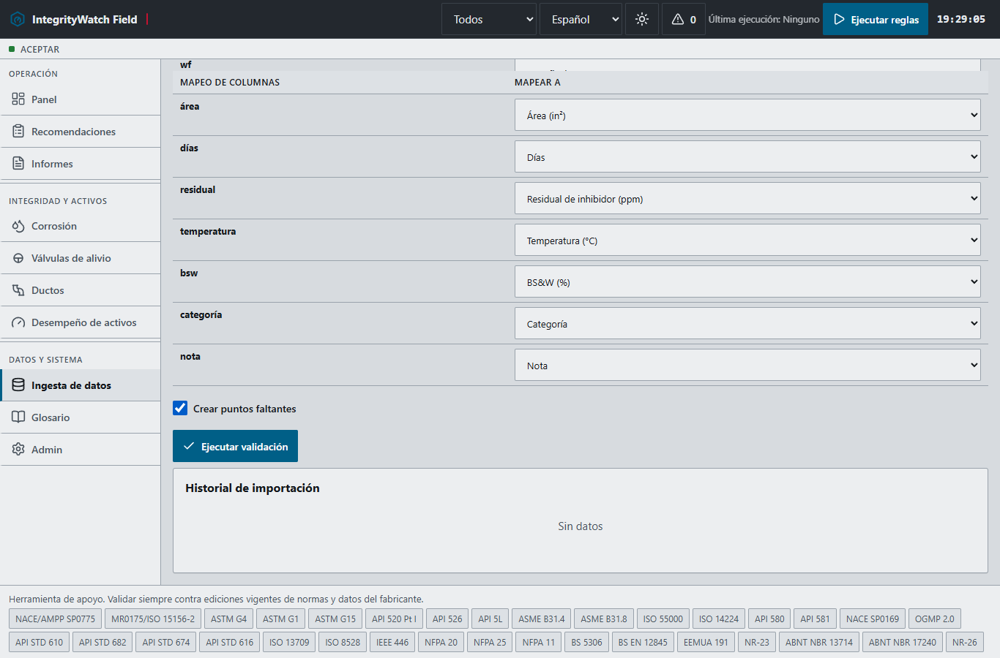
*Mapeo de columnas durante la importación de CSV/WITSML-lite.*

### Recomendaciones

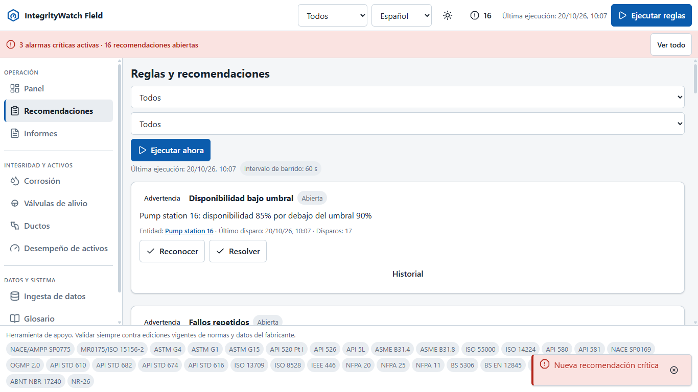
*Motor de recomendaciones R1–R17 con acciones de abrir/reconocer/resolver/reabrir.*

### Informes

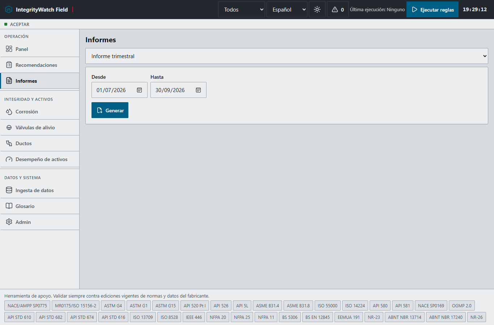
*Informes trimestrales, por punto de monitoreo y fichas técnicas de PSV (tema claro).*

### Glosario

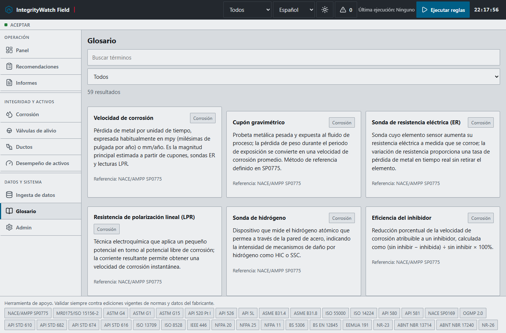
*Glosario técnico multilingüe con referencias normativas.*

### Administración

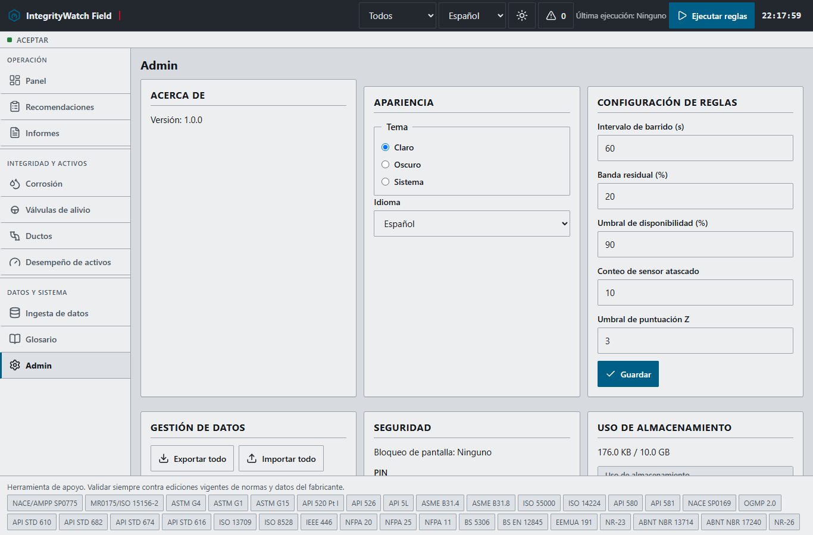
*Configuración general, idioma, tema, respaldo/restauración, expediente portátil .iwf, PIN y estado sin conexión.*

---

## Recorrido en video

**Resumen / promo** — [`docs/evidence/video/integritywatch-field-promo.mp4`](docs/evidence/video/integritywatch-field-promo.mp4) (1:21, ~16 MB, narración en inglés).

Una descripción narrada de qué es IntegrityWatch Field y qué resuelve: integridad y cumplimiento offline-first para **pozos, oleoductos y activos offshore** — modelado de corrosión (De Waard–Milliams, ASTM), dimensionamiento de PSV (API 520/526), oleoductos con un mapa esquemático por kilómetros e inspecciones ILD/UT, inspección basada en riesgo (API 580/581), el motor de recomendaciones **R1–R17** e informes — además de 7 idiomas, temas claro/oscuro, importación CSV/WITSML y expedientes portátiles.

**Recorrido de oleoducto (español latino, modo tablet)** — [`docs/evidence/video/integritywatch-field-oleoducto-es.mp4`](docs/evidence/video/integritywatch-field-oleoducto-es.mp4) (2:11, voz es-MX, **sin subtítulos**, con notas de equipo y tarea). Login admin, alta de perfiles, reset de contraseña, bombas multietapa y LPG, PSV, mapa de kilómetros, ronda diaria y dossier.

**Tour de la UI — cada función, nuevo diseño IFS-24** — [`docs/evidence/video/integritywatch-field-uitour-en.mp4`](docs/evidence/video/integritywatch-field-uitour-en.mp4) (1:35, narración en inglés). Panel, punto de corrosión, activos ISO 14224, válvulas de alivio, la barra de kilómetros del oleoducto, ingesta CSV sin conexión (16/17 filas), reglas priorizadas y el expediente en el dispositivo.

https://github.com/user-attachments/assets/bda20933-ca64-4ec2-b829-34e0a7f3eb6c

**Corte de operadores (planta · oleoducto · refinería)** — [`docs/evidence/video/integritywatch-field-operators-en.mp4`](docs/evidence/video/integritywatch-field-operators-en.mp4) (1:19, narración en inglés). Grabado durante la campaña de operadores: ingesta CSV sin conexión (48/48 filas), registro de activos ISO 14224 y un expediente generado en el dispositivo. Registro de la prueba: [`docs/PRUEBAS-CAMPO-OPERADORES-2026-10-31.md`](docs/PRUEBAS-CAMPO-OPERADORES-2026-10-31.md).

https://github.com/user-attachments/assets/2d49d8f9-8262-4406-b6b8-a6b839aea9ce

**Corte de validación en campo** — [`docs/evidence/video/integritywatch-field-fieldtest-en.mp4`](docs/evidence/video/integritywatch-field-fieldtest-en.mp4) (1:24, ~10 MB, narración en inglés, subtítulos incrustados; [SRT](docs/evidence/video/integritywatch-field-fieldtest-en.srt)).

https://github.com/user-attachments/assets/68e55fe4-8b72-4f6d-8a72-611acc7ee6c6

Grabado desde la aplicación en vivo durante la prueba de validación en campo que aparece más abajo: el panel con puntos reales derivados de oleoductos, una importación CSV sin conexión validada fila por fila (32/32), registro de un activo con banda RBI y un expediente del punto generado en el dispositivo. Los atributos de los activos provienen de datos abiertos de NSTA; no aparecen logos ni nombres de operadores de terceros.

**Recorrido completo** — [`docs/evidence/video/demo-walkthrough.mp4`](docs/evidence/video/demo-walkthrough.mp4) (≈22 s, ~1,5 MB).

Recorrido grabado de punta a punta de la aplicación: arranque y panel, navegación por Corrosión, PSV (dimensionamiento API 520/526), Oleoductos y mapa, APM, Ingesta, Recomendaciones, Informes y Glosario — en los idiomas y temas soportados.

> **Nota:** GitHub no reproduce en línea, dentro del README, los archivos MP4 guardados en el repositorio; abra el enlace para reproducirlo o descargarlo. Para tener un reproductor en línea, suba el archivo desde el editor web de GitHub para que se sirva desde `user-attachments`.

---

## Validación en campo (datos reales, 30-10-2026)

La aplicación se validó de punta a punta contra una instalación limpia usando **datos
reales de activos públicos**, no filas de ejemplo. Esta es la campaña de referencia que
respaldan el video de validación en campo y las capturas usadas en los manuales.

### Conjunto de datos utilizado

| Fuente | Qué es real | Volumen |
|---|---|---|
| NSTA Open Data — infraestructura offshore del UKCS | Nombre del oleoducto, fluido, diámetro, espesor de pared, MAWP, longitud, estado, fecha de puesta en servicio | **55 oleoductos** con atributos de ingeniería completos (de 2.110 activos) |
| NSTA Open Data — puntos de oleoducto | Tags y tipos de equipo: válvulas, múltiples, piezas en T, trampas de diablos, bases de riser, ánodos | **45 registros** |
| HSE Offshore Statistics 2024 | Liberaciones de hidrocarburos, ocurrencias peligrosas, notificaciones, lesiones | **92 HCR**, 180 DO, 616 incumplimientos |

Las series de inspección y de corrosión son **derivadas** de esos parámetros reales de las
líneas y se etiquetan como derivadas en cada fila; nunca se presentan como mediciones de
campo. Procedencia completa: [`docs/FIELD-DATA-SOURCES.md`](docs/FIELD-DATA-SOURCES.md).

### Qué demostró la corrida

| Paso | Resultado |
|---|---|
| Crear puntos de monitoreo a partir de datos reales de línea | 4 puntos (gas, crudo, condensado, multifásico) |
| Importar un CSV de campo sin conexión | 32 filas en total, **32 importadas, 0 omitidas, 0 errores** |
| Registrar un sistema de oleoducto | CATS: 36 in, 28,4 mm de pared, 17,93 MPa, 404,97 km |
| Registrar un activo (APM) | Registro real de válvula NSTA con banda RBI B |
| Ejecutar las reglas R1–R17 | **24 recomendaciones** generadas |
| Generar informes | Expediente del punto, informe trimestral, ficha técnica de PSV |
| Exportar el expediente | `.iwf`, 107.485 bytes, reabierto desde disco |
| Diseño para tableta (1280×800) | Panel e ingesta usables sin servidor |

### Defecto encontrado, corregido y con prueba de regresión

Los puntos creados en la UI se guardaban con un id opaco, mientras que la importación CSV
vincula las lecturas por código de punto; por eso el KPI de velocidad promedio y el mapa de
calor mostraban “—” en todos los puntos creados en la app (los datos semilla lo ocultaban
porque `id === code`). Se corrigió persistiendo `id = code` (convención del SCHEMA), con 3
pruebas nuevas; la suite pasó de 512 a **515 pruebas, 0 fallos**.
Después del arreglo, el mapa de calor reporta 9,4 / 6,8 / 4,9 / 4,6 mpy para las cuatro líneas reales.

### Evidencia y artefactos

- Registro de la prueba con 20 capturas numeradas: [`docs/PRUEBAS-CAMPO-2026-10-30.md`](docs/PRUEBAS-CAMPO-2026-10-30.md)
- Capturas y bitácora legible por máquina: [`docs/field-tests-2026-10-30/`](docs/field-tests-2026-10-30/) (`evidence.json`, `case-file-export.iwf.json`)
- Conjunto de datos y series derivadas: [`datos-prueba/real/`](datos-prueba/real/)
- Runners: [`tools/qa/fetch_field_data.py`](tools/qa/fetch_field_data.py), [`tools/qa/run_field_tests.py`](tools/qa/run_field_tests.py)

### Reproducir

```powershell
python tools\qa\fetch_field_data.py      # refresca el conjunto de datos real
python tools\serve.ps1 -Port 8419         # en otra terminal
python tools\qa\run_field_tests.py       # ejecución de UI, capturas y evidence.json
```

---

## Campaña con operadores (planta · oleoducto · refinería, 31-10-2026)

Una segunda campaña de campo, ejecutada para los tres roles operativos. Mismo método:
instalación limpia, datos reales, capturas en cada paso y evidencia legible por máquina.

### Personas y qué se ejercitó

| Persona | Sitio (real) | Flujo de trabajo en la tableta |
|---|---|---|
| **Operador de refinería** | Galveston Bay, TX — 631.000 b/cd (EIA-820) | Punto de cabeza de la CDU, unidad registrada con banda RBI A, válvula de alivio vencida, expediente del punto |
| **Operador de planta** | Beaumont, TX — 612.000 b/cd (EIA-820) | Punto de la CDU, activo de bomba, lecturas revisadas en diseño para tableta |
| **Operador de oleoducto** | Líneas del UKCS (NSTA) | Sistema CATS, activo de línea en el km 12,4, hallazgo severo de ILI, mapa de estaciones |

### Resultados

| Verificación | Resultado |
|---|---|
| Puntos de monitoreo creados | 6 (3 downstream + 3 midstream) |
| CSV ingerido sin conexión | **48 de 48 filas, 0 omitidas, 0 errores** |
| Lecturas en el almacén tras la importación | 168 |
| Activos registrados (ISO 14224) | 3 (CDU, compresor de gas húmedo, estación de bombeo) |
| Válvulas de alivio creadas | 2, ambas vencidas (se dispara R13) |
| Activos de línea / inspecciones | 1 / 1 (38 % de pérdida de pared, severo, km 12,4) |
| Recomendaciones tras R1–R17 | **25** (5 críticas) |
| Exportación del expediente | 121.134 bytes |
| Capturas tomadas | 24 |
| Incidentes del runner | 0 |

### Defectos encontrados

1. **Render obsoleto al salir del detalle de un activo.** Navegar a `#/reports` actualizaba
   la URL mientras el DOM conservaba la vista del activo anterior (`hash: '#/reports'`,
   `h1: 'REF-GB-CDU-01 …'`). Un render asíncrono pendiente repinta `#main` después del
   cambio de ruta. El runner lo sortea con una recarga; el producto debería cancelar el
   render obsoleto. Registrado en `evidence.json`.
2. **La validación de material es silenciosa.** `carbon-steel` no es un id de material
   válido; el formulario se niega a guardar sin un mensaje explícito. Los ids reales son
   `a106-b` / `api5l-x52`.

### Evidencia

- Registro de la prueba con las 24 capturas: [`docs/PRUEBAS-CAMPO-OPERADORES-2026-10-31.md`](docs/PRUEBAS-CAMPO-OPERADORES-2026-10-31.md)
- Procedencia de los datos: [`docs/FIELD-DATA-SOURCES-OPERATORS.md`](docs/FIELD-DATA-SOURCES-OPERATORS.md)
- Capturas y bitácora: [`docs/field-tests-operators-2026-10-31/`](docs/field-tests-operators-2026-10-31/)
- Runners: [`tools/qa/fetch_operator_data.py`](tools/qa/fetch_operator_data.py), [`tools/qa/run_operator_tests.py`](tools/qa/run_operator_tests.py)

### Reproducir

```powershell
python tools\qa\fetch_operator_data.py
python tools\serve.ps1 -Port 8419
python tools\qa\run_operator_tests.py
```

---

## Mejora visual — sistema de símbolos IFS-24 (31-10-2026)

La aplicación ahora habla el lenguaje de una sala de control: los equipos se dibujan con un
conjunto de pictogramas hecho a propósito, en lugar de glifos genéricos de UI.

| Elemento | Detalle |
|---|---|
| Conjunto | **34 símbolos** (tanques, recipientes, columnas, hornos, intercambiadores, bombas, compresores, válvulas, PSV, ítems de línea, modos de degradación) |
| Trazado | Lienzo de 24 unidades, trazo constante de **1,75 px**, `currentColor`, SVG inline |
| Peso | **7,3 KB** para el conjunto completo, cero dependencias, sin fuente de íconos |
| Estados | `ok` · `warn` · `crit` · `nodata` (contorno discontinuo) · `off` (rayado) — **forma + color + insignia**, nunca solo color |
| Generador | [`tools/build-symbols.py`](tools/build-symbols.py) → [`src/components/symbols.js`](src/components/symbols.js) |
| Mapeo | [`src/components/symbol-map.js`](src/components/symbol-map.js): categoría ISO 14224 / tipo de sensor / tipo de activo de línea → símbolo |
| Pruebas | [`tests/symbols.test.js`](tests/symbols.test.js): todo símbolo tiene geometría, sin scripts, sin colores hardcodeados; toda categoría de la app resuelve |

### Dónde se aplica

| Capa | Cambio |
|---|---|
| Panel | Las celdas del mapa de calor de corrosión muestran el símbolo del equipo del punto, coloreado por severidad, con una insignia de severidad |
| Desempeño de activos | La celda de categoría muestra el pictograma ISO 14224 (columna, intercambiador, bomba, compresor, válvula…) |
| Corrosión | La lista de puntos muestra el pictograma de sensor/equipo con el estado derivado de la velocidad medida |
| Válvulas de alivio | El registro muestra el símbolo de PSV; las válvulas vencidas se marcan como críticas |
| Shell de la app | `symbols.css` se carga en el shell y se precarga; el caché sube a `iw-v19` |

### Qué no se cambió a propósito

La **vista de mapa** de oleoductos ya dibuja una barra de kilómetros con formas de severidad,
tags y leyenda. Anidar pictogramas dentro de su sistema de coordenadas chocaba con su
escalado, así que el mapa conserva su codificación de forma y color y los símbolos se usan
en todo lo demás. Se deja constancia aquí para que la decisión no se confunda con una omisión.

---

## Módulos (tabla)

| Módulo | Qué hace | Normas aplicables |
|--------|--------------|---------------------|
| **Panel** | Resumen de indicadores clave: corrosión promedio, puntos críticos, válvulas vencidas, alertas y cumplimiento de APM, con mapa de calor y alertas recientes. | SP0775, API 580/581 |
| **Corrosión** | Puntos de monitoreo, lecturas, cupones gravimétricos, eficiencia de inhibidores, modelo De Waard-Milliams, servicio ácido (MR0175), protección catódica (SP0169). | ASTM G4/G1/G15, NACE/AMPP SP0775, MR0175/ISO 15156-2, SP0169 |
| **Válvulas de alivio de presión (PSV)** | Registro y dimensionamiento de válvulas de seguridad según API 520/526 (gas, vapor, líquido, líquido viscoso) con selección de orificio. | API 520 Pt I, API 526, ISO 13709/8528/55000/14224 |
| **Oleoductos y activos de línea** | Sistemas de línea, activos ubicados por kilómetro de estación, inspecciones (ILD, UT, visual, reparación) con evidencia de campo (firma manuscrita, fotos JPEG con EXIF/GPS, croquis) y campañas. | ASME B31.4/B31.8, API 5L, ISO 13709, NFPA 20/25/11 |
| **Mapa esquemático** | Vista esquemática del sistema de línea con activos posicionados por kilómetro; navegable con teclado y accesible. | ISA-101, API RP 1165 |
| **Gestión del desempeño de activos (APM)** | Confiabilidad y disponibilidad (MTBF, MTTR, OEE), análisis de riesgo RBI (API 580/581), intervalos de inspección sugeridos. | ISO 55000, ISO 14224, API 580/581, ISO 10218-2 |
| **Ingesta de datos** | Ingesta masiva de múltiples archivos (cola + arrastrar y soltar): CSV / XLSX / JSON / JSONL / XML genérico / WITSML en las 9 entidades del expediente, con mapeo automático de columnas, vista previa, deduplicación por clave natural, diario de rollback e importación reanudable. | WITSML-lite (estándar), ISO 14224 (mapeo) |
| **Recomendaciones** | Motor R1–R17 para detectar condiciones de riesgo y generar acciones (abrir, reconocer, resolver, reabrir). | API 580/581, ISO 13849-1, ISO 62061 |
| **Informes** | 15 plantillas (informes tipados T-01…T-12 + expediente, trimestral, ficha técnica de PSV) × 6 formatos de exportación (PDF/CSV/XLSX/DOCX/JSON/XML) con escritores propios sin dependencias; paquete de evidencia ZIP con manifiesto SHA-256. | ISO 55000, API 580/581, NFPA 20/25, PHMSA Part 195, ISO 14224 |
| **Glosario** | Términos técnicos en varios idiomas con referencias normativas y búsqueda. | ISO 13709, API 610/682/674/616, BS 5306, EEMUA 191 |
| **Administración** | Configuración general, idioma, tema, respaldo/restauración, sesiones de usuario nominales (admin/ingeniero/operador), bitácora de auditoría inmutable encadenada con SHA-256 con verificación, consulta por rango y exportación en 5 formatos, reinicio de la demo. | ISO 13849-1, NFPA 20/25/11, BS EN 12845, ISA/IEC 62443-3-3 |

---

## Motores de cálculo (tabla con fórmulas)

| Norma/Fórmula | Descripción | Referencia |
|------------------|-------------|-----------|
| **ASTM G4** | Velocidad de corrosión por pérdida de peso: CR = 534·ΔW/(ρ·A·t) | NACE/AMPP SP0775 |
| **De Waard–Milliams** | Modelo de corrosión por CO₂: log₁₀(CR) = 5.8 − 1710/T + 0.67·log₁₀(pCO₂) | API 610/682/674/616/520/526/580/581/5L |
| **MR0175 (tamizaje)** | Clasificación de servicio ácido: pH₂S = P·x | ASTM G1/G4/G15 |
| **SP0169** | Protección catódica: potencial ≤ −850 mV vs CSE o polarización de 100 mV | ISO 13709/8528/55000/14224 |
| **API 520 gas** | Dimensionamiento crítico: A = W·√(T·Z/M)/(C·Kd·P1·Kb·Kc) | ASME B31.4/B31.8 |
| **API 520 líquido** | Dimensionamiento subcrítico: A = Q·√(G/ΔP)/(38·Kd·Kw·Kc·Kv) | ISO 55000/14224 |
| **Orificios API 526** | Selección estándar: D(0.110), E(0.196), F(0.307), G(0.503), H(0.785), J(1.287), K(1.838), L(2.853), M(3.60), N(4.34), P(6.38), Q(11.05), R(16.00), T(26.00) in² | ISO 13709/8528/55000/14224 |
| **RBI API 580/581** | Riesgo = POF × COF (bandas 1–5) → intervalos de inspección | ISO 13709/8528/55000/14224 |
| **ISO 14224 MTBF/MTTR/OEE** | Métricas de confiabilidad: MTBF=(ventana − tiempo muerto)/fallas, MTTR=tiempo muerto/fallas, OEE=disponibilidad×desempeño×calidad | ISO 55000/14224 |

---

## Normas cubiertas

**EE. UU./Internacional:** API 610/682/674/616/520/526/580/581/5L, ASTM G1/G4/G15, ISA-101, API RP 1165, NFPA 20/25/11, IEEE 446, ASME B31.4/B31.8, ISO 13709/8528/55000/14224, ISO 3864, OGMP 2.0

**Reino Unido:** EEMUA 191, BS 5306, BS EN 12845

**Brasil:** NR-23, NR-26, ABNT NBR 13714/17240

**Total:** 33 normas en 5 regiones

---

## Instalación y uso

### Instalación en un vistazo

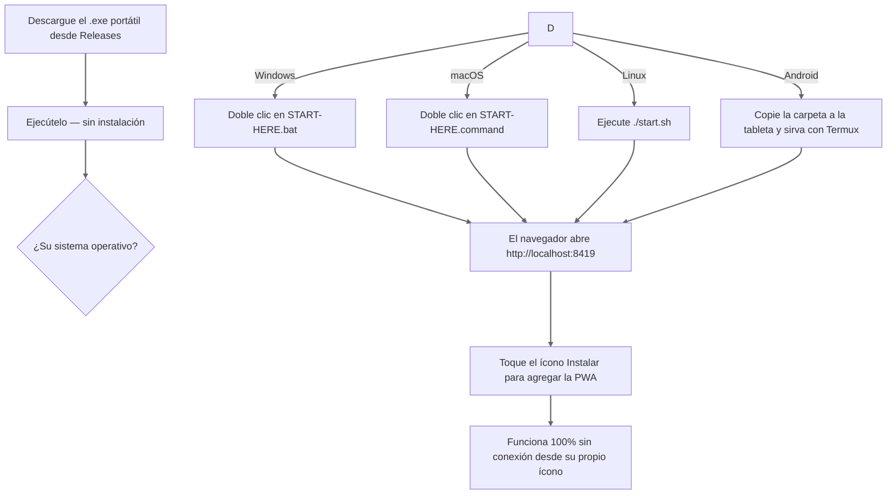

### 3 métodos de arranque

#### 1. **START-HERE.bat** (Windows)

**Pasos:**
1. Abra la carpeta del proyecto
2. Doble clic en `START-HERE.bat`
3. El navegador se abre con la aplicación en modo completo (PWA activa, actualizaciones automáticas)

*Recomendado para el uso diario y la PWA. Si el puerto 8419 está ocupado, la ventana indicará un puerto alternativo.*

#### 2. **index.html** (modo `file://`)

Abra `index.html` directamente en el navegador.

**Limitaciones:**
- No se puede instalar como PWA
- No funciona sin conexión (el service worker solo funciona con HTTP/HTTPS)
- Sin actualizaciones automáticas de caché

*Recomendado para pruebas rápidas.*

#### 3. **Servidor estático propio**

Sirva la carpeta del proyecto con cualquier servidor estático.

**Ejemplos:**
- `tools\serve.ps1` (PowerShell)
- `tools\serve.py` (Python)
- nginx, IIS, Apache

#### 4. **Electron** (opcional)

**Para escritorio:** use el contenedor Electron para una ventana de escritorio independiente.

**Uso:**
1. `npm install` en `electron/`
2. `npm start` para desarrollo
3. `npm run dist` para empaquetar

**Resultado:** `electron/dist/IntegrityWatch Field 1.4.1.exe` (portátil, sin instalación; esta carpeta está ignorada por git a propósito — el .exe se distribuye por GitHub Releases, no por el repositorio)

### **Instalación como PWA**

**Solo con HTTP/HTTPS** (use START-HERE.bat):

**Pasos por plataforma:**

| Plataforma | Pasos |
|----------|-------|
| **Windows (Edge/Chrome)** | Abra la app → haga clic en el ícono "instalar" de la barra de direcciones → *Instalar aplicación* → confirme |
| **Android (Chrome)** | Abra la app → menú ⋮ → *Instalar aplicación* / *Agregar a la pantalla de inicio* |
| **iOS (Safari)** | Abra la app → botón *Compartir* → *Agregar a la pantalla de inicio* → *Agregar* |

**Una vez instalada:** ábrala desde su propio ícono y funciona completamente sin conexión.

### Teléfonos y tabletas Android

En Android no hay `.bat`, así que use una de estas tres rutas:

**A. Instalación completa en la tableta (recomendada)** — un servidor local vía Termux:
1. Instale **Termux** desde [f-droid.org](https://f-droid.org/packages/com.termux/) (no la versión de Play Store).
2. Copie la carpeta portátil descomprimida al almacenamiento de su tableta (USB, SD o carpeta compartida).
3. En Termux ejecute: `termux-setup-storage && pkg install python -y`
4. Inicie el servidor: `cd storage/<su-carpeta>/IntegrityWatch-Field-Portable && python -m http.server 8419`
5. Abra `http://localhost:8419` en Chrome → menú ⋮ → **Instalar app** / *Agregar a la pantalla de inicio*.
6. Chrome trata `localhost` como seguro, así que el service worker se registra: después de esta primera instalación el ícono abre **totalmente sin conexión** — Termux ya no necesita estar corriendo.

**B. Modo consulta desde un servidor en laptop (sin instalación, sin apps adicionales)**:
1. Inicie la app en una laptop que esté en la misma red (Wi-Fi de campo o hotspot del teléfono): `START-HERE.bat`.
2. Averigüe la IP de la laptop (`ipconfig` en Windows) y abra `http://<IP-de-la-laptop>:8419` en el navegador de la tableta.
3. App completa para consultar y registrar mientras la laptop está en red. Los datos se guardan en el navegador de la tableta; el ícono PWA y el modo sin conexión **no** aplican sobre direcciones LAN (no hay contexto seguro).

**C. Apertura rápida desde archivo (modo limitado)**: abra `index.html` directamente desde el gestor de archivos de la tableta. Permite leer y capturar, con un aviso en pantalla de que las funciones PWA/sin conexión están desactivadas.

> La interfaz es responsive: funciona en tabletas de 7 pulgadas y teléfonos con el menú lateral colapsable. Siete idiomas, incluido el árabe (de derecha a izquierda).

---

## Manuales de usuario (7 idiomas)

Manuales de campo en lenguaje sencillo — instalación, módulos, importación CSV, informes y solución de problemas:

| Idioma | Manual |
|----------|--------|
| Inglés | [docs/manual/MANUAL.en.md](docs/manual/MANUAL.en.md) |
| Español | [docs/manual/MANUAL.es.md](docs/manual/MANUAL.es.md) |
| Francés | [docs/manual/MANUAL.fr.md](docs/manual/MANUAL.fr.md) |
| Portugués | [docs/manual/MANUAL.pt.md](docs/manual/MANUAL.pt.md) |
| Ruso | [docs/manual/MANUAL.ru.md](docs/manual/MANUAL.ru.md) |
| Chino simplificado | [docs/manual/MANUAL.zh.md](docs/manual/MANUAL.zh.md) |
| Árabe | [docs/manual/MANUAL.ar.md](docs/manual/MANUAL.ar.md) |

Manual completo imprimible (español): [DOCX](docs/manual/IntegrityWatch-Field-Manual-Usuario.docx) · [HTML](docs/manual/IntegrityWatch-Field-Manual-Usuario.html) · Guía detallada: [GUIA-DE-USO.md](docs/GUIA-DE-USO.md)

---

## Paquete portátil

**IntegrityWatch-Field-Portable v1.4.1** — un único ejecutable, sin instalación y sin
necesidad de internet. Empaqueta toda la aplicación (JS vanilla, service worker, manifest) y
el shell de Electron que la sirve localmente.

**Descarga (GitHub Release):** https://github.com/DeployModeIO/integritywatch-field/releases/tag/v1.4.1-portable

| Archivo | Tamaño | SHA-256 |
|------|------|---------|
| [`IntegrityWatch.Field.1.4.1.exe`](https://github.com/DeployModeIO/integritywatch-field/releases/download/v1.4.1-portable/IntegrityWatch.Field.1.4.1.exe) | 71,3 MB (74.762.520 B) | `487921CFBCE37D54D828DBA84507E9EC23B15F19CD82E17A37022856A476A4CF` |

> Los releases `v1.2.0-portable` (y los volúmenes RAR divididos anteriores `v1.0.0-portable`)
> fueron **eliminados** con aprobación del cliente. `v1.4.0` y `v1.3.0` siguen disponibles como versiones anteriores.

**Novedades de la 1.4.1**
- **Sonido de alarma retirado por completo a pedido del cliente** (módulo, UI de Admin, claves i18n, entrada de precache). La app es silenciosa por diseño; todos los arreglos antititileo de la 1.4.0 quedan intactos.
- **Arreglo en Admin "Acerca de → Versión":** mostraba un `1.0.0` viejo hardcodeado; ahora lee el `APP_VERSION` real del sello del expediente y no puede volver a desviarse.
- Suite de pruebas: **987 en verde** (997 − 10 pruebas de la función de sonido retirada; la regresión antititileo conserva sus 4).

**Novedades de la 1.4.0**
- **Arreglo del titileo (reportado por el usuario, medido en vivo en el .exe):** el programador automático de reglas reescribía cada recomendación abierta, una por una, cada 60 s, y cada escritura borraba y reconstruía toda la pantalla (medido: ~97 repintados y 48 eventos por tick dentro del .exe). Ahora el motor escribe en bloque (`saveAll`), las vistas de panel/APM/recomendaciones agrupan los refrescos con un debounce de 250 ms (medido después del arreglo: 4 repintados, 5 eventos) y el sello `lastRulesRunISO` ya no repinta el panel.
- **Deduplicación de notificaciones:** el toast de "nueva recomendación crítica" se dispara solo cuando se crean alarmas de verdad, no cada minuto con las mismas abiertas.
- ~~**NUEVO — sonido de alarma crítica:** doble pitido (880/659 Hz) cada 2,5 s mientras haya al menos una alarma crítica (roja) abierta.~~ **Retirado en la 1.4.1 a pedido del cliente** — la app es silenciosa; la insignia y el banner siguen refrescándose al instante al reconocer, resolver o eliminar.
- Suite de pruebas: **997 en verde** (982 + 15 nuevas: 9 de sonido, 5 de regresión antititileo, 1 del motor en bloque).

**Novedades de la 1.3.0**
- **Ingesta masiva de múltiples archivos** (cola + arrastrar y soltar): CSV / XLSX / JSON / JSONL / XML genérico / WITSML en las 9 entidades del expediente, con vista previa → confirmar → rollback y diarios reanudables. Medido en un navegador real: 200 mil lecturas en 45,4 s; reimportar el mismo archivo agrega 0 duplicados (18,1 s).
- **Informes: 15 plantillas × 6 formatos.** Los 12 informes tipados T-01…T-12 (incluido el traspaso de campaña T-12) más el expediente del punto, el informe trimestral y la ficha de PSV, exportados a PDF / CSV / XLSX / DOCX / JSON / XML por escritores propios sin dependencias (validados con `zipfile`, `openpyxl` y `python-docx` de CPython como jueces externos).
- **Paquete de evidencia**: ZIP con manifiesto y SHA-256 por archivo, verificación dentro de la app.
- **Plantillas CMMS**: SAP PM, IBM Maximo, ISO 14224 (17 columnas), PHMSA B31.8S (2 hojas).
- **Lectura de placas QR** en los 3 formularios de activos (APM, PSV, oleoductos) con degradación elegante cuando no hay cámara; **GPS + foto EXIF** en inspecciones de campo.
- **Bitácora de auditoría inmutable** encadenada con SHA-256, endurecida contra carreras entre pestañas (`navigator.locks` + CAS + `repairHead`); verificar / consultar por rango / exportar en 5 formatos desde Admin.
- **Paridad de 7 idiomas** vigilada por pruebas automatizadas (997+ hojas idénticas) y un barrido Playwright de 11 rutas con 0 claves crudas.
- **Offline-first verificado en modo avión**: caché `iw-v25`, 120 rutas precargadas auditadas 1:1 contra `index.html`.
- Suite de pruebas: **982 en verde** (desde 583 al inicio del trabajo de esta versión).

**Novedades de la 1.2.0**
- Conjunto de pictogramas IFS-24 (34 símbolos de equipos) en el panel, el registro de activos, la lista de corrosión y las válvulas de alivio.
- Motor de informes declarativo con modelos puros, un solo renderizador y gráficos SVG seguros para impresión.
- Video de tour de la UI en inglés (1:35) y el material de la campaña de operadores.
- Validación de entrada de datos en todos los módulos: 9 formularios, 22 capturas, 0 errores.
- **Escaneo de secretos en CI**: `.github/workflows/gitleaks.yml` corre en cada push/PR y semanalmente sobre todo el historial; la protección de push de GitHub sigue activa como primera línea.
- **Credenciales nominales para múltiples usuarios** (1.2.0): cuentas de administrador, ingeniero y operador, puerta de inicio de sesión, Bloquear ahora para cambiar de usuario sin perder datos, protección del último administrador y nombre de usuario registrado en cada registro. El PIN existente migra automáticamente al primer admin.
- **Modelo de seguridad**: sesiones persistentes admin/ingeniero/operador (ventana de inactividad de 15 minutos), guardia de permisos en cada ruta de escritura, sello de autoría en todos los registros, expedientes firmados con SHA-256 (envoltura V2) con rechazo de ataques de downgrade, validación de esquema en la importación, límites de tamaño de archivo y un endpoint de sincronización endurecido (solo https fuera de localhost, token bearer opcional). Verificado de punta a punta: 8 formularios guardados bajo una sesión de admin, exportación V2 con `signedBy: admin` y expiración de sesión devolviendo rol nulo.

**Cómo instalar (1 minuto):**
1. Descargue `IntegrityWatch.Field.1.4.1.exe`.
2. Ejecútelo. Windows SmartScreen puede advertir sobre una compilación sin firma: elija **Más información → Ejecutar de todos modos**.
3. La app se abre en su propio servidor local; sin configuración de navegador y sin red.

**Verificar la descarga (opcional):**
```bash
certutil -hashfile IntegrityWatch.Field.1.4.1.exe SHA256
```
La huella debe coincidir con la tabla de arriba.

**Contenido:**
- Aplicación completa (JS vanilla, service worker, manifest)
- `IntegrityWatch.Field.1.4.1.exe` (contenedor Electron portátil, sin instalación)
- Todos los `docs/`: guía de usuario, normas, manuales técnicos y **manuales de usuario en 7 idiomas** (`docs/manual/MANUAL.en|es|fr|pt|ru|zh|ar.md`, más el manual imprimible DOCX/HTML)
- `datos-prueba/` (CSV y JSON para validación)
- `THIRD-PARTY-NOTICES.md`
- `SHA256SUMS.txt` con el hash SHA256 de cada archivo del paquete (excepto él mismo)

**Verificación:**
```bash
certutil -hashfile IntegrityWatch.Field.1.4.1.exe SHA256
# debe coincidir: 487921CFBCE37D54D828DBA84507E9EC23B15F19CD82E17A37022856A476A4CF
```

---

## Kit de datos de campo

**`datos-prueba/`** (archivos de validación):

**Archivos CSV:**
- `integritywatch-carga-prueba.csv` (41 filas)
- **Casos de validación:** puntos faltantes, Wf>Wi, fechas futuras, CR fuera de rango, duplicados
- **Validadores asociados:** `validar-carga.cjs`

**Archivos JSON:**
- `precarga-ductos-combustibles.json` (6 oleoductos de combustibles, 408 km, 51 activos)
- **Validador asociado:** `validar-precarga.cjs`

**Pasos de importación:**
1. Pestaña **Ingesta** → *Elegir archivo* o arrastre el CSV/JSON
2. El sistema **detecta automáticamente** las columnas (idioma/español, con acentos)
3. Marque *Crear puntos faltantes* si quiere crear nuevos MP a partir del CSV
4. **Validar** → revise la tabla de errores fila por fila
5. **Importar** → resumen y bitácora del historial de importaciones

**Datos de demostración:** 8 puntos de corrosión, 5 PSV, un oleoducto con 12 activos, 9 activos APM, ~120 lecturas.

---

## Documentos incluidos

**Documentación técnica y de usuario:**

| Documento | Tipo | Ubicación |
|----------|------|----------|
| `docs/presentacion/IntegrityWatch-Field-Presentacion-Tecnica.pptx` | Presentación técnica | `docs/presentacion/` |
| `docs/manual/IntegrityWatch-Field-Manual-Usuario.docx` | PDF imprimible | `docs/manual/` |
| `docs/manual/IntegrityWatch-Field-Manual-Usuario.html` | Web (lite) | `docs/manual/` |
| [docs/manual/MANUAL.en.md](docs/manual/MANUAL.en.md) | Manual de usuario — inglés | `docs/manual/` |
| [MANUAL.es.md](docs/manual/MANUAL.es.md) · [MANUAL.fr.md](docs/manual/MANUAL.fr.md) · [MANUAL.pt.md](docs/manual/MANUAL.pt.md) · [MANUAL.ru.md](docs/manual/MANUAL.ru.md) · [MANUAL.zh.md](docs/manual/MANUAL.zh.md) · [MANUAL.ar.md](docs/manual/MANUAL.ar.md) | Manual de usuario — Español, Francés, Portugués, Ruso, Chino simplificado, Árabe | `docs/manual/` |
| `docs/GUIA-DE-USO.md` | Guía de usuario en markdown | `docs/` |
| `docs/PLAN-DE-PRUEBAS.md` | Plan de pruebas y calidad | `docs/` |
| `docs/STANDARDS.md` | Referencia de fórmulas implementadas | `docs/` |
| `docs/FIELD-DATA-SOURCES-OPERATORS.md` | Datos de la campaña con operadores (refinerías EIA-820, oleoductos NSTA) | `docs/` |
| `docs/manual/IntegrityWatch-Field-Manual-es-419.html` / `.docx` | Versiones imprimibles del manual extendido en español latino (generadas por `tools/manual_es419_print.py`) | `docs/` |
| `docs/manual/MANUAL.es-419.md` | **Manual extendido en español latino** para operadores e ingenieros de oleoducto (23 capturas, checklist diario) | `docs/` |
| `docs/REPORTING-BLUEPRINT.md` | Tipos de informe, prácticas de KPI de la industria (IOGP 456, API RP 754, ISO 14224, API 580, B31.8S) y el diseño de entrega sin conexión | `docs/` |
| `docs/SCHEMA.md` | Esquema de IndexedDB + contratos | `docs/` |
| `docs/CONTRACTS.md` | Convenciones y contratos de integración | `docs/` |
| `docs/TESTS.md` | Anclas de prueba verificadas manualmente | `docs/` |
| `docs/VISUAL-SPEC.md` | Auditoría visual y corrección | `docs/` |

**Plan de tareas:** `tasks/plan.md`

---

## Arquitectura

### **JS vanilla de modo dual**

**Características:**
- Sin build, sin CDN, sin dependencias en runtime
- UMD-lite (compatible con `file://` + pruebas en Node)
- CSP estricta (`default-src 'self'; script-src 'self'; ...`)
- DOM seguro (`innerHTML` no se usa con datos externos)

**Capas:**
- **Acceso a datos:** IndexedDB (`integritywatch`), caché cache-first del service worker con versión `iw-vN`
- **Reglas de negocio:** R1–R17, evaluación en tiempo real, reconciliación de historial
- **Visualización:** 7 idiomas (árabe RTL), tema claro/oscuro/sistema, componentes accesibles WCAG AA
- **Router:** basado en hash `#/modulo/:id`, precargado por T1b
- **Service worker:** registro solo con HTTP/HTTPS, actualización automática, caché con nombre por versión

### **Tokens de diseño**

**ISA-101 (HMI de alto desempeño):**
- Tipografía consistente, sin decoración, símbolos estables entre pantallas
- Color solo para lo anormal (errores, alertas)
- Formularios compactos, mapas legibles, informes estructurados

**Jerarquía de color:**
- **Severidad:** baja (`--sev-low`), moderada, alta, severa
- **Estado:** `--alert-critical` (rojo), `--alert-warning` (ámbar), `--alert-info` (azul)

### **i18n**

**7 idiomas soportados:**

| Idioma | Código | Dirección |
|----------|------|-----------|
| Inglés | en | LTR |
| Español | es | LTR |
| Portugués | pt | LTR |
| Francés | fr | LTR |
| Chino simplificado | zh | LTR |
| Ruso | ru | LTR |
| Árabe | ar | RTL |

**Claves i18n:** más de 330 claves anidadas en todos los idiomas, interpolación `{{param}}`.

### **Procesamiento sin conexión**

**Flujo:**
1. PWA instalada → caché sin conexión con service worker
2. IndexedDB local, 15 almacenes (meta, monitoringPoints, readings, coupons, psvs, pipelineSystems, lineAssets, lineInspections, iliAnomalies, apmAssets, apmEvents, recommendations, importLog, mutationQueue, auditLog — el último encadenado con SHA-256 y seguro entre pestañas)
3. Cola de sincronización opcional (`mutationQueue`) hacia un endpoint remoto
4. Restauración: JSON importado → clear + bulkPut (modo merge o replace)

### **Electron**

**Envoltura de escritorio:** `electron/`

**Características:**
- `IntegrityWatch.Field.1.4.1.exe` (portátil, sin instalación, ~71,3 MB)
- Carga la aplicación desde un servidor HTTP local
- No requiere runtime de Node.js (solo para desarrollo)
- Misma lógica que la versión web (paridad funcional)

---

## Calidad y pruebas

**987 pruebas** (Node >=20, CJS, `node:assert/strict`)

**Cobertura ≥80 %** en los motores (`src/calc/**`, `src/rules/**`)

### **Suite de pruebas**

| Tipo | Cobertura | Comando | Resultado |
|------|----------|---------|--------|
| **Unidad (motores)** | corrosión 100 %, PSV 98 %, APM 93 %, unidades 90 %, reglas 96–98 % | `node --test` | **987/987 en verde** (suite completa; los motores crecieron desde 300) |
| **Datos/ingesta** | parseo CSV + validación + 12 alias + límites; WITSML-lite; store/repos; export/import; syncQueue; bloqueo PBKDF2; seed; glosario; paridad i18n en 7 locales | 119 pruebas `qa-*.test.js` | ✅ |
| **Integración (sin DOM)** | CSV de oleoducto→repos→reglas→recomendaciones; ciclo ack→resolve→reopen; deduplicación; hooks de store | `qa-rules-sweep`, `qa-data-integrity` | ✅ |
| **Navegador (manual, MCP chrome-devtools)** | 12 vistas renderizadas; árabe RTL; tema oscuro; cambio en caliente de i18n; mapa de teclado; informe A4; 0 errores de consola | capturas `docs/evidence/*.png` (26) | ✅ |
| **Datos reales de campo** | CSV de 41 filas importado E2E: 35 válidas/4 errores/2 duplicados/3 puntos creados | `datos-prueba/INFORME-CARGA-DATOS.md` | ✅ |
| **Seguridad (parcial)** | CSP sin inline; Semgrep sobre 8 módulos críticos (1 ReDoS corregido); DOM seguro (textContent); 0 secretos; bloqueo probado | fase F + `qa-data-integrity` | ✅ |
| **Campos de UI (inventario)** | ~200 campos de formulario inventariados uno por uno (6 diálogos + 4 vistas inline) | auditoría de esta campaña | ✅ |
| **Campaña visual** | 24 capturas de módulos verificadas (>20 KB cada una) + 1 recorrido en video; 0 errores de consola JS; estado demo reiniciado | capturas `docs/evidence/*.png` + `docs/evidence/video/*.mp4` | ✅ |

### **Herramientas de prueba**

**Ubicación:** `tools/tests/`

| Script | Comando | Cobertura |
|--------|---------|----------|
| `e2e-core.mjs` | `node tools\tests\e2e-core.mjs` | arranque, seed limpio, importación CSV real, reglas, PDF A4, **PWA sin conexión**, **file://**, **XSS vía importación**, viewports 390/800/1366, consola | **10/10 PASS** (PDF 96 KB) |
| `volume.cjs` | `node tools\tests\volume.cjs` | pipeline de 10.000 filas (parser→validación→toRecords) + saveAll 9.100 | **8/8 PASS** · 58 ms |
| `e2e-volume.mjs` | `node tools\tests\e2e-volume.mjs` | importación por UI de 10.000 filas, desempeño de panel/detalle con 450 filas | **7/7 PASS** · importación por UI 568 ms · panel 104 ms |
| `quality.mjs` | `node tools\tests\quality.mjs` | axe-core (3 vistas + diálogo), **7 idiomas** (dir/RTL/claves), Firefox, Edge | **OK** · axe critical/serious/moderate/minor = 0 problemas |

### **Desempeño medido**

Cifras documentadas en las suites de `tools/tests/` y en `docs/TESTS.md`:

| Medición | Valor documentado | Fuente |
|-------------|-----------------|--------|
| Pruebas unitarias | **300/300** en verde (cobertura ≥80 % en los motores) | `node --test` |
| E2E core (navegador) | **10/10 PASS** (arranque, seed, CSV, reglas, PDF A4, PWA sin conexión, `file://`, XSS, viewports, consola) | `tools/tests/e2e-core.mjs` |
| Volumen (pipeline de 10.000 filas) | **8/8 PASS** · ~58 ms | `tools/tests/volume.cjs` |
| E2E volumen (UI 10.000 filas) | **7/7 PASS** · importación por UI 568 ms · panel 104 ms | `tools/tests/e2e-volume.mjs` |
| Calidad (a11y) | axe-core: critical/serious/moderate/minor = **0 problemas** | `tools/tests/quality.mjs` |

### **Cobertura de pruebas**

**Gestión:** `node --test --experimental-test-coverage`
**Umbral:** ≥80 % en `src/calc/**` y `src/rules/**`

---

## Limitaciones y descargo de responsabilidad

### **Limitaciones técnicas**

1. **Tablas de curvas digitalizadas:** las curvas Kb/Kw de API 520 son aproximaciones lineales por tramos. Verifique siempre contra la edición vigente de la norma.
2. **`Kv` es analítico:** la fórmula de API 520 §5.8.2 se implementa como `min(1, 1/(0.9935+2.878/√Re+342.75/Re^1.5))` con validación `Re ≥ 100`. Re < 100 emite `E_RE_RANGE` (evalúe una válvula especial).
3. **`Kb` para válvulas convencionales:** `Kb = 1.0` con la advertencia `E_BP_CONV` si la contrapresión > 10 % (requiere fuelle balanceado).

### **Alcance**

- **Tamizaje vs diseño:** los criterios de MR0175, SP0169, etc. son de **tamizaje**, no un sustituto de un estudio completo de materiales.
- **Validación obligatoria:** los cálculos son herramientas de apoyo. Valide siempre contra las ediciones vigentes de las normas y los datos del fabricante de los equipos.
- **Formato API 520:** los informes PDF siguen el diseño A4 de API 520 pero son indicativos; valide contra las normas originales.

### **Problemas conocidos**

- **Bug ALTO (abierto):** una suscripción al bus sin desmontaje al cambiar de ruta puede repintar un detalle obsoleto sobre `#main` después del tick del programador de reglas. Ruta de reproducción y arreglo propuesto en [`docs/ISSUES-CONOCIDOS.md`](docs/ISSUES-CONOCIDOS.md).
- **Deuda menor de accesibilidad:** algunos campos de panel/ingesta/glosario sin `id`/`name`/`label` (detectado por axe-core/DevTools). Detalle en el mismo documento.

### **Descargo de responsabilidad**

IntegrityWatch Field es una **herramienta de apoyo** y no reemplaza el criterio de un ingeniero calificado. Sus resultados de cálculo son **indicativos** y deben verificarse contra las normas vigentes y los datos del fabricante antes de cualquier decisión de diseño u operación.

---

## Preguntas abiertas

Ninguna (el modo dual cumple con los requisitos de `file://` y de pruebas en Node)

---

## Estructura de archivos

```
integritywatch-field/
├─ .gitignore
├─ index.html                              [T1a]
├─ LICENSE
├─ manifest.webmanifest                    [T1a]
├─ package.json                            [T1a]  (name/private/scripts.test; SIN dependencias en runtime)
├─ package-lock.json
├─ README.md                               [D2]
├─ START-HERE.bat                          [T1a]
├─ START-HERE.command
├─ start.sh
├─ sw.js                                   [T1a]
├─ THIRD-PARTY-NOTICES.md
├─ assets/
│  ├─ icons/*.svg + *.png generados        [T1a]
│  └─ styles/
│     ├─ tokens.css base.css layout.css components.css print.css   [T1a]
│     ├─ views-a.css                       [T8]
│     ├─ views-b.css                       [T9]
│     └─ views-c.css                       [T10]
├─ src/
│  ├─ app/main.js  app/shell.js  app/router.js  app/theme.js       [T1b]
│  ├─ calc/units.js                        [T1b]
│  ├─ calc/corrosion.js                    [T3]
│  ├─ calc/cui583.js                       [T3]
│  ├─ calc/exif.js                         [T3]
│  ├─ calc/ffs.js                          [T3]
│  ├─ calc/mic.js                          [T3]
│  ├─ calc/norsok506.js                    [T3]
│  ├─ calc/apm.js                          [T5]
│  ├─ calc/pipelineAssessment.js           [T3]
│  ├─ calc/reliability.js                  [T5]
│  ├─ calc/remainingLife.js                [T5]
│  ├─ calc/spc.js                          [T3]
│  ├─ compat/file-guard.js                 [T1b]
│  ├─ components/icons.js  components/ui.js  components/inspectionEvidence.js  components/signaturePad.js  [T1b]
│  ├─ core/bus.js  core/caseFile.js  core/db.js  core/dbMemory.js  core/store.js  core/exportImport.js  core/syncQueue.js  [T5]
│  ├─ data/fluids.js  data/glossary.js  data/materials.js  data/seed.js  data/standards.js            [D1]
│  ├─ i18n/i18n.js                         [T2a]
│  ├─ i18n/locales/en.js es.js pt.js fr.js zh.js ru.js ar.js          [T2a/T2b]
│  ├─ ingest/csv.js  ingest/witsmlLite.js  [T7]
│  ├─ reports/quarterly.js dossier.js datasheet.js                 [T10]
│  ├─ rules/engine.js  rules/definitions.js                        [T6]
│  ├─ security/lock.js                     [T5]
│  └─ views/admin.js apm.js corrosion.js dashboard.js glossary.js ingest.js pipelines.js pipelineMap.js psv.js recommendations.js reports.js  [T8-T10]
├─ tests/*.test.js + fixtures/            [cada tarea B escribe los suyos; D2 valida]
├─ tools/serve.ps1 serve.py build-portable.ps1 bump-cache.cjs make-icons.ps1 make-manual-html.py make-manual.py make-pptx.py [T1a]
└─ electron/main.js preload.js package.json README.md dist/        [D2]
```

---

## Licencias y atribución

**IntegrityWatch Field — Licencia MIT · Copyright © 2026 DeployModeIO.** Texto completo en [`LICENSE`](LICENSE).

**ISC/MIT (terceros):** Lucide (íconos), Tabler (glifos)

**Terceros:** `THIRD-PARTY-NOTICES.md`

**No se copió ningún recurso de terceros** (referencia a DEC para el cumplimiento de propiedad intelectual).

**Alerta de supervisión:** la aplicación usa 19 vulnerabilidades reportadas por npm en devDependencies (herramientas de build), no en el paquete distribuido. Usar `npm install` en `electron/` instala devDependencies, que no afectan el runtime de la aplicación.

---

## Estructura de archivos (resumen)

*README.md de IntegrityWatch Field*
*Secciones: 18 (todas completas)*
*Imágenes verificadas: 26 (galería de módulos) + 1 recorrido en video*
*Capturas referenciadas: todas existen en docs/evidence/*
