# IntegrityWatch Field

**Integrity and compliance operations center, offline-first, for oil & gas field work.**

IntegrityWatch Field is an application that runs **completely on your computer or device, without internet and without a mandatory server**. It brings together the most common integrity tasks for a field: corrosion, pressure relief valves, pipelines, asset management, inspections, recommendations, and reports. Everything is stored locally in your browser (IndexedDB) and you can install it as a Progressive Web App (PWA) to use it offline.

> **Support tool. Always validate results against current editions of standards and manufacturer equipment data.** Calculations are based on published formulas from recognized standards (NACE/AMPP, API, ASME, ASTM, ISO); see `docs/STANDARDS.md` for exact references and approximations.

---

## Cover

**IntegrityWatch Field**

**Value proposition:** Offline-first integrity and compliance operations center for oil & gas field work

**Badges:**      [](LICENSE)

**Engineering disclaimer:** Support tool. Always validate against current editions of standards and manufacturer data. Calculation results are indicative and must be reviewed by qualified personnel.

---

## What it is and who it's for

**Oil & gas field integrity engineering:** Corrosion, PSV, pipelines, APM, compliance

IntegrityWatch Field is a Progressive Web App (PWA) offline-first designed specifically for oil & gas field integrity professionals. It combines in a single interface the main integrity tasks performed daily at production sites:

- **Corrosion and corrosion protection** (weight loss corrosion, inhibitors, cathodic protection)
- **Safety and relief valves** (sizing per API 520/526, test records)
- **Pipelines and line assets** (pipeline maintenance, ILD/UT inspections, assets by station kilometer)
- **Asset management and reliability** (APM, RBI per API 580/581, inspection intervals)
- **Data collection** (CSV import, WITSML-lite, validation)
- **Recommendation engine** (R1-R17 for decision making)
- **Reports and compliance** (quarterly, technical, legal)

**Target audience:** Field operators, integrity engineers, maintenance technicians, field supervisors who need fast and reliable access to integrity data without depending on internet connection or external servers.

---

## System architecture

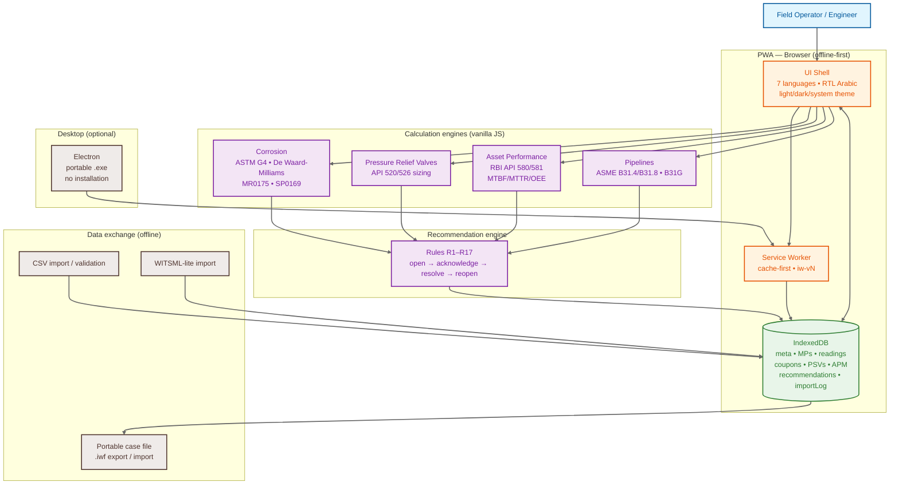

### Data ingestion flow

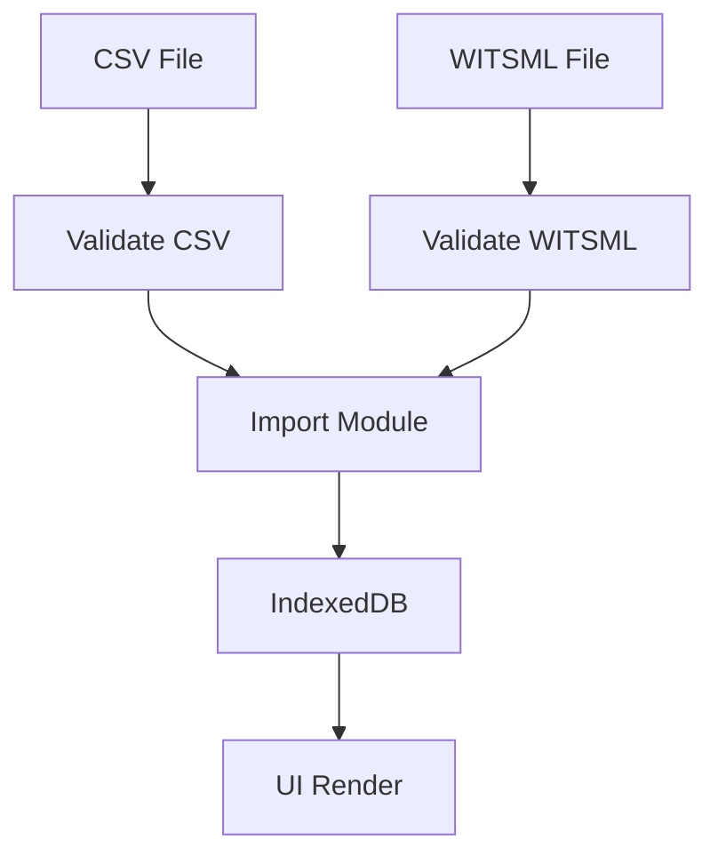

### Rules engine flow

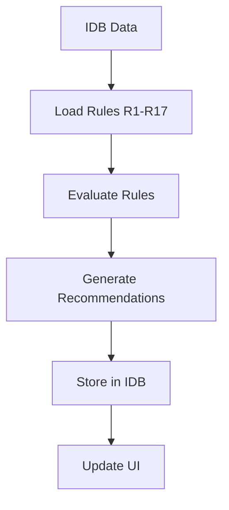

---

## Screenshots

Visual evidence gallery organized by module. All captures live in `docs/evidence/` and correspond to real views rendered with demo data.

### Panel and operation

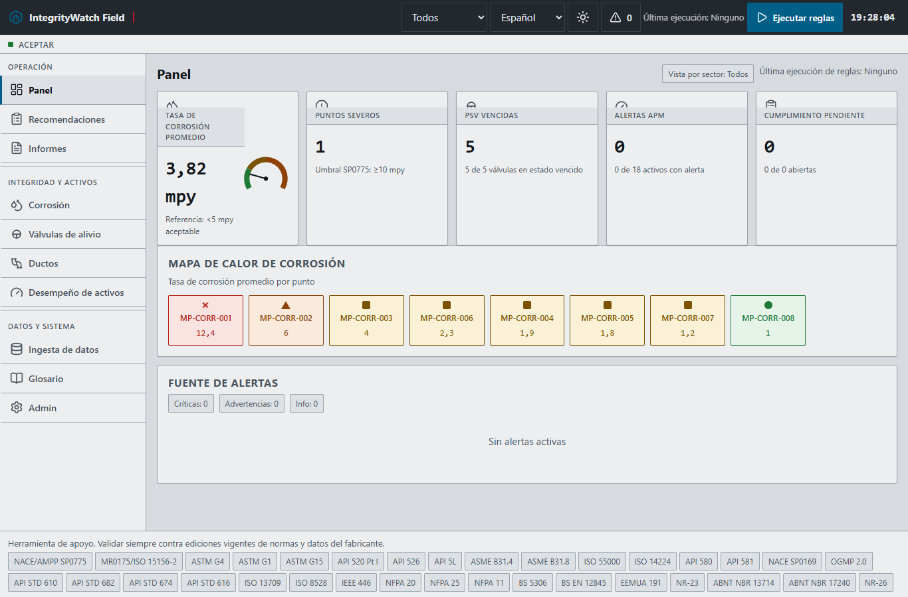
*Main panel with key indicators, heatmap, and recent alerts (light theme).*

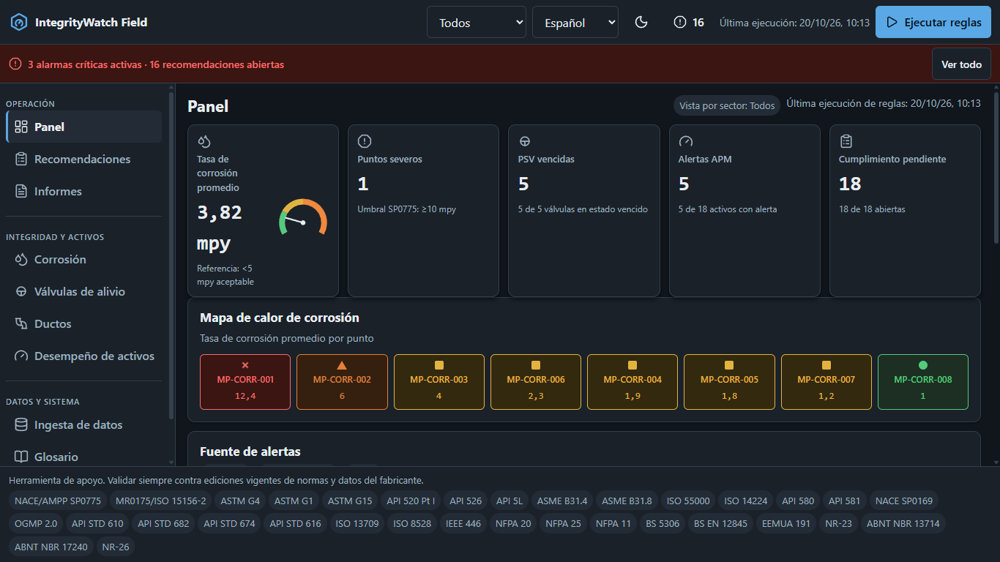
*Main panel in dark theme.*

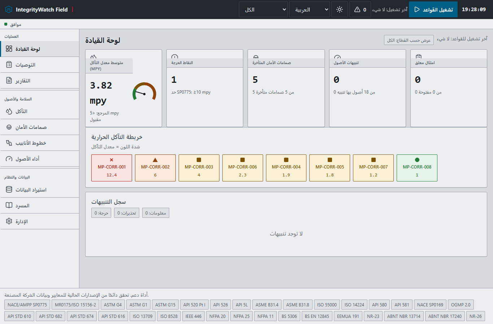
*Main panel in Arabic with RTL reading direction.*

### Corrosion

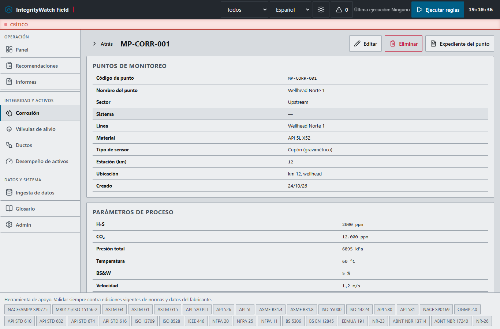
*Monitoring point detail with readings, coupons, and corrosion rate (light theme).*

### Pressure Relief Valves (PSV) · API 520/526

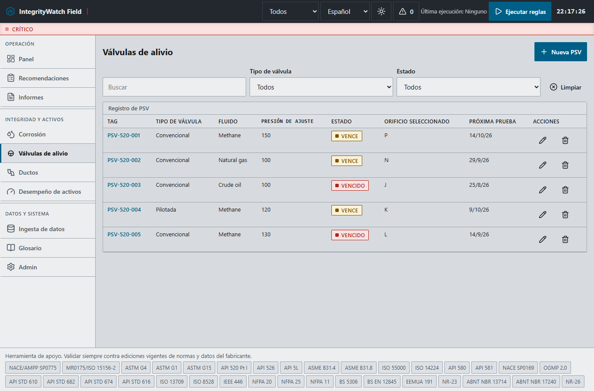
*List of safety and relief valves with test status.*

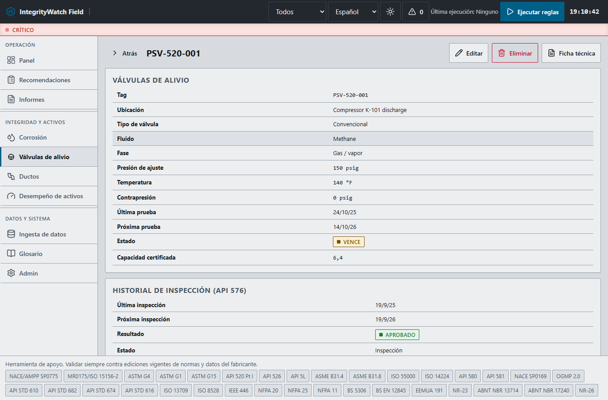
*Valve sizing per API 520/526 (light theme).*

### Pipelines and line assets

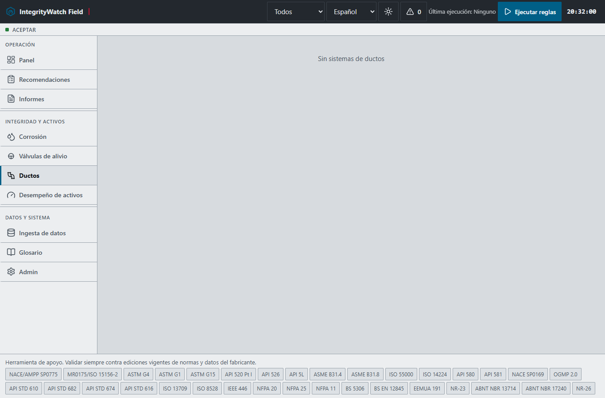
*Schematic map of pipelines with assets positioned by kilometer (light theme).*

### Asset Performance Management (APM)

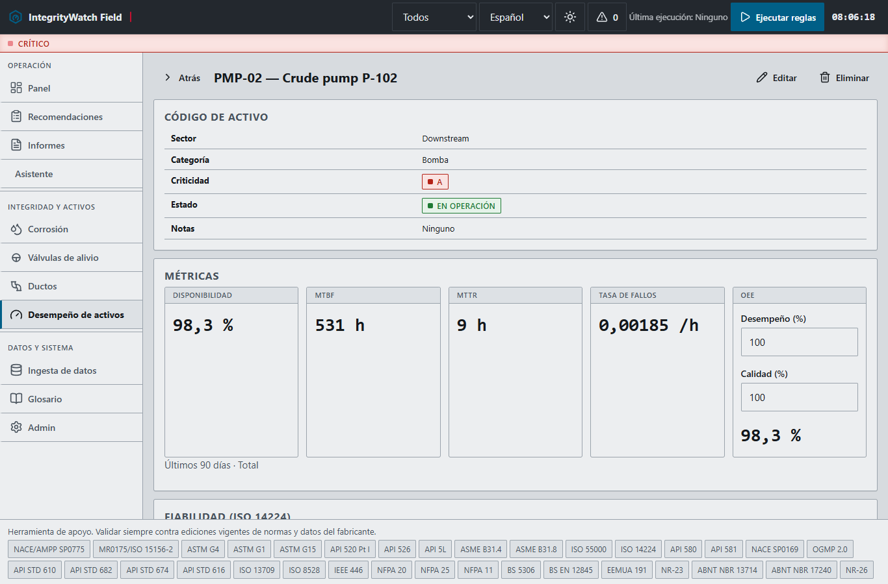
*APM asset detail with RBI risk analysis (light theme).*

### Data ingestion

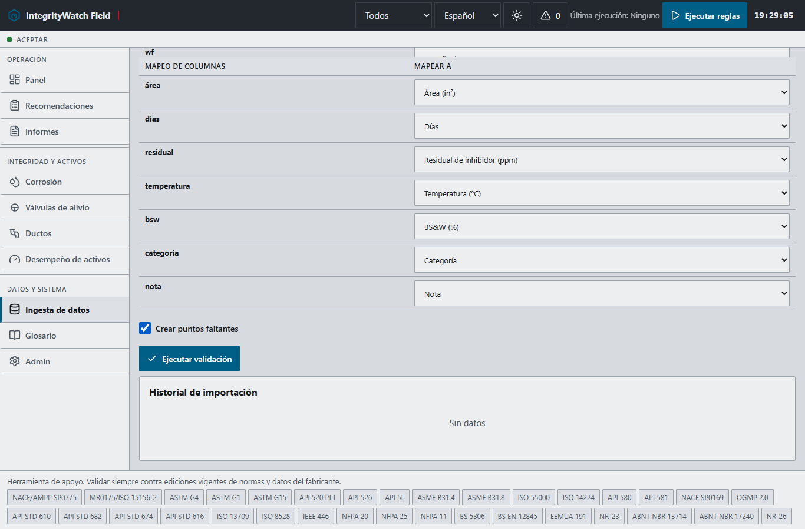
*Column mapping during CSV/WITSML-lite import.*

### Recommendations

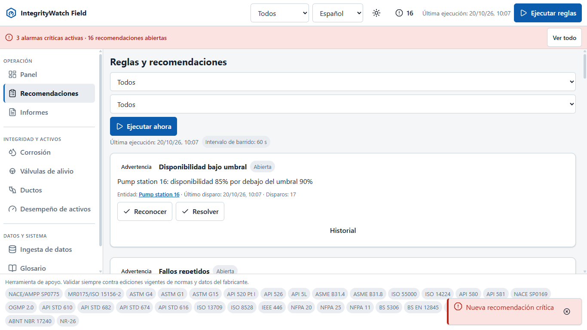
*Recommendation engine R1–R17 with open/acknowledge/resolve/reopen actions.*

### Reports

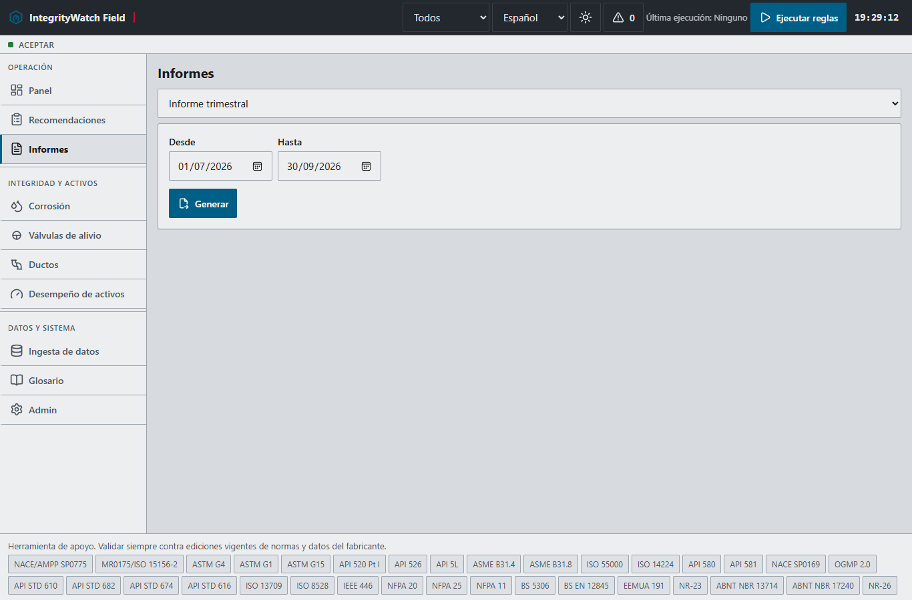
*Quarterly, per monitoring point, and PSV datasheet reports (light theme).*

### Glossary

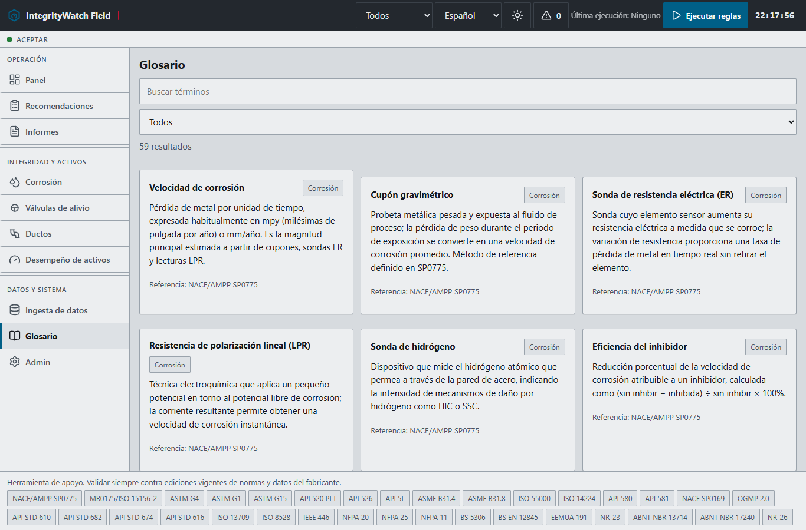
*Multilingual technical glossary with normative references.*

### Administration

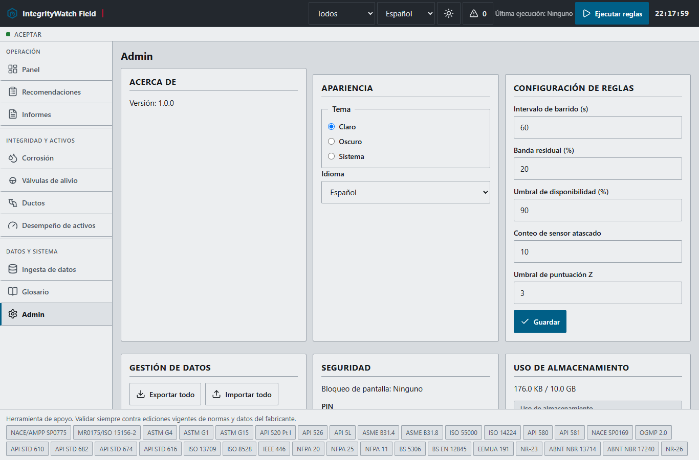
*General settings, language, theme, backup/restore, portable case file .iwf, PIN, and offline status.*

---

## Video walkthrough

**Overview / promo** — [`docs/evidence/video/integritywatch-field-promo.mp4`](docs/evidence/video/integritywatch-field-promo.mp4) (1:21, ~16 MB, English narration).

A narrated overview of what IntegrityWatch Field is and what it solves: offline-first integrity and compliance for **wells, pipelines, and offshore assets** — corrosion modeling (De Waard–Milliams, ASTM), PSV sizing (API 520/526), pipelines with a kilometer-based schematic map and ILD/UT inspections, risk-based inspection (API 580/581), the **R1–R17** recommendation engine, and reports — plus 7 languages, light/dark themes, CSV/WITSML import, and portable case files.

**Operator cut (plant · pipeline · refinery)** — [`docs/evidence/video/integritywatch-field-operators-en.mp4`](docs/evidence/video/integritywatch-field-operators-en.mp4) (1:19, English narration). Recorded from the operator campaign: offline CSV ingest (48/48 rows), ISO 14224 asset registration and an on-device dossier. Test record: [`docs/PRUEBAS-CAMPO-OPERADORES-2026-10-31.md`](docs/PRUEBAS-CAMPO-OPERADORES-2026-10-31.md).

https://github.com/user-attachments/assets/2d49d8f9-8262-4406-b6b8-a6b839aea9ce

**Field validation cut** — [`docs/evidence/video/integritywatch-field-fieldtest-en.mp4`](docs/evidence/video/integritywatch-field-fieldtest-en.mp4) (1:24, ~10 MB, English narration, burned-in subtitles; [SRT](docs/evidence/video/integritywatch-field-fieldtest-en.srt)).

https://github.com/user-attachments/assets/68e55fe4-8b72-4f6d-8a72-611acc7ee6c6

Recorded from the live application during the field validation run below: the dashboard with real pipeline-derived points, an offline CSV import validated row by row (32/32), asset registration with RBI band, and a point dossier generated on the device. Asset attributes come from NSTA open data; no third-party logos or operator names appear.

**Full walkthrough** — [`docs/evidence/video/demo-walkthrough.mp4`](docs/evidence/video/demo-walkthrough.mp4) (≈22 s, ~1.5 MB).

End-to-end recorded walkthrough of the application: startup and dashboard, navigation through Corrosion, PSV (API 520/526 sizing), Pipelines and map, APM, Ingestion, Recommendations, Reports, and Glossary — in the supported languages and themes.

> **Note:** GitHub does not play MP4 files stored in the repository inline within the README; open a link to play or download it. For an inline player, upload the file through the GitHub web editor so it is served from `user-attachments`.

---

## Field validation run (real data, 30-10-2026)

The application was validated end to end against a clean install using **real public
asset data**, not dummy rows. This is the reference campaign behind the field
validation video and the source of the captures used in the manuals.

### Dataset used

| Source | What is real | Volume |
|---|---|---|
| NSTA Open Data — UKCS offshore infrastructure | Pipeline name, fluid, diameter, wall thickness, MAWP, length, status, commissioning date | **55 pipelines** with complete engineering attributes (of 2,110 active) |
| NSTA Open Data — pipeline points | Equipment tags and types: valves, manifolds, tee pieces, pig traps, riser bases, anodes | **45 records** |
| HSE Offshore Statistics 2024 | Hydrocarbon releases, dangerous occurrences, notices, injuries | **92 HCRs**, 180 DOs, 616 non-compliances |

Inspection and corrosion series are **derived** from those real line parameters and are
labelled as derived in every row; they are never presented as field measurements.
Full provenance: [`docs/FIELD-DATA-SOURCES.md`](docs/FIELD-DATA-SOURCES.md).

### What the run proved

| Step | Result |
|---|---|
| Create monitoring points from real line data | 4 points (gas, crude, condensate, multiphase) |
| Import a field CSV offline | 32 rows total, **32 imported, 0 skipped, 0 errors** |
| Register a pipeline system | CATS: 36 in, 28.4 mm wall, 17.93 MPa, 404.97 km |
| Register an asset (APM) | Real NSTA valve record with RBI band B |
| Run rules R1–R17 | **24 recommendations** raised |
| Generate reports | Point dossier, quarterly report, PSV datasheet |
| Export the case file | `.iwf`, 107,485 bytes, reopened from disk |
| Tablet layout (1280×800) | Dashboard and ingest usable without a server |

### Defect found, fixed and regression-tested

Points created in the UI were stored with an opaque id while CSV import links readings
by point code, so the average-rate KPI and heatmap showed “—” for every point created in
the app (seed data hid it because `id === code`). Fixed by persisting `id = code`
(SCHEMA convention), with 3 new tests; the suite went from 512 to **515 tests, 0 failures**.
After the fix the heatmap reports 9.4 / 6.8 / 4.9 / 4.6 mpy for the four real lines.

### Evidence and artefacts

- Test record with 20 numbered captures: [`docs/PRUEBAS-CAMPO-2026-10-30.md`](docs/PRUEBAS-CAMPO-2026-10-30.md)
- Captures and machine-readable log: [`docs/field-tests-2026-10-30/`](docs/field-tests-2026-10-30/) (`evidence.json`, `case-file-export.iwf.json`)
- Dataset and derived series: [`datos-prueba/real/`](datos-prueba/real/)
- Runners: [`tools/qa/fetch_field_data.py`](tools/qa/fetch_field_data.py), [`tools/qa/run_field_tests.py`](tools/qa/run_field_tests.py)

### Reproduce

```powershell
python tools\qa\fetch_field_data.py      # refresh the real dataset
python tools\serve.ps1 -Port 8419         # in another terminal
python tools\qa\run_field_tests.py       # UI run, captures and evidence.json
```

---

## Operator campaign (plant · pipeline · refinery, 31-10-2026)

A second field campaign, run for the three operating roles. Same method: clean install,
real data, screenshots at every step, machine-readable evidence.

### Personas and what was exercised

| Persona | Site (real) | Workflow on the tablet |
|---|---|---|
| **Refinery operator** | Galveston Bay, TX — 631,000 b/cd (EIA-820) | CDU overhead point, unit registered with RBI band A, overdue relief valve, point dossier |
| **Plant operator** | Beaumont, TX — 612,000 b/cd (EIA-820) | CDU point, pump asset, readings reviewed in tablet layout |
| **Pipeline operator** | UKCS lines (NSTA) | CATS system, line asset at km 12.4, severe ILI finding, station map |

### Results

| Check | Result |
|---|---|
| Monitoring points created | 6 (3 downstream + 3 midstream) |
| CSV ingested offline | **48 of 48 rows, 0 skipped, 0 errors** |
| Readings in store after import | 168 |
| Assets registered (ISO 14224) | 3 (CDU, wet-gas compressor, pump station) |
| Relief valves created | 2, both overdue (R13 fires) |
| Line assets / inspections | 1 / 1 (38 % wall loss, severe, km 12.4) |
| Recommendations after R1–R17 | **25** (5 critical) |
| Case-file export | 121,134 bytes |
| Screenshots captured | 24 |
| Runner incidents | 0 |

### Defects found

1. **Stale render when leaving an asset detail.** Navigating to `#/reports` updated the URL
   while the DOM kept the previous asset view (`hash: '#/reports'`, `h1: 'REF-GB-CDU-01 …'`).
   A pending async render repaints `#main` after the route change. The runner works around
   it with a reload; the product should cancel the stale render. Recorded in `evidence.json`.
2. **Material validation is silent.** `carbon-steel` is not a valid material id; the form
   refuses to save without an explicit message. Real ids are `a106-b` / `api5l-x52`.

### Evidence

- Test record with the 24 captures: [`docs/PRUEBAS-CAMPO-OPERADORES-2026-10-31.md`](docs/PRUEBAS-CAMPO-OPERADORES-2026-10-31.md)
- Data provenance: [`docs/FIELD-DATA-SOURCES-OPERATORS.md`](docs/FIELD-DATA-SOURCES-OPERATORS.md)
- Captures and log: [`docs/field-tests-operators-2026-10-31/`](docs/field-tests-operators-2026-10-31/)
- Runners: [`tools/qa/fetch_operator_data.py`](tools/qa/fetch_operator_data.py), [`tools/qa/run_operator_tests.py`](tools/qa/run_operator_tests.py)

### Reproduce

```powershell
python tools\qa\fetch_operator_data.py
python tools\serve.ps1 -Port 8419
python tools\qa\run_operator_tests.py
```

---

## Modules (table)

| Module | What it does | Applicable standards |
|--------|--------------|---------------------|
| **Dashboard** | Summary of key indicators: average corrosion, critical points, expired valves, APM alerts and compliance, with heatmap and recent alerts. | SP0775, API 580/581 |
| **Corrosion** | Monitoring points, readings, gravimetric coupons, inhibitor efficiency, De Waard-Milliams model, sour service (MR0175), cathodic protection (SP0169). | ASTM G4/G1/G15, NACE/AMPP SP0775, MR0175/ISO 15156-2, SP0169 |
| **Pressure Relief Valves (PSV)** | Registration and sizing of safety valves per API 520/526 (gas, steam, liquid, viscous liquid) with orifice selection. | API 520 Pt I, API 526, ISO 13709/8528/55000/14224 |
| **Pipelines and line assets** | Line systems, assets located by station kilometer, inspections (ILD, UT, visual, repair) with field evidence (handwritten signature, JPEG photos with EXIF/GPS, sketches) and campaigns. | ASME B31.4/B31.8, API 5L, ISO 13709, NFPA 20/25/11 |
| **Schematic map** | Schematic view of the line system with assets positioned by kilometer; keyboard and accessibility navigable. | ISA-101, API RP 1165 |
| **Asset Performance Management (APM)** | Reliability and availability (MTBF, MTTR, OEE), RBI risk analysis (API 580/581), suggested inspection intervals. | ISO 55000, ISO 14224, API 580/581, ISO 10218-2 |
| **Data ingestion** | CSV/WITSML-lite import with validation, column mapping, import history. | API 520/526 (validation), WITSML-lite (standard) |
| **Recommendations** | R1–R17 engine to detect risk conditions and generate actions (open, acknowledge, resolve, reopen). | API 580/581, ISO 13849-1, ISO 62061 |
| **Reports** | Quarterly, per monitoring point, PSV datasheet; PDF export with browser printing. | ISO 55000, API 580/581, NFPA 20/25 |
| **Glossary** | Technical terms in multiple languages with normative references and search. | ISO 13709, API 610/682/674/616, BS 5306, EEMUA 191 |
| **Administration** | General settings, language, theme, backup/restore, PIN, offline status. | ISO 13849-1, NFPA 20/25/11, BS EN 12845 |

---

## Calculation engines (table with formulas)

| Standard/Formula | Description | Reference |
|------------------|-------------|-----------|
| **ASTM G4** | Corrosion rate by weight loss: CR = 534·ΔW/(ρ·A·t) | NACE/AMPP SP0775 |
| **De Waard–Milliams** | CO₂ corrosion model: log₁₀(CR) = 5.8 − 1710/T + 0.67·log₁₀(pCO₂) | API 610/682/674/616/520/526/580/581/5L |
| **MR0175 (screening)** | Sour service classification: pH₂S = P·x | ASTM G1/G4/G15 |
| **SP0169** | Cathodic protection: potential ≤ −850 mV vs CSE or 100 mV polarization | ISO 13709/8528/55000/14224 |
| **API 520 gas** | Critical sizing: A = W·√(T·Z/M)/(C·Kd·P1·Kb·Kc) | ASME B31.4/B31.8 |
| **API 520 liquid** | Subcritical sizing: A = Q·√(G/ΔP)/(38·Kd·Kw·Kc·Kv) | ISO 55000/14224 |
| **API 526 orifices** | Standard selection: D(0.110), E(0.196), F(0.307), G(0.503), H(0.785), J(1.287), K(1.838), L(2.853), M(3.60), N(4.34), P(6.38), Q(11.05), R(16.00), T(26.00) in² | ISO 13709/8528/55000/14224 |
| **API 580/581 RBI** | Risk = POF × COF (bands 1–5) → inspection intervals | ISO 13709/8528/55000/14224 |
| **ISO 14224 MTBF/MTTR/OEE** | Reliability metrics: MTBF=(window − downtime)/failures, MTTR=downtime/failures, OEE=availability×performance×quality | ISO 55000/14224 |

---

## Standards covered

**USA/International:** API 610/682/674/616/520/526/580/581/5L, ASTM G1/G4/G15, ISA-101, API RP 1165, NFPA 20/25/11, IEEE 446, ASME B31.4/B31.8, ISO 13709/8528/55000/14224, ISO 3864, OGMP 2.0

**United Kingdom:** EEMUA 191, BS 5306, BS EN 12845

**Brazil:** NR-23, NR-26, ABNT NBR 13714/17240

**Total:** 33 standards in 5 regions

---

## Installation and use

### Install at a glance

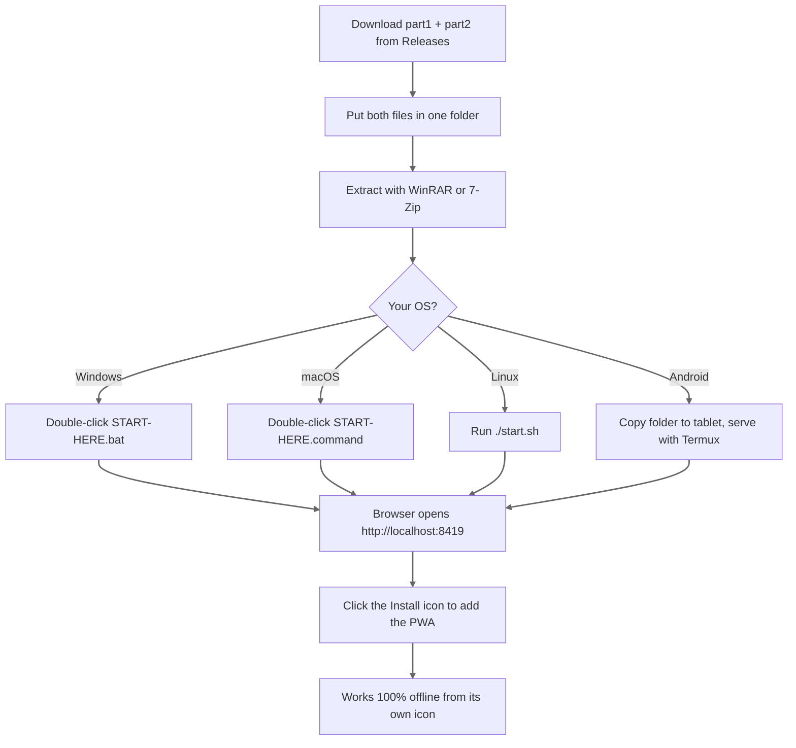

### 3 startup methods

#### 1. **START-HERE.bat** (Windows)

**Steps:**
1. Open the project folder
2. Double-click `START-HERE.bat`
3. The browser opens with the application in full mode (PWA active, automatic updates)

*Recommended for daily use and PWA. If port 8419 is occupied, the window will indicate an alternative port.*

#### 2. **index.html** (`file://` mode)

Open `index.html` directly in the browser.

**Limitations:**
- Cannot be installed as PWA
- Does not work offline (service worker only with HTTP/HTTPS)
- No automatic cache updates

*Recommended for quick tests.*

#### 3. **Custom static server**

Serve the project folder with any static server.

**Examples:**
- `tools\serve.ps1` (PowerShell)
- `tools\serve.py` (Python)
- nginx, IIS, Apache

#### 4. **Electron** (optional)

**For desktop:** Use the Electron container for a standalone desktop window.

**Usage:**
1. `npm install` in `electron/`
2. `npm start` for development
3. `npm run dist` for packaging

**Result:** `electron/dist/IntegrityWatch Field 1.0.0.exe` (portable, no installation)

### **PWA installation**

**Only with HTTP/HTTPS** (use START-HERE.bat):

**Steps by platform:**

| Platform | Steps |
|----------|-------|
| **Windows (Edge/Chrome)** | Open the app → click "install" icon in address bar → *Install application* → confirm |
| **Android (Chrome)** | Open the app → menu ⋮ → *Install application* / *Add to home screen* |
| **iOS (Safari)** | Open the app → *Share* button → *Add to home screen* → *Add* |

**Once installed:** Open from its own icon and it works completely offline.

### Android phones and tablets

There is no `.bat` on Android, so use one of these three routes:

**A. Full install on the tablet (recommended)** — a local server via Termux:
1. Install **Termux** from [f-droid.org](https://f-droid.org/packages/com.termux/) (not the Play Store build).
2. Copy the extracted portable folder to your tablet storage (USB, SD or shared folder).
3. In Termux run: `termux-setup-storage && pkg install python -y`
4. Start the server: `cd storage/<your-folder>/IntegrityWatch-Field-Portable && python -m http.server 8419`
5. Open `http://localhost:8419` in Chrome → menu ⋮ → **Install app** / *Add to home screen*.
6. Chrome treats `localhost` as secure, so the service worker registers: after this first install the app icon opens **fully offline** — Termux no longer needs to be running.

**B. Query mode from a laptop server (no install, no extra apps)**:
1. Start the app on a laptop on the same network (field Wi-Fi or phone hotspot): `START-HERE.bat`.
2. Find the laptop's IP (`ipconfig` on Windows) and open `http://<laptop-IP>:8419` on the tablet browser.
3. Full app for viewing and logging while the laptop is on network. Data is saved in the tablet's browser; the PWA icon/offline does **not** apply over LAN addresses (no secure context).

**C. Quick open from file (limited mode)**: open `index.html` directly from the tablet's file manager. Works read-and-capture, with a banner warning that PWA/offline features are disabled.

> The interface is responsive: it works on 7-inch tablets and phones with the collapsible side menu. Seven languages including Arabic (right-to-left).

---

## User manuals (7 languages)

Plain-language field manuals — install, modules, CSV import, reports and troubleshooting:

| Language | Manual |
|----------|--------|
| English | [docs/manual/MANUAL.en.md](docs/manual/MANUAL.en.md) |
| Español | [docs/manual/MANUAL.es.md](docs/manual/MANUAL.es.md) |
| Français | [docs/manual/MANUAL.fr.md](docs/manual/MANUAL.fr.md) |
| Português | [docs/manual/MANUAL.pt.md](docs/manual/MANUAL.pt.md) |
| Русский | [docs/manual/MANUAL.ru.md](docs/manual/MANUAL.ru.md) |
| 简体中文 | [docs/manual/MANUAL.zh.md](docs/manual/MANUAL.zh.md) |
| العربية | [docs/manual/MANUAL.ar.md](docs/manual/MANUAL.ar.md) |

Printable full manual (Spanish): [DOCX](docs/manual/IntegrityWatch-Field-Manual-Usuario.docx) · [HTML](docs/manual/IntegrityWatch-Field-Manual-Usuario.html) · Detailed guide: [GUIA-DE-USO.md](docs/GUIA-DE-USO.md)

---

## Portable package

**IntegrityWatch-Field-Portable** — ready-to-use package, no installation or internet required. Split into two RAR volumes so it uploads and downloads cleanly.

**Download (GitHub Release):** https://github.com/DeployModeIO/integritywatch-field/releases/tag/v1.0.0-portable

Direct links to the two volumes:
- part1: https://github.com/DeployModeIO/integritywatch-field/releases/download/v1.0.0-portable/IntegrityWatch-Field-Portable.part1.rar
- part2: https://github.com/DeployModeIO/integritywatch-field/releases/download/v1.0.0-portable/IntegrityWatch-Field-Portable.part2.rar

| Volume | Size | SHA-256 |
|--------|------|---------|
| `IntegrityWatch-Field-Portable.part1.rar` | 45 MB | `a49c6c3f07e15b77af613397d7c0b6cef9ccf6aa600b8d6329dce793943f6929` |
| `IntegrityWatch-Field-Portable.part2.rar` | 37 MB | `f8315051385fa978a7c3d75984886774b4141afa511fb791e7f113303d9803c1` |

Both parts contain one ZIP (`IntegrityWatch-Field-Portable.zip`, SHA-256 `b8e6241bd16b149c0700fa05900cfed157a3b2a1aec40cfd74d369fb49e26c38`).

**How to install (2 minutes):**
1. Download **both** parts and put them in the same folder.
2. Right-click `part1.rar` → **Extract here** (WinRAR or 7-Zip). You get the ZIP; extract it too.
3. Run `START-HERE.bat` (Windows), `START-HERE.command` (macOS) or `./start.sh` (Linux).

**Contents:**
- Complete application (vanilla JS, service worker, manifest)
- `app/IntegrityWatch Field 1.0.0.exe` (Electron portable container, no installation)
- All `docs/`: user guide, standards, technical manuals, and **user manuals in 7 languages** (`docs/manual/MANUAL.en|es|fr|pt|ru|zh|ar.md`, plus DOCX/HTML printable manual)
- `datos-prueba/` (CSV and JSON for validation)
- `THIRD-PARTY-NOTICES.md`
- `SHA256SUMS.txt` with SHA256 hash of each file in the package (except itself)

**Verification:**
```bash
# 1. Check each downloaded volume against the table above:
certutil -hashfile IntegrityWatch-Field-Portable.part1.rar SHA256

# 2. After extracting the ZIP, verify its overall hash:
certutil -hashfile IntegrityWatch-Field-Portable.zip SHA256
#    must match: b8e6241bd16b149c0700fa05900cfed157a3b2a1aec40cfd74d369fb49e26c38

# 3. After extracting, verify each file against SHA256SUMS.txt (relative paths):
certutil -hashfile "app\IntegrityWatch Field 1.0.0.exe" SHA256
#    on macOS/Linux: sha256sum -c SHA256SUMS.txt
```

---

## Field data kit

**`datos-prueba/`** (validation files):

**CSV files:**
- `integritywatch-carga-prueba.csv` (41 rows)
- **Validation cases:** Missing points, Wf>Wi, future dates, CR out of range, duplicates
- **Associated validators:** `validar-carga.cjs`

**JSON files:**
- `precarga-ductos-combustibles.json` (6 fuel pipelines, 408 km, 51 assets)
- **Associated validator:** `validar-precarga.cjs`

**Import steps:**
1. **Ingestion** tab → *Choose file* or drag CSV/JSON
2. The system **automatically detects** columns (language/Spanish, with accents)
3. Check *Create missing points* if you want to create new MPs from the CSV
4. **Validate** → review row-by-row error table
5. **Import** → summary and import history log

**Demo data:** 8 corrosion points, 5 PSVs, one pipeline with 12 assets, 9 APM assets, ~120 readings.

---

## Included documents

**Technical and user documentation:**

| Document | Type | Location |
|----------|------|----------|
| `docs/presentacion/IntegrityWatch-Field-Presentacion-Tecnica.pptx` | Technical presentation | `docs/presentacion/` |
| `docs/manual/IntegrityWatch-Field-Manual-Usuario.docx` | Printable PDF | `docs/manual/` |
| `docs/manual/IntegrityWatch-Field-Manual-Usuario.html` | Web (lite) | `docs/manual/` |
| [docs/manual/MANUAL.en.md](docs/manual/MANUAL.en.md) | User manual — English | `docs/manual/` |
| [MANUAL.es.md](docs/manual/MANUAL.es.md) · [MANUAL.fr.md](docs/manual/MANUAL.fr.md) · [MANUAL.pt.md](docs/manual/MANUAL.pt.md) · [MANUAL.ru.md](docs/manual/MANUAL.ru.md) · [MANUAL.zh.md](docs/manual/MANUAL.zh.md) · [MANUAL.ar.md](docs/manual/MANUAL.ar.md) | User manual — Español, Français, Português, Русский, 简体中文, العربية | `docs/manual/` |
| `docs/GUIA-DE-USO.md` | User guide markdown | `docs/` |
| `docs/PLAN-DE-PRUEBAS.md` | Test and quality plan | `docs/` |
| `docs/STANDARDS.md` | Reference of implemented formulas | `docs/` |
| `docs/FIELD-DATA-SOURCES-OPERATORS.md` | Operator campaign data (EIA-820 refineries, NSTA pipelines) | `docs/` |
| `docs/REPORTING-BLUEPRINT.md` | Report types, industry KPI practices (IOGP 456, API RP 754, ISO 14224, API 580, B31.8S) and the offline delivery design | `docs/` |
| `docs/SCHEMA.md` | IndexedDB schema + contracts | `docs/` |
| `docs/CONTRACTS.md` | Integration conventions and contracts | `docs/` |
| `docs/TESTS.md` | Manually verified test anchors | `docs/` |
| `docs/VISUAL-SPEC.md` | Visual audit and correction | `docs/` |

**Task plan:** `tasks/plan.md`

---

## Architecture

### **JS Vanilla Dual-Mode**

**Features:**
- No build, no CDN, no runtime dependencies
- UMD-lite (compatible with `file://` + Node tests)
- Strict CSP (`default-src 'self'; script-src 'self'; ...`)
- Secure DOM (`innerHTML` not used with external data)

**Layers:**
- **Data access:** IndexedDB (`integritywatch`), service worker cache-first with version `iw-vN`
- **Business rules:** R1–R17, real-time evaluation, history reconciliation
- **Visualization:** 7 languages (RTL Arabic), light/dark/system theme, WCAG AA accessible components
- **Router:** Hash-based `#/modulo/:id`, preloaded by T1b
- **Service worker:** Registration only HTTP/HTTPS, automatic update, version-named cache

### **Design tokens**

**ISA-101 (High-performance HMI):**
- Consistent typography, no decoration, stable symbols across screens
- Color only for abnormal (errors, alerts)
- Compact forms, readable maps, structured reports

**Color hierarchy:**
- **Severity:** low (`--sev-low`), moderate, high, severe
- **Status:** `--alert-critical` (red), `--alert-warning` (amber), `--alert-info` (blue)

### **i18n**

**7 supported languages:**

| Language | Code | Direction |
|----------|------|-----------|
| English | en | LTR |
| Spanish | es | LTR |
| Portuguese | pt | LTR |
| French | fr | LTR |
| Simplified Chinese | zh | LTR |
| Russian | ru | LTR |
| Arabic | ar | RTL |

**i18n keys:** 330+ nested keys in all languages, `{{param}}` interpolation.

### **Offline processing**

**Workflow:**
1. PWA installed → offline cache with service worker
2. IndexedDB local (stores: meta, monitoringPoints, readings, coupons, psvs, apmAssets, recommendations, importLog)
3. Optional sync queue (`mutationQueue`) to remote endpoint
4. Restore: JSON imported → clear + bulkPut (merge or replace mode)

### **Electron**

**Desktop wrapper:** `electron/`

**Features:**
- `IntegrityWatch Field 1.0.0.exe` (portable, no installation, ~71 MB)
- Loads the application from local HTTP server
- No Node.js runtime required (only for development)
- Same logic as web version (functional parity)

---

## Quality and testing

**300 unit tests** (Node >=20, CJS, `node:assert/strict`)

**Coverage ≥80%** in engines (`src/calc/**`, `src/rules/**`)

### **Test suite**

| Type | Coverage | Command | Result |
|------|----------|---------|--------|
| **Unit (engines)** | corrosion 100%, PSV 98%, APM 93%, units 90%, rules 96–98% | `node --test` | **300/300 green** |
| **Data/ingestion** | CSV parse + validation + 12 aliases + boundaries; WITSML-lite; store/repos; export/import; syncQueue; lock PBKDF2; seed; glossary; i18n parity 7 locales | 119 tests `qa-*.test.js` | ✅ |
| **Integration (no DOM)** | pipeline CSV→repos→rules→recommendations; cycle ack→resolve→reopen; deduplication; store hooks | `qa-rules-sweep`, `qa-data-integrity` | ✅ |
| **Browser (manual, MCP chrome-devtools)** | 12 views rendered; RTL Arabic; dark theme; hot-switch i18n; keyboard map; A4 report; 0 console errors | captures `docs/evidence/*.png` (26) | ✅ |
| **Real field data** | CSV 41 rows imported E2E: 35 valid/4 errors/2 duplicates/3 points created | `datos-prueba/INFORME-CARGA-DATOS.md` | ✅ |
| **Security (partial)** | CSP without inline; Semgrep on 8 critical modules (1 ReDoS corrected); secure DOM (textContent); 0 secrets; lock tested | phase F + `qa-data-integrity` | ✅ |
| **UI fields (inventory)** | ~200 form fields inventoried one by one (6 dialogs + 4 inline views) | audit of this campaign | ✅ |
| **Visual campaign** | 24 module captures verified (>20 KB each) + 1 video walkthrough; 0 JS console errors; demo state reset | captures `docs/evidence/*.png` + `docs/evidence/video/*.mp4` | ✅ |

### **Test tools**

**Location:** `tools/tests/`

| Script | Command | Coverage |
|--------|---------|----------|
| `e2e-core.mjs` | `node tools\tests\e2e-core.mjs` | boot, clean seed, real CSV import, rules, PDF A4, **offline PWA**, **file://**, **XSS via import**, viewports 390/800/1366, console | **10/10 PASS** (PDF 96 KB) |
| `volume.cjs` | `node tools\tests\volume.cjs` | 10,000 row pipeline (parser→validation→toRecords) + saveAll 9,100 | **8/8 PASS** · 58 ms |
| `e2e-volume.mjs` | `node tools\tests\e2e-volume.mjs` | UI import 10,000 rows, dashboard/detail performance with 450 rows | **7/7 PASS** · UI import 568 ms · dashboard 104 ms |
| `quality.mjs` | `node tools\tests\quality.mjs` | axe-core (3 views + dialog), **7 languages** (dir/RTL/keys), Firefox, Edge | **OK** · axe critical/serious/moderate/minor = 0 issues |

### **Measured performance**

Figures documented in `tools/tests/` suites and `docs/TESTS.md`:

| Measurement | Documented value | Source |
|-------------|-----------------|--------|
| Unit tests | **300/300** green (coverage ≥80% in engines) | `node --test` |
| E2E core (browser) | **10/10 PASS** (boot, seed, CSV, rules, PDF A4, offline PWA, `file://`, XSS, viewports, console) | `tools/tests/e2e-core.mjs` |
| Volume (10,000 row pipeline) | **8/8 PASS** · ~58 ms | `tools/tests/volume.cjs` |
| E2E volume (UI 10,000 rows) | **7/7 PASS** · UI import 568 ms · dashboard 104 ms | `tools/tests/e2e-volume.mjs` |
| Quality (a11y) | axe-core: critical/serious/moderate/minor = **0 issues** | `tools/tests/quality.mjs` |

### **Test coverage**

**Management:** `node --test --experimental-test-coverage`
**Threshold:** ≥80% in `src/calc/**` and `src/rules/**`

---

## Limitations and disclaimer

### **Technical limitations**

1. **Digitized curve tables:** API 520 Kb/Kw curves are piecewise-linear approximations. Always verify against the current edition of the standard.
2. **`Kv` is analytical:** API 520 §5.8.2 formula is implemented as `min(1, 1/(0.9935+2.878/√Re+342.75/Re^1.5))` with validation `Re ≥ 100`. Re < 100 emits `E_RE_RANGE` (evaluate special valve).
3. **`Kb` for conventional valves:** `Kb = 1.0` with warning `E_BP_CONV` if backpressure > 10% (requires balanced bellows).

### **Scope**

- **Screening vs design:** MR0175, SP0169, etc. criteria are **screening**, not a substitute for a complete materials study.
- **Validation required:** Calculations are support tools. Always validate against current editions of standards and manufacturer equipment data.
- **API 520 format:** PDF reports follow API 520 A4 layout but are indicative; validate against original standards.

### **Known issues**

- **HIGH bug (open):** bus subscription without teardown on route change can repaint an obsolete detail over `#main` after the rules scheduler tick. Reproduction path and proposed fix in [`docs/ISSUES-CONOCIDOS.md`](docs/ISSUES-CONOCIDOS.md).
- **Minor accessibility debt:** some dashboard/ingestion/glossary fields without `id`/`name`/`label` (detected by axe-core/DevTools). Detail in the same document.

### **Disclaimer**

IntegrityWatch Field is a **support tool** and does not replace the judgment of a qualified engineer. Its calculation results are **indicative** and must be verified against current standards and manufacturer data before design or operational decisions.

---

## Open questions

None (dual-mode meets `file://` and Node test requirements)

---

## File structure

```
integritywatch-field/
├─ .gitignore
├─ index.html                              [T1a]
├─ LICENSE
├─ manifest.webmanifest                    [T1a]
├─ package.json                            [T1a]  (name/private/scripts.test; NO runtime deps)
├─ package-lock.json
├─ README.md                               [D2]
├─ START-HERE.bat                          [T1a]
├─ START-HERE.command
├─ start.sh
├─ sw.js                                   [T1a]
├─ THIRD-PARTY-NOTICES.md
├─ assets/
│  ├─ icons/*.svg + *.png generated        [T1a]
│  └─ styles/
│     ├─ tokens.css base.css layout.css components.css print.css   [T1a]
│     ├─ views-a.css                       [T8]
│     ├─ views-b.css                       [T9]
│     └─ views-c.css                       [T10]
├─ src/
│  ├─ app/main.js  app/shell.js  app/router.js  app/theme.js       [T1b]
│  ├─ calc/units.js                        [T1b]
│  ├─ calc/corrosion.js                    [T3]
│  ├─ calc/cui583.js                       [T3]
│  ├─ calc/exif.js                         [T3]
│  ├─ calc/ffs.js                          [T3]
│  ├─ calc/mic.js                          [T3]
│  ├─ calc/norsok506.js                    [T3]
│  ├─ calc/apm.js                          [T5]
│  ├─ calc/pipelineAssessment.js           [T3]
│  ├─ calc/reliability.js                  [T5]
│  ├─ calc/remainingLife.js                [T5]
│  ├─ calc/spc.js                          [T3]
│  ├─ compat/file-guard.js                 [T1b]
│  ├─ components/icons.js  components/ui.js  components/inspectionEvidence.js  components/signaturePad.js  [T1b]
│  ├─ core/bus.js  core/caseFile.js  core/db.js  core/dbMemory.js  core/store.js  core/exportImport.js  core/syncQueue.js  [T5]
│  ├─ data/fluids.js  data/glossary.js  data/materials.js  data/seed.js  data/standards.js            [D1]
│  ├─ i18n/i18n.js                         [T2a]
│  ├─ i18n/locales/en.js es.js pt.js fr.js zh.js ru.js ar.js          [T2a/T2b]
│  ├─ ingest/csv.js  ingest/witsmlLite.js  [T7]
│  ├─ reports/quarterly.js dossier.js datasheet.js                 [T10]
│  ├─ rules/engine.js  rules/definitions.js                        [T6]
│  ├─ security/lock.js                     [T5]
│  └─ views/admin.js apm.js corrosion.js dashboard.js glossary.js ingest.js pipelines.js pipelineMap.js psv.js recommendations.js reports.js  [T8-T10]
├─ tests/*.test.js + fixtures/            [each task B writes its own; D2 validates]
├─ tools/serve.ps1 serve.py build-portable.ps1 bump-cache.cjs make-icons.ps1 make-manual-html.py make-manual.py make-pptx.py [T1a]
└─ electron/main.js preload.js package.json README.md dist/        [D2]
```

---

## Licenses and attribution

**IntegrityWatch Field — MIT License · Copyright © 2026 DeployModeIO.** Full text in [`LICENSE`](LICENSE).

**ISC/MIT (third-party):** Lucide (icons), Tabler (glyphs)

**Third-Party:** `THIRD-PARTY-NOTICES.md`

**No third-party assets were copied** (reference to DEC for IP compliance).

**Supervision alert:** The application uses 19 vulnerabilities reported by npm in devDependencies (build tools), not in the packaged bundle. Using `npm install` in `electron/` installs devDependencies, which do not affect the application runtime.

---

## File structure (English)

*README.md of IntegrityWatch Field*
*Sections: 18 (all complete)*
*Images verified: 26 (module gallery) + 1 video walkthrough*
*Captures referenced: all existing in docs/evidence/*

https://github.com/user-attachments/assets/2d49d8f9-8262-4406-b6b8-a6b839aea9ce
