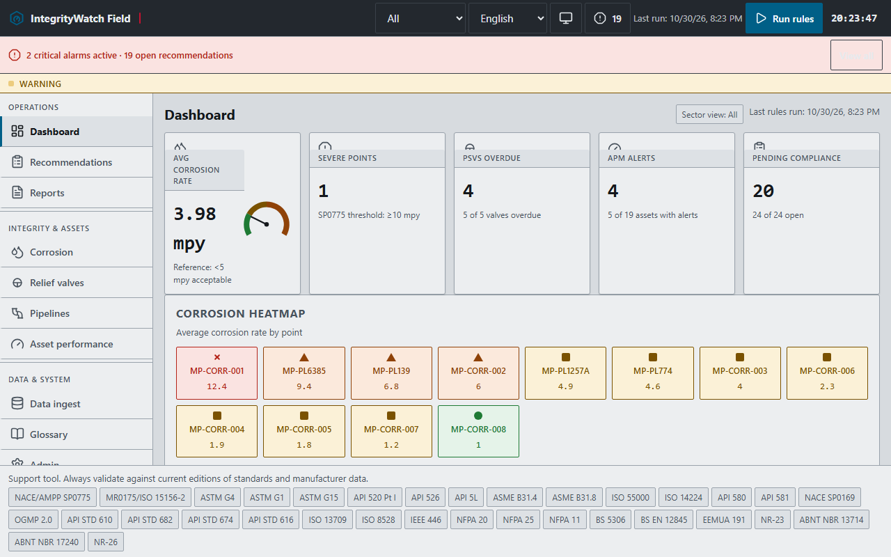

# GUÍA DE USO — IntegrityWatch Field

**Para quién es esta guía:** operadores, ingenieros de integridad y supervisores de campo. No necesitas
saber programar. La aplicación funciona **100 % sin internet** y todos tus datos quedan en tu equipo.

---

## 1. Cómo abrir la aplicación

| Opción | Pasos | Cuándo usarla |
|---|---|---|
| **A. Recomendada (con instalación PWA)** | Doble clic en `START-HERE.bat` → se abre el navegador → botón de instalar en la barra de direcciones (o menú ⋮ → «Instalar aplicación») | Uso diario; queda como app instalada en Windows/Android/iOS |
| B. Sin servidor (modo archivo) | Doble clic en `index.html` | Prueba rápida; verás una franja avisando que las actualizaciones/PWA están desactivadas |
| C. Servidor manual | `tools\serve.ps1` o `tools\serve.py` | Si ya usas otro servidor estático en tu red |
| D. Escritorio Windows (.exe) | Carpeta `electron/` → ver `electron/README.md` | Equipos sin navegador o con políticas restrictivas |

**Requisitos:** Chrome, Edge, Firefox o Safari de los últimos dos años. Resolución mínima 1366×768
(funciona en tablets y móviles con el menú lateral plegable).

## 2. Primer arranque (5 minutos)

1. Al abrir por primera vez se cargan **datos de demostración** (8 puntos de corrosión, 5 válvulas,
   un oleoducto con 12 activos, 9 activos APM y ~120 lecturas) para que veas todo funcionando.
2. **Elige idioma** en el encabezado (English · Español · Français · 简体中文 · Русский · العربية · Português).
   El árabe cambia toda la interfaz a derecha-a-izquierda.
3. **Elige tema**: botón ☀/🌙/🖥 del encabezado (claro → oscuro → automático). Se recuerda solo.
4. **Selector de sector** (Todos / Upstream / Midstream / Downstream) filtra el Panel y APM.

> ¿Quieres empezar de cero con tus datos? Menú **Admin → Restablecer datos de demo** (o borrar todo).

## 3. Recorrido por los módulos

### 3.1 Panel (pantalla inicial)
- **5 indicadores**: tasa media de corrosión, puntos severos (SP0775 ≥10 mpy), válvulas vencidas,
  activos APM con alerta y cumplimiento pendiente.
- **Mapa de calor**: una celda por punto; el color y la forma indican severidad
  (● Baja, ■ Moderada, ▲ Alta, ✕ Severa).
- **Fuente de alertas**: las recomendaciones abiertas, ordenadas por gravedad.
- Botón **Ejecutar reglas** (también en el encabezado): analiza todo y genera recomendaciones.

### 3.2 Corrosión
1. **Crear un punto de monitoreo**: Corrosión → «Nuevo punto» → completa código (p. ej. MP-CORR-021),
   material (13 aceros/aleaciones), tipo de sensor (cupón, ER, LPR, H₂, UT, visual), parámetros de
   proceso (H₂S, CO₂, presión, temperatura, BS&W, velocidad, objetivo/residual de inhibidor),
   protección catódica y aislamiento (CUI) si aplica.
2. **Registrar lecturas**: entra al punto → «Nueva lectura» → fecha + tasa (mpy) + nota.
3. **Registrar cupones (pares inhibitor/blank)**: «Nuevo cupón» → eliges **Rol** (Blanco/Inhibido),
   **Par** (p. ej. P3), peso inicial/final, área y días. La tasa se calcula sola (ASTM G4).
   El panel **Eficiencia del inhibidor** compara ambos y da la banda (Excelente ≥90 %, Deficiente <70 %).
4. **Editar un cupón existente**: botón **Editar** en su fila (puedes corregir rol, par, pesos…).
5. Paneles automáticos: **Balance de inhibidor** (ventana 80–150 %), **De Waard–Milliams** (modelo vs
   medido), **Screening agrio MR0175** (pH₂S), **Protección catódica** y **CUI**.
6. **Expediente del punto**: botón «Expediente del punto» → informe listo para imprimir/PDF.

### 3.3 Válvulas de alivio (PSV)
1. **Registrar**: «Nueva PSV» → etiqueta, tipo (convencional / fuelle compensado / pilotada),
   fluido (11 pre-cargados, editables), presión de ajuste, temperatura, contrapresión, fechas de prueba.
2. **Dimensionar**: en la ficha de la válvula, pestañas **Gas** y **Líquido**:
   - Gas: caudal W, presión/temperatura, Z, M, k → área requerida con API 520; detecta flujo crítico/subcrítico.
   - Líquido: caudal Q, gravedad G, viscosidad → área con corrección Kv (Re en el orificio).
   - El sistema **selecciona el orificio API 526** (D–T), muestra margen, capacidad real y avisos de validación.
3. **Guardar el dimensionamiento** en la válvula y generar el **Datasheet** (informe formato API 520/ISA S20).

### 3.4 Ductos (midstream)
1. **Crear el sistema**: nombre, operador, producto, diámetro, espesor, material, longitud, rango de estaciones (km).
2. **Activos de línea**: dentro del sistema, «Nuevo activo de línea» → tipo (12: válvulas, bridas,
   estaciones de bombeo/compresión, tanques, cruces, ROW, medición…), estación km y lado.
3. **Inspecciones**: tipo (ILD, corrosión externa, visual, UT, reparación, reemplazo), tramo km, severidad, hallazgos.
4. **Mapa**: nodos sobre la línea a escala de km, color y forma por severidad de la última inspección.
   Navegable con **Tab** y **Enter** (accesible por teclado). Filtros por tipo y severidad.

### 3.5 Desempeño de activos (APM)
1. **Crear activo**: código, nombre, sector, categoría (pozos, plataformas, bombas, compresores,
   intercambiadores, torres, utilidades…), criticidad A/B/C, estado, **POF×COF** (riesgo RBI) e
   intervalo base de inspección (la fecha siguiente se sugiere sola por banda de riesgo).
2. **Registrar eventos**: tipo (fallo, mantenimiento, parada no planificada, orden de trabajo, inspección),
   fechas y tiempo de parada → el sistema calcula **disponibilidad, MTBF, MTTR** y el semáforo de salud.
3. La **matriz de riesgo 5×5** muestra dónde cae cada activo y qué prioridad de inspección le toca.

### 3.6 Ingesta de datos
1. Pestaña **CSV** → «Elegir archivo» (o arrastra el archivo). Acepta `,` `;` y tabulador.
2. Revisa el **mapeo de columnas** (se detecta automáticamente: punto, fecha, tasa, wi, wf, área, días,
   residual, temperatura, bsw, categoría, nota — admite variantes en español/inglés y con tildes).
3. Marca **«Crear puntos faltantes»** si el archivo trae puntos nuevos.
4. **Ejecutar validación** → tabla de errores por fila (fecha futura, Wf>Wi, fuera de rango, punto inexistente,
   duplicados omitidos). *Si cambias la casilla de crear puntos, vuelve a validar antes de importar.*
5. **Importar** → resumen y registro en el historial.
6. Pestañas extra: **WITSML** (pozos/trayectorias/canales) y **JSON** (respaldo completo, modo merge o reemplazo).

### 3.7 Recomendaciones
- Lista con filtros por estado (Abierta/Reconocida/Resuelta) y gravedad.
- Cada tarjeta muestra la regla, el mensaje con datos reales, la entidad afectada y el enlace a su ficha.
- Acciones: **Reconocer** → **Resolver** (con nota). Todo queda auditado con fecha y quién lo hizo.
- Si la condición vuelve a cumplirse tras resolver, la recomendación **se reabre automáticamente**.

### 3.8 Informes
1. **Informe trimestral**: elige periodo → Generar → portada, KPIs, gráfico semanal, top de puntos
   críticos, eficiencia por par, campañas y recomendaciones. Botón **Imprimir** → «Guardar como PDF».
2. **Expediente por punto**: ficha técnica + historial + cálculos ASTM G4 + clasificación SP0775 + screening MR0175.
3. **Datasheet de válvula**: ficha de dimensionamiento completa, copiable al portapapeles.

### 3.9 Glosario
- Buscador y filtro por categoría (corrosión, PSV, ductos, APM, normas, datos). 53 términos con su
  referencia normativa, en tu idioma.

### 3.10 Admin
| Sección | Para qué |
|---|---|
| Apariencia | Tema e idioma (equivalente al encabezado) |
| Reglas | Intervalo de barrido (segundos) y umbrales (banda residual, disponibilidad, sensor atascado, z-score) |
| Datos | Exportar todo a JSON, importar respaldo, restablecer demo, borrar todo |
| Seguridad | Activar bloqueo con PIN (roles admin/operador) |
| Almacenamiento | Uso de espacio y conteo de registros |
| Sincronización | Endpoint opcional y estado de la cola offline |

### 3.11 Validación con datos reales de campo

La aplicación se probó de punta a punta con **activos reales** de la plataforma
continental del Reino Unido (NSTA Open Data) y cifras oficiales de HSE 2024:
4 puntos de monitoreo, un sistema de ducto de 404,97 km, un activo APM, 32 lecturas
importadas (32/32 sin errores), 24 recomendaciones y tres informes.

- Acta de pruebas con las 20 capturas: `docs/PRUEBAS-CAMPO-2026-10-30.md`
- Procedencia de los datos: `docs/FIELD-DATA-SOURCES.md`
- Reproducir: `python tools\qa\run_field_tests.py` (servidor en el puerto 8419)

---

## 4. Recetas rápidas

**Cargar la campaña mensual de cupones**: Ingesta → CSV → archivo → validar → importar → Corrosión →
asignar Rol/Par a los cupones nuevos → Ejecutar reglas → revisar Recomendaciones.

**Precargar ductos de combustibles (GLP, gasolinas 93/97, diésel, kerosene doméstico, Jet A-1)**:
Ingesta → pestaña **JSON** → elige `datos-prueba/precarga-ductos-combustibles.json` → modo **merge** →
Importar. Quedan cargados **6 poliductos (408 km) con 51 activos, 15 inspecciones, 6 puntos de corrosión,
3 PSV de GLP y 4 activos APM**; el mapa muestra los colores/formatos de severidad y el Panel suma los
KPIs. No borra nada de lo que ya tengas.

**Programar una inspección RBI**: APM → activo → ajusta POF/COF → «reprogramar» próxima inspección
(la fecha sugerida cambia según el riesgo).

**Generar el informe del trimestre**: Informes → Informe trimestral → fechas → Generar → Imprimir → PDF.

**Respaldar todo**: Admin → Exportar (JSON) → guarda el archivo en red/USB. Restaurar: Ingesta → JSON → modo merge.

## 5. Solución de problemas

| Síntoma | Causa probable | Solución |
|---|---|---|
| «El puerto está ocupado» al usar START-HERE | Otro proceso usa 8419 | `tools\serve.ps1 -Port 9000` (o cierra el otro proceso) |
| PowerShell bloquea el script | Política de ejecución | Usa `START-HERE.bat` (ya incluye el bypass) o `py tools\serve.py` |
| No veo la opción de instalar PWA | Abriste por `file://` | Usa `START-HERE.bat` |
| Los datos desaparecieron | Navegador en modo incógnito o borrado de datos del sitio | Restaura tu respaldo JSON; evita modo privado |
| «Actualización disponible» | Nueva versión publicada | Pulsa **Recargar** en el aviso |
| El informe sale en blanco | Se generó y cambió de vista | Vuelve a Generar y pulsa Imprimir sin salir |
| **Sigo viendo la versión anterior** tras una actualización | El service worker conserva la versión previa hasta que se publica una versión de caché nueva (*cache-first*) | Pulsa **Recargar** en el aviso «Actualización disponible»; si no aparece: **Ctrl+F5** una vez, o DevTools → Application → Service Workers → **Update**. (Desde esta entrega, la app comprueba actualizaciones en cada carga.) |

## 6. Buenas prácticas

1. **Respalda cada semana** (Admin → Exportar) y antes de importaciones grandes.
2. **Valida antes de importar**; revisa siempre la tabla de errores.
3. Usa **códigos consistentes** (MP-CORR-nnn, PSV-nnn, SYS-…) para que los informes queden legibles.
4. Activa el **PIN** si el equipo es compartido.
5. Los cálculos son de apoyo: **valida siempre contra las ediciones vigentes de las normas** y los datos del fabricante.
