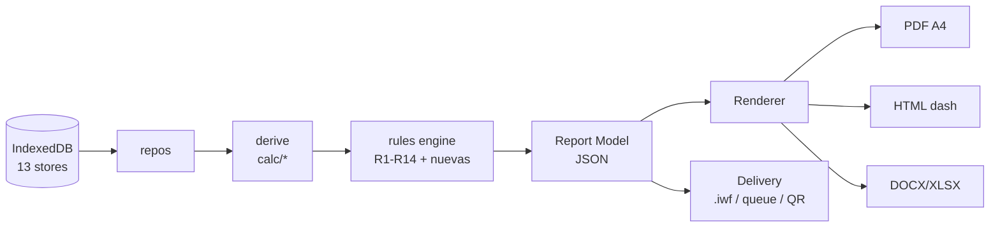

# Blueprint de reportabilidad — IntegrityWatch Field

**Fecha:** 31-10-2026
**Autor:** Arquitecto Supremo (análisis sobre el repo `integritywatch-field` + fuentes normativas)
**Estado:** propuesta de diseño, no implementada
**Alcance:** qué informes se pueden obtener de los datos actuales, qué prácticas de la industria adoptar,
catálogo de informes TIPO por situación, modernización de la salida (dashboard, gráficos, sugerencias,
alertas tempranas) y entrega de datos desde el equipo offline.

---

## 1. Resumen ejecutivo

La aplicación ya tiene **más capacidad analítica de la que muestra**. El motor de cálculo implementa
modelos que normalmente se venden aparte (FFS API 579, B31G, NORSOK M-506, MIC, CUI API 583, vida
remanente por regresión), y las reglas R1–R14 ya forman un sistema de alertas tempranas. Sin embargo,
la capa de informes se reduce a **tres documentos**: trimestral, dossier de punto y ficha de PSV.

La conclusión del análisis es que el cuello de botella **no son los datos ni los cálculos, sino la
presentación y la entrega**. Con el modelo de datos actual se pueden producir **12 informes TIPO**
sin añadir ni un campo nuevo a IndexedDB, y llevar la salida a un nivel de dashboard moderno.

Tres recomendaciones estructurantes:

1. **Plantillas declarativas**: un informe = plantilla (JSON) + consulta + render. Hoy cada informe es
   un archivo JS de 300–500 líneas; con 12 tipos eso no escala.
2. **Jerarquía de KPIs estilo IOGP 456 / API RP 754** (Tier 1–4): da lenguaje común con las operadoras
   y convierte R1–R14 en indicadores "líderes" auditables, no solo avisos.
3. **Paquete de evidencia firmado** para la entrega offline: PDF + JSON + CSV + fotos + hash, con cola
   de envío y acuse de recibo. Es lo que convierte una tablet en un sistema auditable.

---

## 2. Base actual: datos, cálculos e informes

### 2.1 Stores (13)

`monitoringPoints`, `readings`, `coupons`, `psvs`, `pipelineSystems`, `lineAssets`, `lineInspections`,
`apmAssets`, `apmEvents`, `recommendations`, `importLog`, `mutationQueue`, `meta`.

### 2.2 Motor de cálculo — capacidad real (hallazgo clave)

| Módulo | Qué calcula | Norma | Informe que habilita |
|---|---|---|---|
| `calc/corrosion.js` | CR por pérdida de peso, clasificación SP0775, EI, balance de inhibidor, De Waard-Milliams, pH₂S, MR0175, CP | NACE SP0775, ASTM G1/G4, MR0175/ISO 15156-2 | T-01, T-02, T-03 |
| `calc/norsok506.js` | CR por CO₂ con fugacidad, cizalla, glicol e inhibidor | NORSOK M-506 | T-01 (modelo predictivo) |
| `calc/cui583.js` | Evaluación de corrosión bajo aislamiento | API RP 583 | T-04 |
| `calc/mic.js` | Evaluación de corrosión microbiológica | — (buena práctica) | T-05 |
| `calc/ffs.js` | Espesor requerido, MAWP, pérdida generalizada, picadura, sistema de línea | API 579-1/ASME FFS-1 | T-06 |
| `calc/pipelineAssessment.js` | B31G, presión operable admisible, anomalías | ASME B31G / B31.8S | T-10 |
| `calc/remainingLife.js` | Regresión de serie, vida remanente, RUL desde lecturas | — (analítica) | T-01, T-10 |
| `calc/psv.js` | Sizing gas/líquido, Kd/Kb/Kw/Kc/Kv, orificio, capacidad real, margen | API 520/526 | T-07 |
| `calc/apm.js` | Disponibilidad, MTBF, MTTR, OEE, tasa de fallo, banda RBI, intervalo de inspección | ISO 14224, API 580 | T-08, T-09 |

**Consecuencia:** hoy se reporta una parte pequeña de esto. FFS, B31G, MIC, CUI, RUL y el modelo
NORSOK **no aparecen en ningún informe**, aunque se calculan en la app.

### 2.3 Informes actuales y sus límites

| Informe | Secciones | Límite principal |
|---|---|---|
| Trimestral | KPIs, gráfico semanal, top críticos, EI, campañas, recomendaciones, estándares | Sin jerarquía Tier, sin riesgo ni tendencia por activo, sin narrativa de acción |
| Dossier de punto | Datos, lecturas, ASTM, screening, PSVs, estándares | No incluye FFS, RUL ni CUI/MIC; no hay "qué hacer" |
| Ficha PSV | Ficha, sizing, fechas, estándares | No incluye historial de pruebas ni plan de recertificación |

---

## 3. Prácticas de referencia (investigación primaria)

Fuentes consultadas y **verificadas por lectura del documento**, no por resumen de buscador:

### 3.1 IOGP Report 456 — *Process safety: Recommended practice on KPIs* (3.ª ed., mayo 2023, 90 pp.)

- Estructura: Parte A (KPIs corporativos y de instalación), B (barreras y selección), C (Tier 1 y 2),
  D (recolección IOGP), E/F (determinación y clasificación de eventos), **G (Tier 3 y 4)**,
  H (ejemplos de KPIs líderes), I (aprendizaje), J (well control).
- **Figura A.2: "Hierarchy of asset integrity KPIs"** — el KPI debe poder consolidarse del activo a la
  corporación, no al revés.
- Tier 1 y 2 están **definidos con alcance estrecho y umbrales**, y son **consistentes con API RP 754**
  para permitir benchmarking entre compañías.
- **Tier 3** = desafíos a los sistemas de seguridad (fallo de barrera por debajo del umbral Tier 2).
  **Tier 4** = implementación y eficacia de los elementos del sistema de gestión.
- El mayor valor de Tier 3/4 es **local**, porque los activos difieren en actividad y equipo.
- Tres elementos sostienen el sistema: **monitorizar desempeño, reportar interna y externamente,
  y revisar los resultados** para cambiar el sistema de gestión.

### 3.2 API RP 754 (4.ª ed., agosto 2026) — indicadores de seguridad de proceso

| Tier | Definición | Ejemplos/umbral |
|---|---|---|
| 1 (más rezagado) | Pérdida de contención con la mayor consecuencia | Lesión con días fuera del trabajo o fatalidad; ingreso hospitalario de tercero; fuego/explosión ≥ 100.000 USD |
| 2 | Pérdida de contención con consecuencia menor, predictiva | Lesión registrable; fuego/explosión ≥ 2.500 USD |
| 3 | Desafío a los sistemas de seguridad | Excursiones de límites operativos; inspección/prueba fuera de límites; demandas sobre sistemas de seguridad |
| 4 (más líder) | Desempeño de componentes de la disciplina operativa y del sistema de gestión | Indicadores internos de ejecución |

Tiers 1–2 son aptos para reporte público; 3–4 son de uso interno. La lógica es directamente aplicable
a integridad si se mapea "pérdida de contención" a fallo de barrera.

### 3.3 ISO 14224:2016 — datos de confiabilidad y mantenimiento

- Tres categorías de datos: **(a) equipo** (taxonomía, atributos), **(b) falla** (causa, consecuencia),
  **(c) mantenimiento** (acción, recursos, consecuencia, downtime).
- Usos: fiabilidad, **disponibilidad/eficiencia**, mantenimiento, **seguridad y medio ambiente**.
- Los modos de falla funcionan como **"thesaurus de fiabilidad"**; incluye control y aseguramiento de
  calidad del dato (clave: sin calidad de dato, MTBF no es comparable).

### 3.4 API RP 580 (3.ª ed., febrero 2016, 94 pp.) — RBI

Elementos del programa, en el orden que publica el propio estándar:

`a)` premisa de diseño · `b)` planificación de la evaluación · `c)` recolección de datos ·
`d)` mecanismos de daño y modos de falla · `e)` probabilidad de falla (POF) · `f)` consecuencia (COF) ·
`g)` determinación y gestión del riesgo · `h)` gestión con actividades de inspección y control de proceso ·
`i)` otras actividades de mitigación · `j)` reevaluación y actualización · `k)` roles, responsabilidades,
formación y cualificación · `l)` documentación y registro.

Es literalmente el índice de un informe RBI auditable.

### 3.5 ASME B31.8S-2022 — integridad de gasoductos

- Sección 8 **Integrity Management Plan**; 9 **Performance Plan**; 10 Communications Plan;
  11 **Management of Change**; 12 **Quality Control Plan**.
- Anexo A: **planes por amenaza** (corrosión externa, corrosión interna, fabricación, construcción,
  equipos), con diagramas de proceso.
- La estructura por amenazas (dependientes del tiempo, estables, aleatorias) es el esqueleto del
  informe de integridad de ducto.

### 3.6 API RP 584 (2.ª ed., diciembre 2021) — Integrity Operating Windows

- Define tipos de IOW, cómo crearlas, documentarlas e implantarlas; **cómo monitorizar y medir** las
  variables; **cómo comunicar cuando se rebasa un límite**; revisión y actualización; integración con
  RBI, MOC y PSI.
- Distingue **límites informativos** y recomienda **medias móviles** para su seguimiento: exactamente
  el mecanismo que la app ya usa en R2 (7d vs 30d) y R4 (residual vs objetivo).

> Nota de uso: se citan prácticas públicas de normas y consorcios. No se reproduce contenido
> propietario ni se muestran marcas de terceros.

---

## 4. Catálogo de informes TIPO

Cada ficha es una plantilla replicable: mismo esqueleto, distinto disparador y datos.
**Todas se pueden construir con los stores actuales.**

### T-01 · Alerta de integridad de punto de corrosión
- **Disparo:** R1 (≥10 mpy), R2 (7d ≥ 2× 30d), R7 (desvío vs DWM).
- **Entradas:** `monitoringPoints`, `readings`, `calc/corrosion`, `calc/norsok506`, `calc/remainingLife`.
- **Secciones:** 1) Hecho y fecha; 2) serie con umbral y modelo; 3) clasificación SP0775;
  4) vida remanente y fecha estimada de breach; 5) contexto de proceso; 6) acción recomendada.
- **KPIs:** CR actual, Δ vs 30d, ratio medido/modelo, RUL (meses), fecha de breach.
- **Gráficos:** tendencia + banda de predicción; CUSUM; bullet de RUL.
- **Salida:** PDF 2 pp + entrada en el paquete de evidencia.

### T-02 · Tratamiento químico y eficiencia de inhibidor
- **Disparo:** R3 (EI < 70 %), R4 (residual fuera de banda).
- **Entradas:** `coupons` (pares blank/inhibited), `calc/corrosion.inhibitorEfficiency`, `inhibitorBalance`.
- **Secciones:** pares y pesos, EI por par, residual vs objetivo, tendencia, recomendación de dosificación.
- **KPIs:** EI %, residual ppm, desviación vs banda 80–150 %.
- **Gráficos:** barras EI por par; línea residual vs banda.
- **Norma:** ASTM G1/G4, NACE SP0775.

### T-03 · Screening de servicio ácido
- **Disparo:** R8; o manual al registrar un punto con H₂S.
- **Entradas:** `process.h2sPpm`, `totalPressureKpa`, `calc/corrosion.partialPressureH2S/classifyMr0175`.
- **Secciones:** pH₂S, región (low/moderate/high), material actual, aptitud, acciones.
- **KPIs:** pH₂S kPa, nivel, material exigido.
- **Gráfico:** gauge de región ácida.
- **Norma:** MR0175 / ISO 15156-2.

### T-04 · Corrosión bajo aislamiento (CUI)
- **Disparo:** `cui.insulated` y antigüedad/inspección vencida; evaluación `cui583`.
- **Secciones:** condiciones, temperatura de servicio, historial, índice de riesgo, plan de inspección.
- **Gráficos:** mapa de riesgo por zona; línea de tiempo de inspecciones.
- **Norma:** API RP 583.

### T-05 · Corrosión microbiológica (MIC)
- **Disparo:** evaluación `mic.assess` con resultado alto; agua/bacterias.
- **Secciones:** factores, resultado, muestreo recomendado, biocida.
- **Norma:** buena práctica + NACE.

### T-06 · Fitness-for-Service (pérdida de metal y picadura)
- **Disparo:** RUL baja, UT bajo mínimo, hallazgo de inspección.
- **Entradas:** `calc/ffs` (espesor requerido, MAWP, LTA, picadura), `lineInspections`.
- **Secciones:** datos de diseño, espesor medido vs requerido, MAWP evaluado, aceptación, vida remanente,
  decisión (monitorizar/reparar/reemplazar).
- **KPIs:** t requerido, t medido, MAWP, % de pared perdida, RUL.
- **Gráficos:** perfil de espesor a lo largo del km; semáforo de aceptación.
- **Norma:** API 579-1/ASME FFS-1.

### T-07 · PSV: sizing, margen y recertificación
- **Disparo:** R13 (vencida), R14 (margen < 0); o manual.
- **Entradas:** `psvs`, `calc/psv`, `calc/psv.realCapacity`.
- **Secciones:** ficha, sizing (Kd/Kb/Kw/Kc/Kv, orificio), capacidad real vs requerida, margen,
  fechas de prueba y plan.
- **KPIs:** margen %, días a vencimiento, área instalada/requerida.
- **Gráficos:** bullet capacidad vs requerida; calendario de recertificación.
- **Norma:** API 520/526 (y API 576 para inspección).

### T-08 · RBI y plan de inspección
- **Disparo:** R9 (inspección vencida); ciclo anual por activo.
- **Entradas:** `apmAssets.rbi`, `calc/apm.rbiRisk/inspectionIntervalMonths`.
- **Secciones:** las 12 de API 580 (`a`–`l`), con énfasis en mecanismos de daño, POF×COF, riesgo,
  plan, reevaluación y registro.
- **KPIs:** score de riesgo, banda, intervalo, días de atraso, confianza del dato.
- **Gráficos:** matriz 5×5 con activos; heatmap por sector; Pareto de mecanismos.
- **Norma:** API 580/581, ISO 55000.

### T-09 · Confiabilidad y disponibilidad de activos
- **Disparo:** R10 (MTBF), R11 (disponibilidad), R12 (≥3 fallas/90d); cierre mensual.
- **Entradas:** `apmAssets`, `apmEvents`, `calc/apm`.
- **Secciones:** taxonomía ISO 14224 del activo, eventos, MTBF/MTTR, disponibilidad, OEE,
  causas de falla, acciones.
- **KPIs:** disponibilidad %, MTBF h, MTTR h, OEE %, tasa de fallo.
- **Gráficos:** Pareto de causas; tendencia MTBF; cascada OEE.
- **Norma:** ISO 14224, ISO 55000.

### T-10 · Integridad de ducto por amenazas
- **Disparo:** campaña ILD/UT cerrada; anomalía evaluada; vencimiento de certificado.
- **Entradas:** `pipelineSystems`, `lineAssets`, `lineInspections`, `calc/pipelineAssessment`, `remainingLife`.
- **Secciones:** sistema y tramos, amenazas B31.8S (tiempo-dependiente / estable / aleatoria),
  hallazgos por km, B31G y presión admisible, severidad, plan de mitigación, MOC y control de calidad.
- **KPIs:** km cubiertos, hallazgos por severidad, MAOP vs presión admisible, RUL por tramo.
- **Gráficos:** mapa por km con severidad; perfil de espesor; línea de tiempo de campañas.
- **Norma:** ASME B31.8S-2022 (Plan de Integridad, Plan de Desempeño, MOC, QC), API 1160 para líquidos.

### T-11 · Informe trimestral ejecutivo (jerarquía IOGP)
- **Disparo:** cierre de trimestre.
- **Entradas:** todas las anteriores agregadas.
- **Secciones:** 1) resumen Tier 1–2 (eventos); 2) Tier 3 (desafíos a barreras = R1–R14);
  3) Tier 4 (ejecución: inspecciones a tiempo, datos completos); 4) tendencia 12 meses;
  5) recomendaciones y cierre; 6) metodología y estándares.
- **KPIs:** conteo por tier, % de inspecciones a tiempo, % de datos válidos, CR media, disponibilidad.
- **Gráficos:** sparklines por tier; heatmap de puntos; Pareto de reglas; gauge de cumplimiento.
- **Norma:** IOGP 456 (Partes A/G/H/I), API RP 754.

### T-12 · Paquete de cierre y handover offline
- **Disparo:** botón "cerrar turno/entrega" o reconexión.
- **Contenido:** PDF resumen + JSON del caso + CSV del periodo + fotos con EXIF/GPS + `SHA-256`
  + manifiesto + estado de la cola de sincronización.
- **KPIs:** filas importadas, recomendaciones abiertas, cobertura de inspección, integridad del paquete.
- **Norma:** ISO 55000 (información del activo), buenas prácticas de evidencia auditable.

### T-13 (opcional) · Emisiones OGMP 2.0
- Si se añade el store de fuentes/mediciones: reporte por nivel (L4/L5) y cobertura de medición.

---

## 5. Arquitectura de reporte propuesta



**Decisión de diseño: plantilla declarativa.**

```json
{
  "id": "T-06",
  "title": "fitnessForService",
  "trigger": { "rule": ["RUL_LOW", "UT_BELOW_MIN"] },
  "query": { "stores": ["lineInspections", "pipelineSystems"], "calc": ["ffs", "remainingLife"] },
  "sections": [
    { "type": "kpiRow", "items": ["tReq", "tMeasured", "mawp", "rul"] },
    { "type": "chart", "chart": "thicknessProfile" },
    { "type": "table", "source": "inspections" },
    { "type": "actions", "source": "recommendations" }
  ],
  "standard": ["API 579-1/ASME FFS-1"]
}
```

Beneficio: 13 informes con **un** motor de render y 13 plantillas, en lugar de 13 archivos de 400 líneas.
Mantiene el enfoque print-first actual (A4) y añade la vista dashboard sin duplicar lógica.

---

## 6. Modernización de la salida

### 6.1 Dashboard por rol (hoy hay uno operativo)

| Rol | Pregunta que responde | Contenido |
|---|---|---|
| Campo / técnico | ¿Qué está rojo y qué hago hoy? | Recomendaciones accionables ordenadas por severidad y vencimiento |
| Integridad / ingeniería | ¿Qué activo se degrada y cuándo rompe? | RUL, CUSUM, matriz RBI, cobertura de inspección |
| Gerencia / regulador | ¿Cómo vamos contra el estándar? | Tier 1–4, tendencia 12 meses, cumplimiento |

### 6.2 Gráficos a incorporar

| Gráfico | Dónde | Por qué |
|---|---|---|
| **CUSUM / Shewhart** | lecturas de corrosión | Detecta deriva antes del umbral (hoy solo hay z-score en R5) |
| **Proyección RUL con banda** | punto y tramo | Convierte la tasa en *fecha de fallo estimada* |
| **Matriz 5×5** | RBI | Ya existe en APM; extenderla a PSV y ductos |
| **Heatmap por km** | ducto | Superpone severidad de inspecciones al esquema actual |
| **Pareto** | fallas y reglas | Prioriza causas, no solo cuenta eventos |
| **Cascada OEE** | APM | Explica disponibilidad (ISO 14224) |
| **Bullet** | PSV y FFS | Margen vs requerido en una lectura |
| **Sparkline** | tablas | Tendencia sin abrir el detalle |
| **Calendario de vencimientos** | PSV, RBI, cupones | Anticipa carga de trabajo |

### 6.3 Alertas tempranas en tres niveles

Mapeo propuesto de las reglas actuales a la lógica IOGP/API 754:

| Nivel | Significado | Reglas | Acción |
|---|---|---|---|
| **L1 Información** | deriva detectada, aún en ventana | R2 con ratio 1,3–2; R4 aviso temprano; R5 cerca del umbral | Registrar y vigilar |
| **L2 Advertencia** | barrera degradada | R2 ratio ≥2, R3, R4 fuera de banda, R5, R9, R10, R11, R12, R13 | Plan de acción con dueño y fecha |
| **L3 Crítica** | barrera superada | R1, R7, R8 high, R9 >90d, R13 >30d, R14 | Escalar y parar/contener |

Añadir tres alertas nuevas, todas derivables hoy:
- **R15 · Proyección de breach**: `remainingLife` cruza `tMin` en < 90 días → L2.
- **R16 · Calidad de dato**: `importLog` con >10 % de filas en error o cupón sin par → L1.
- **R17 · Inspección sin evidencia**: `lineInspections` sin `reportRef` en severidad high → L2.

### 6.4 Sugerencias accionables

Cada recomendación debe llevar, además de regla y severidad: **acción sugerida**, **dueño**, **fecha
límite** y **efecto esperado**. Sin eso, el informe describe pero no mueve nada. La app ya guarda
`resolveNote` e historial; falta el "qué hacer" estructurado.

---

## 7. Entrega de datos desde el equipo offline

Estado actual: `mutationQueue` con reintentos y `dead`, export JSON, export `.iwf`, impresión PDF,
endpoint de sincronización. Propuestas, ordenadas por impacto:

| # | Mejora | Impacto | Esfuerzo |
|---|---|---|---|
| 1 | **Paquete firmado** (PDF+JSON+CSV+fotos+SHA-256) en `.zip` | Auditoría real | M |
| 2 | **Cola de informes pendientes** reutilizando `mutationQueue` | No se pierde un informe por falta de red | S |
| 3 | **Acuse de recibo** del endpoint + estado visible en Admin | Trazabilidad de qué salió | S |
| 4 | **Sincronización delta idempotente** (por `id`, no export completo) | Menos datos, sin duplicados | M |
| 5 | **Export DOCX/XLSX** además de PDF | Integración con CMMS/ERP del cliente | M |
| 6 | **Compartir por QR/P2P** tablet↔oficina | Último tramo sin red corporativa | M |
| 7 | **Sincronizar multimedia** con EXIF/GPS intacto | Evidencia de inspección | S |
| 8 | **Informe de relevo** en un clic | Operación diaria | S |
| 9 | **Verificación de backup/restore** en Admin | Continuidad | S |

Regla de diseño: **nada de lo anterior debe requerir servidor**. Todo debe funcionar con IndexedDB y
el sistema de archivos del dispositivo, y encolarse cuando haya red.

---

## 8. Priorización y hoja de ruta

| Fase | Entrega | Informes | Riesgo |
|---|---|---|---|
| **1** | Plantillas declarativas + render único + T-01, T-02, T-07, T-11 | 4 | Bajo |
| **2** | T-03, T-04, T-06, T-08, T-09 | 5 | Medio (FFS/RBI requieren cuidado normativo) |
| **3** | T-10, T-05, T-12 + dashboard por rol + CUSUM/RUL | 3 | Medio |
| **4** | Entrega offline: paquete firmado, delta sync, cola de informes, DOCX/XLSX | — | Medio |

Criterio de aceptación por informe: renderiza con el dataset semilla **y** con el dataset real NSTA;
PDF A4 sin desbordes; todos los números trazables a un store; cero cálculos en el renderer (solo en
`calc/*`); test de plantilla con snapshot.

---

## 9. Plan de delegación (Arquitecto → subagentes)

1. **coder** (DeepSeek V4 Pro): introduce el motor de plantillas y migra los 3 informes actuales sin
   cambiar su salida (test de regresión visual), luego T-01/T-02/T-07/T-11.
2. **tester**: verifica A4, i18n en 7 idiomas, sin overflow, con dataset semilla y real.
3. **reviewer**: revisa que FFS/B31G/RBI citen la norma correcta y no inventen fórmulas; que no haya
   números hardcodeados fuera de `calc/*`.
4. **designer**: sistema visual de los 9 gráficos y el dashboard por rol.

Riesgo principal: **precisión normativa**. FFS (API 579) y B31G tienen supuestos que, mal expuestos,
producen informes que parecen válidos y no lo son. Cada plantilla debe declarar sus supuestos y su
nivel de confianza.

---

## 10. Anexos

### A. Mapa store → informe

| Store | T-01 | T-02 | T-03 | T-04 | T-06 | T-07 | T-08 | T-09 | T-10 | T-11 | T-12 |
|---|---|---|---|---|---|---|---|---|---|---|---|
| monitoringPoints | ● | ● | ● | ● | ● | | | | ● | ● | ● |
| readings | ● | ● | | | ● | | | | ● | ● | ● |
| coupons | | ● | | | | | | | | ● | ● |
| psvs | | | | | | ● | | | | ● | ● |
| pipelineSystems | | | | | ● | | | | ● | ● | ● |
| lineAssets | | | | | ● | | | | ● | ● | ● |
| lineInspections | | | | | ● | | | | ● | ● | ● |
| apmAssets | | | | | | | ● | ● | | ● | ● |
| apmEvents | | | | | | | ● | ● | | ● | ● |
| recommendations | ● | ● | ● | ● | ● | ● | ● | ● | ● | ● | ● |
| importLog | | | | | | | | | | ● | ● |
| mutationQueue | | | | | | | | | | | ● |

### B. Fuentes

| Fuente | Qué se tomó | Fecha |
|---|---|---|
| IOGP Report 456, 3.ª ed. (mayo 2023), 90 pp. | Estructura A–J, Figura A.2, definición Tier 3/4, consistencia con API 754 | 31-10-2026 |
| API RP 754, 4.ª ed. (agosto 2026), vía Inspectioneering | Umbrales y ejemplos Tier 1–4 | 31-10-2026 |
| ISO 14224:2016 (muestra oficial iTeh, 15 pp.) | Tres categorías de datos, usos, thesaurus de fallas, calidad del dato | 31-10-2026 |
| API RP 580, 3.ª ed. (febrero 2016), preview oficial API | Elementos `a`–`l` del programa RBI | 31-10-2026 |
| ASME B31.8S-2022 (índice oficial ASME) | Plan de Integridad, Plan de Desempeño, MOC, QC, anexos por amenaza | 31-10-2026 |
| API RP 584, 2.ª ed. (diciembre 2021), vía Inspectioneering | Tipos de IOW, monitorización, comunicación de breaches, medias móviles | 31-10-2026 |

### C. Limitaciones de este análisis

- No se ha implementado nada; el documento es diseño.
- Las citas de normas son de dominio público o resúmenes oficiales; **no** se ha copiado texto
  propietario ni tablas completas.
- La cifra de "12 informes" asume los stores actuales; T-13 (OGMP) requiere un store nuevo.
- El esfuerzo está expresado en S/M/L cualitativo, no en horas, hasta que el coder estime.
