# IntegrityWatch Field — User Manual

**Who this manual is for:** field operators, integrity engineers, maintenance and operations supervisors. No programming knowledge needed. The app works **100% offline**. Your data never leaves your computer.

---

## 1. Install and open the app

### Windows (portable)
1. Download `IntegrityWatch-Field-Portable.part1.rar` and `part2.rar` from GitHub Releases.
2. Put all parts in the same folder and extract with WinRAR or 7-Zip.
3. Double-click `START-HERE.bat`. A local server starts and your browser opens the app.
4. The app can also run from a USB stick. No install, no admin rights needed.

### macOS
1. Extract the package and double-click `START-HERE.command`.
2. Your browser opens `http://localhost:8419`.

### Linux
1. Extract the package and double-click `start.sh` (or run `./start.sh`).
2. Your browser opens `http://localhost:8419`.

### Install as an app (PWA) — recommended for daily use
1. Start the app with `START-HERE.bat`.
2. In the browser address bar, click the **Install** icon (or menu ⋮ → "Install app").
3. From now on the app opens from its own icon and works fully offline.

**Requirements:** Chrome, Edge, Firefox or Safari from the last two years. Minimum screen 1366×768. Works on tablets and phones.

---

## 2. First launch (5 minutes)

1. The app loads with **demo data**: 8 corrosion points, 5 valves, one pipeline with 12 assets, 9 APM assets and about 120 readings. This shows every screen working.
2. **Pick your language** in the header: English, Español, Français, Português, 简体中文, Русский, العربية. Arabic switches the whole layout to right-to-left.
3. **Pick your theme**: the ☀/🌙/🖥 button cycles light → dark → automatic. Your choice is remembered.
4. **Sector filter** (All / Upstream / Midstream / Downstream) filters the Dashboard and APM.

> To start clean with your own data: menu **Admin → Reset demo data** (or clear all).

---

## 3. Corrosion monitoring

1. **Create a monitoring point:** Corrosion → "New point". Fill in the code (example: MP-CORR-021), material (13 steels and alloys), sensor type (coupon, ER, LPR, H₂S probe, UT, visual) and process data (H₂S, CO₂, pressure, temperature, BS&W, velocity, inhibitor target and residual). Add cathodic protection and CUI insulation if they apply.
2. **Log readings:** open the point → "New reading" → date + rate (mpy) + note.
3. **Log coupons (inhibitor/blank pairs):** "New coupon" → choose **Role** (Blank or Inhibited) and **Pair** (example: P3), then initial and final weight, area and days. The corrosion rate is calculated for you (ASTM G1/G4). The **Inhibitor efficiency** panel compares both coupons and rates the result (Excellent ≥90%, Poor <70%).
4. **Automatic panels:** inhibitor balance (80–150% window), De Waard–Milliams model versus measured, sour screening NACE MR0175 (pH₂S), cathodic protection and CUI.
5. **Point dossier:** button "Point dossier" gives a printable report — one page per monitoring point.

---

## 4. Pressure safety valves (PSV)

1. **Register a valve:** "New PSV" → tag, type (conventional / balanced bellows / pilot), fluid (11 pre-loaded, editable), set pressure, temperature, backpressure and test dates.
2. **Size it:** open the valve → tabs **Gas** and **Liquid**:
   - Gas: flow W, pressure/temperature, Z, M, k → required area per API 520. The app detects critical or subcritical flow.
   - Liquid: flow Q, gravity G, viscosity → area with Kv viscosity correction.
   - The app **selects the API 526 orifice** (D–T) and shows the margin and the real capacity.
3. **Save the sizing** on the valve and print the **datasheet** (API 520 / ISA format).

---

## 5. Pipelines (midstream)

1. **Create the system:** name, operator, product, diameter, wall thickness, material, length and station range (km).
2. **Line assets:** inside the system, "New line asset" → type (12 kinds: valves, flanges, pump and compressor stations, tanks, crossings, ROW, metering…), station km and side.
3. **Inspections:** type (ILI, external corrosion, visual, UT, repair, replacement), km section, severity, findings.
4. **Map:** nodes drawn on the line to km scale, colored by the severity of the last inspection. Keyboard navigable (Tab and Enter).

---

## 6. Asset performance (APM)

1. **Create an asset:** code, name, sector, category (wells, platforms, pumps, compressors, exchangers, towers, utilities…), criticality A/B/C, and **POF × COF** risk (RBI style). The next inspection date is suggested by the risk band.
2. **Log events:** failure, maintenance, unplanned shutdown, work order or inspection, with dates and downtime. The app calculates **availability, MTBF and MTTR** and shows a health traffic light.
3. The **5×5 risk matrix** shows where each asset sits and what inspection priority it gets.

---

## 7. Import your data (CSV, WITSML, JSON)

1. Tab **CSV** → "Choose file" (or drag the file). Accepts comma, semicolon or tab separated files.
2. Check the **column mapping** — the app auto-detects point, date, rate, Wi, Wf, area, days, residual, temperature, bsw, category, note. Spanish and English headers are recognized.
3. Tick **"Create missing points"** if the file contains new monitoring points.
4. **Run validation** → the error table shows bad rows (future date, Wf greater than Wi, out of range, unknown point, duplicates skipped). If you change the checkbox, validate again before importing.
5. **Import** → summary, and the action is logged in history.
6. Extra tabs: **WITSML** (wells, trajectories, channels) and **JSON** (full backup, merge or replace mode).

---

## 8. Rules and recommendations

- Press **Run rules** (header button) to scan everything. The app has 17 engineering rules (R1–R17): wall loss rates, pitting, overdue PSV tests, inhibitor problems, pipeline findings and APM risk movements.
- Every recommendation shows the rule, the real numbers behind it, the affected asset and a link to its record.
- Actions: **Acknowledge** → **Resolve** (with a note). Everything is stamped with date and user.
- If the condition comes back after you resolve it, the recommendation **reopens automatically**.

---

## 9. Reports

1. **Quarterly report:** pick the period → Generate → cover page, KPIs, weekly chart, worst points, pair efficiency, campaigns and open recommendations. Button **Print** → "Save as PDF".
2. **Point dossier:** technical sheet + history + ASTM G1/G4 calculations + SP0775 class + MR0175 screening.
3. **Valve datasheet:** complete sizing sheet, copyable to the clipboard.

---

## 10. Backups

1. **Admin → Export** writes one JSON file with all your data. Save it on the network or a USB stick.
2. **Restore:** Ingestion → JSON tab → choose the file → mode **merge** (adds) or **replace** (full restore).
3. Back up **every week** and always before a big import.

---

## 11. Quick recipes

| You want to… | Do this |
|---|---|
| Load the monthly coupon campaign | Ingestion → CSV → file → validate → import → assign Role/Pair → Run rules → check Recommendations |
| Program an RBI inspection | APM → asset → adjust POF/COF → reschedule next inspection (date follows the risk) |
| Print the quarterly report | Reports → Quarterly → dates → Generate → Print → PDF |
| Move data to a second laptop | Admin → Export → copy the JSON → on the other laptop: Ingestion → JSON → merge |

---

## 12. Troubleshooting

| Symptom | Likely cause | Fix |
|---|---|---|
| "Port busy" at START-HERE | Another program uses port 8419 | Run `tools\serve.ps1 -Port 9000`, or close the other program |
| PowerShell blocks the script | Execution policy | Use `START-HERE.bat` (it already includes the bypass), or `py tools\serve.py` |
| No "Install app" button | You opened `index.html` from disk | Start with `START-HERE.bat` (PWA needs http://localhost) |
| Data disappeared | Private/incognito window, or site data cleared | Restore your JSON backup; avoid private mode |
| "Update available" banner | New version published | Click **Reload** on the banner |
| Old version still shown | Service worker cache | Click **Reload**, or Ctrl+F5 once, or DevTools → Application → Service Workers → Update |

---

## 13. Field validation walkthrough (real field data)

A full UI validation was run on 30 October 2026 against a clean install, driven by
`tools/qa/run_field_tests.py`. It used **real asset records**, not dummy rows: 55
UKCS pipelines from NSTA open data, with diameter, wall thickness, MAWP, fluid and
length as published. Full capture sheet: `docs/PRUEBAS-CAMPO-2026-10-30.md`.

**Video of this run** (1:24, English narration): [`docs/evidence/video/integritywatch-field-fieldtest-en.mp4`](../evidence/video/integritywatch-field-fieldtest-en.mp4) ([subtitles](../evidence/video/integritywatch-field-fieldtest-en.srt)). Summary and dataset provenance: [README — Field validation run](../../README.md#field-validation-run-real-data-30-10-2026).

**What the run proves**

| Step | Evidence |
|---|---|
| Create a point from real line data | 4 points (gas, crude, condensate, multiphase) |
| Import a field CSV offline | 32 rows total, 32 imported, 0 skipped, 0 errors |
| Register a pipeline system | CATS: 36 in, 28.4 mm, 17.93 MPa, 404.97 km |
| Register an asset | Real NSTA valve record, PBI band B |
| Run rules R1-R17 | 24 recommendations raised |
| Generate reports | Point dossier, quarterly report, PSV datasheet |
| Export the case file | 107,485 bytes, reopened from disk |
| Tablet layout (1280x800) | Dashboard and ingest usable without a server |

**Create a point from real data**

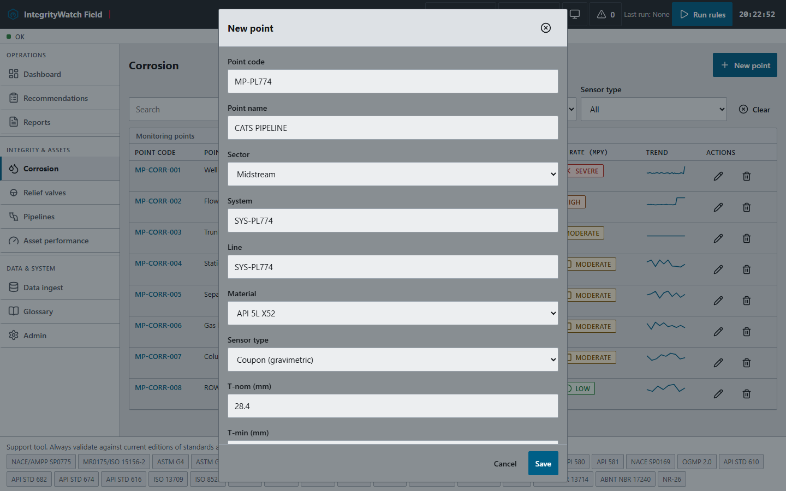

**Import a CSV and see every row validated**

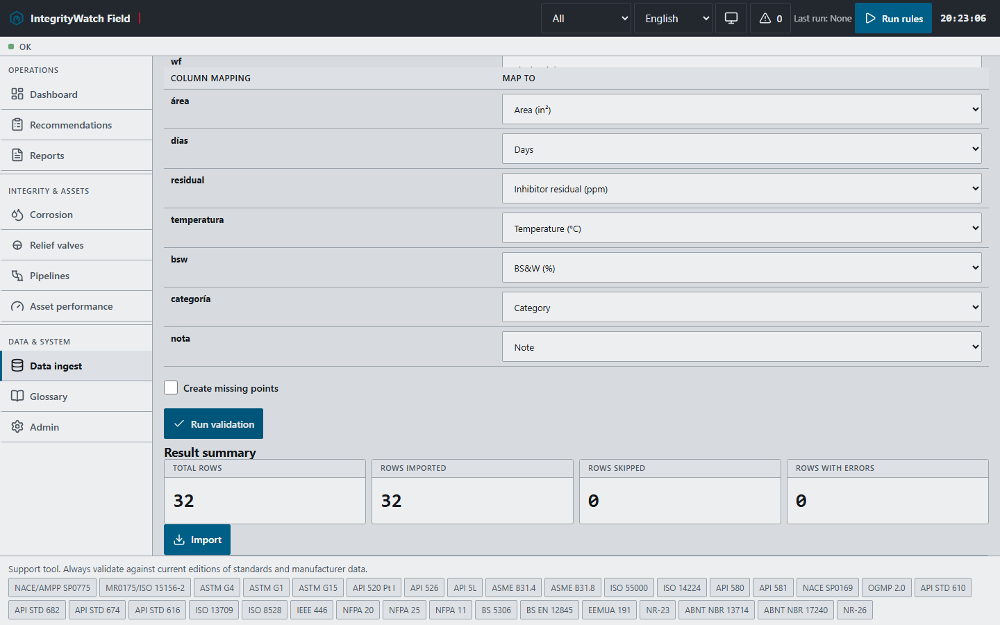

**Generate the dossier on the device**

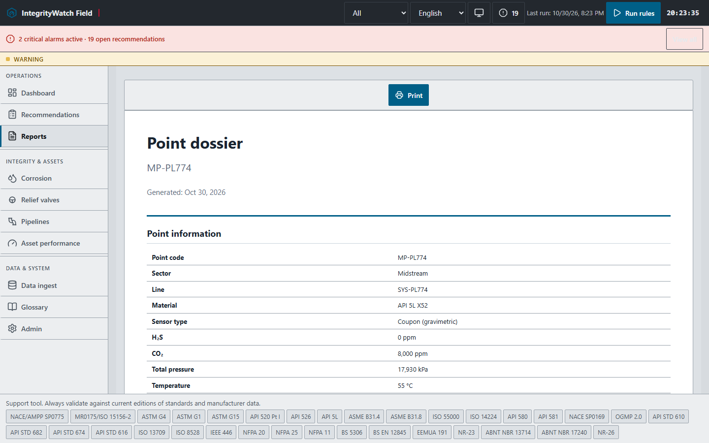

> Asset attributes are real. Inspection and corrosion series are derived from those
> attributes and labelled as derived in every row — never presented as field measurements.

To repeat the run: `python tools\qa\run_field_tests.py` (server on port 8419).

---

## 14. Operator workflows (plant · pipeline · refinery)

A dedicated field run for the three operating roles was executed on 31 October 2026
(`tools/qa/run_operator_tests.py`), using real refinery data from the EIA-820 report and
real UKCS pipeline records. Full record: `docs/PRUEBAS-CAMPO-OPERADORES-2026-10-31.md`.

| Persona | What was exercised on the tablet |
|---|---|
| Refinery operator | CDU overhead point, unit registered with RBI band A, overdue PSV, point dossier |
| Plant operator | CDU point, pump asset, readings viewed in tablet layout |
| Pipeline operator | CATS system from real attributes, line asset at km 12.4, severe ILI finding, map |

**Verified in the run:** 6 monitoring points, 48/48 CSV rows imported (0 skipped, 0 errors),
3 assets, 2 overdue relief valves, 25 recommendations after the R1-R17 sweep, and a
121 KB case-file export — all without a server or connection.

> Real: refinery sites and capacities (EIA), pipeline attributes (NSTA). Derived and
> labelled: equipment tags, process chemistry, PSV dates and corrosion series.

**Video of this run** (1:19, English narration):
[`docs/evidence/video/integritywatch-field-operators-en.mp4`](../evidence/video/integritywatch-field-operators-en.mp4).

---

## 15. UI tour (IFS-24 design, 31-10-2026)

A full walkthrough of the current interface was captured for the English tour video.
Every screen below uses the IFS-24 pictogram set: equipment is recognised by shape,
state is encoded by shape + colour + badge.

| Screen | What it shows |
|---|---|
| Dashboard | KPIs and a heatmap of every point, each with its equipment symbol |
| Corrosion | Point list with pictogram and state, plus the point detail with trend |
| Asset performance | ISO 14224 category pictograms, risk band and interval |
| Pipelines | Kilometres bar with severity per segment and assets by station |
| Data ingest | CSV mapped, validated and committed offline (16/17 rows, 1 rejected) |
| Reports | Dossier generated on the device |

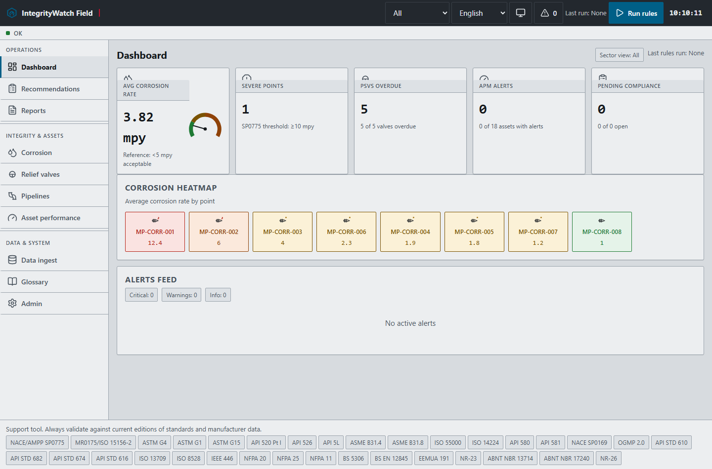

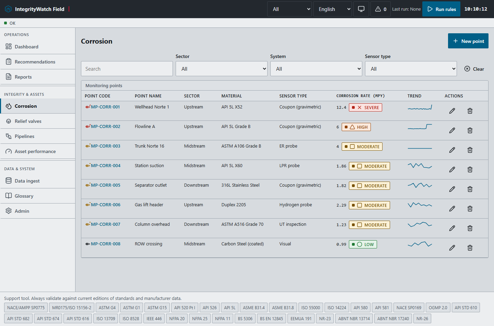

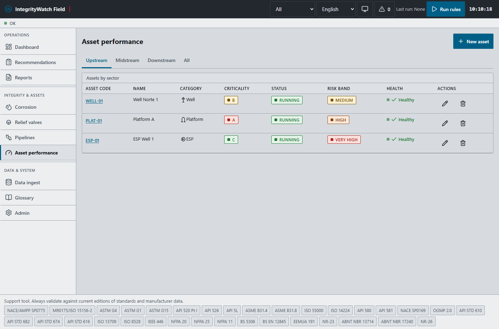

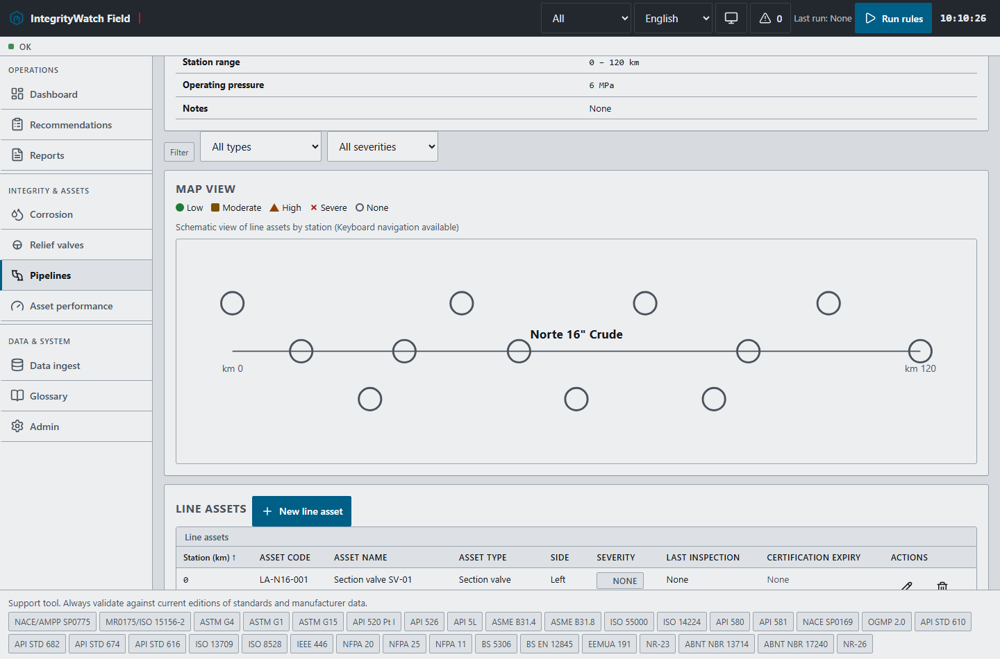

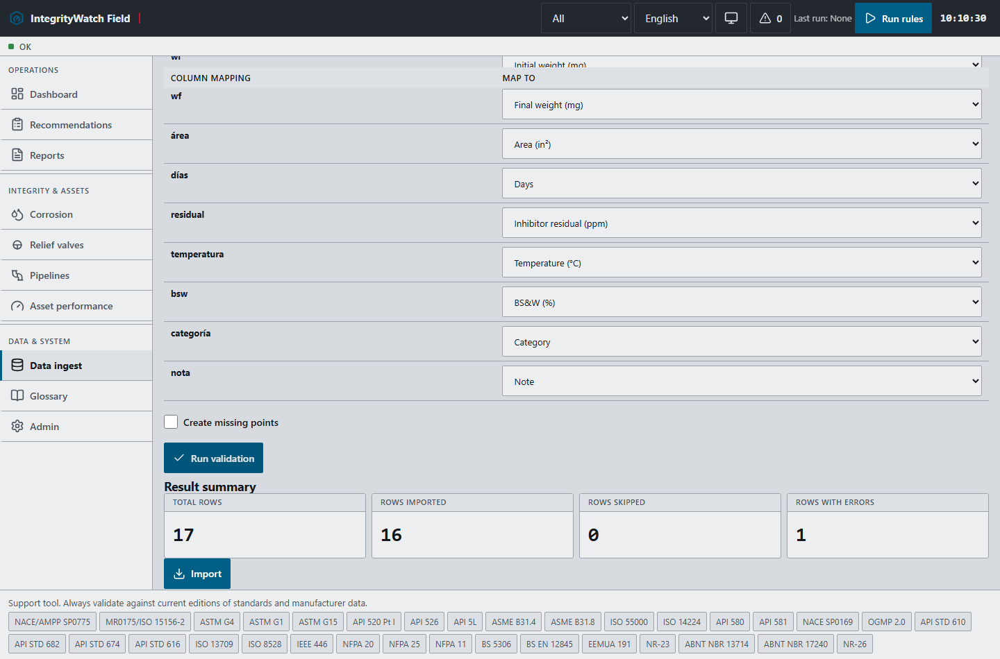

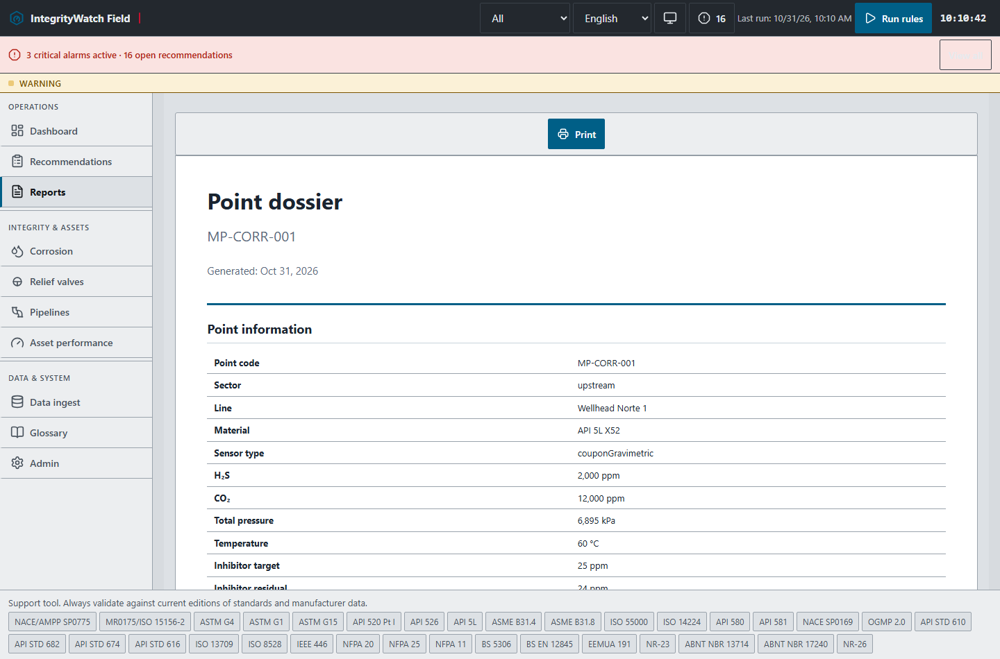

**Video of this tour** (1:35, English narration):
[`docs/evidence/video/integritywatch-field-uitour-en.mp4`](../evidence/video/integritywatch-field-uitour-en.mp4).

---

## 16. Important notes

- IntegrityWatch Field is a **support tool**. It does not replace the judgment of a qualified engineer.
- Verify all calculations against the current edition of the applicable standard (API 510/570/653, ASME PCC-2, NACE SP0775/MR0175, ASTM G1/G4) and manufacturer data before any operational decision.
- MIT licensed. Free to use, copy and modify. GitHub link: see this project's repository.

---

## Data entry validation (31-10-2026)

Every module that accepts data was exercised through its own form: monitoring point, manual reading, coupon, asset, asset event, relief valve, pipeline system, line asset, inspection, CSV ingest and the three reports. **9 forms saved, 22 captures, 0 errors.** The store grew to 9 points, 137 readings, 5 coupons, 19 assets, 25 events, 6 PSVs, 2 systems, 13 line assets and 6 inspections.

Full record: `docs/data-entry-2026-10-31/`

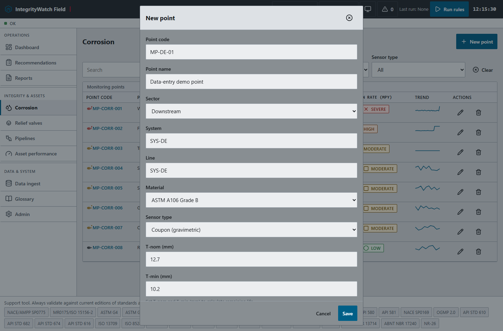

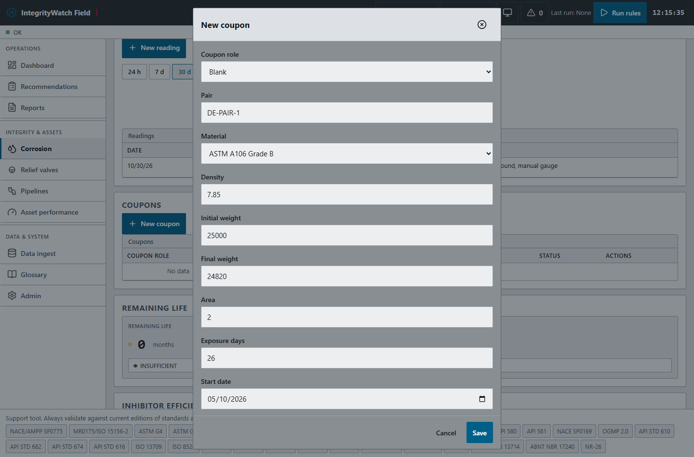

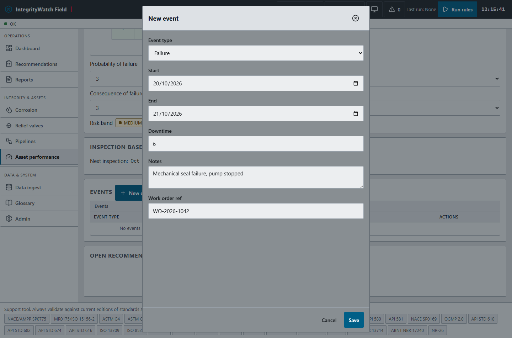

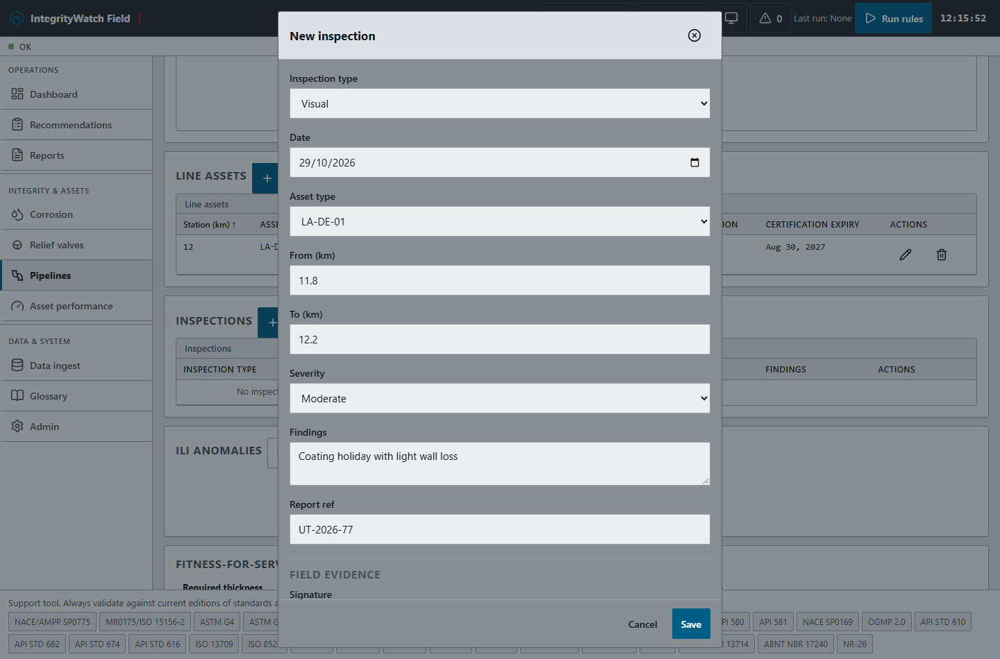

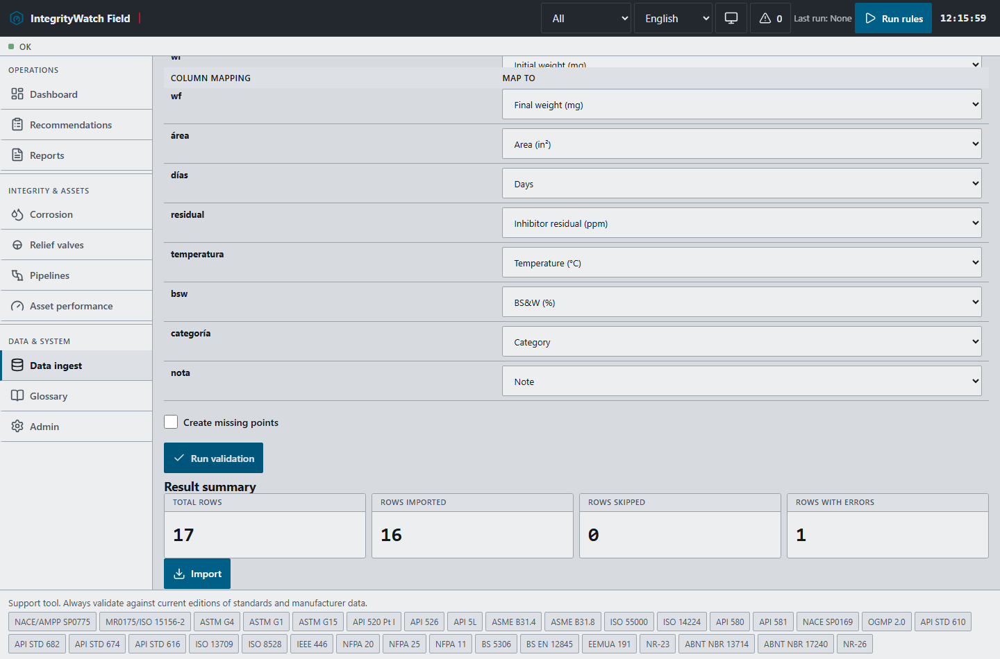
