# Manual extendido en español latino — IntegrityWatch Field

**Versión:** 1.4.1 · **Fecha de validación:** 3 de noviembre de 2026 (las capturas provienen de la campaña de campo del 1.° de noviembre)
**Audiencia:** operadores de oleoducto, ingenieros de integridad y administradores del sistema
**Modo de uso:** tablet Android en horizontal (1280×800) — válido también en escritorio
**Datos de las capturas:** escenario de oleoducto con atributos reales de NSTA y detalles derivados (ver §2)

---

## 1. Qué es IntegrityWatch Field

IntegrityWatch Field es un centro de operaciones de integridad y cumplimiento que corre
**completamente en la tablet**: sin servidor, sin nube y sin conexión. Permite registrar el
recorrido diario de campo, dar de alta activos, mantener válvulas de alivio, ver el oleoducto
como una barra de kilómetros, importar lecturas, ejecutar reglas de alerta y generar informes
firmables — todo sin señal.

Este manual amplía el manual general con el **flujo completo de un oleoducto**: perfiles de
usuario, altas de equipo (bombas centrífugas multietapa, LPG, productos limpios), revisiones
diarias, chec list y presiones.

---

## 2. Datos del escenario de validación

| Elemento | Detalle | Origen |
|---|---|---|
| Oleoducto de crudo | MAGNUS TO NINIAN · 24 in · 10,5 mm · 6,19 MPa · 91,23 km | **Real (NSTA)** |
| Ramales LPG y productos limpios | AFFLECK PIP · 8,63 in · 20,97 mm · 34,5 MPa · 20,97 km | Real (NSTA); servicio asignado como escenario |
| Estaciones | Bombeo Km 0 · Intermedia Km 40 · Terminal LPG · Terminal Productos Limpios | Derivado (ISO 14224) |
| Activos dados de alta | Bombas centrífugas multietapa, booster, bomba LPG, esfera, generador, PSV | Derivado |
| Serie de corrosión | 42 lecturas diarias (6 puntos × 7 días) con presiones en la nota | Derivado |

Cada registro declara su origen. Las series derivadas nunca se presentan como mediciones reales.

---

## 3. Acceso y perfiles

### 3.1 Iniciar sesión como administrador

Al activar el bloqueo, la app muestra la **puerta de acceso**. El administrador entra con su
usuario y contraseña.

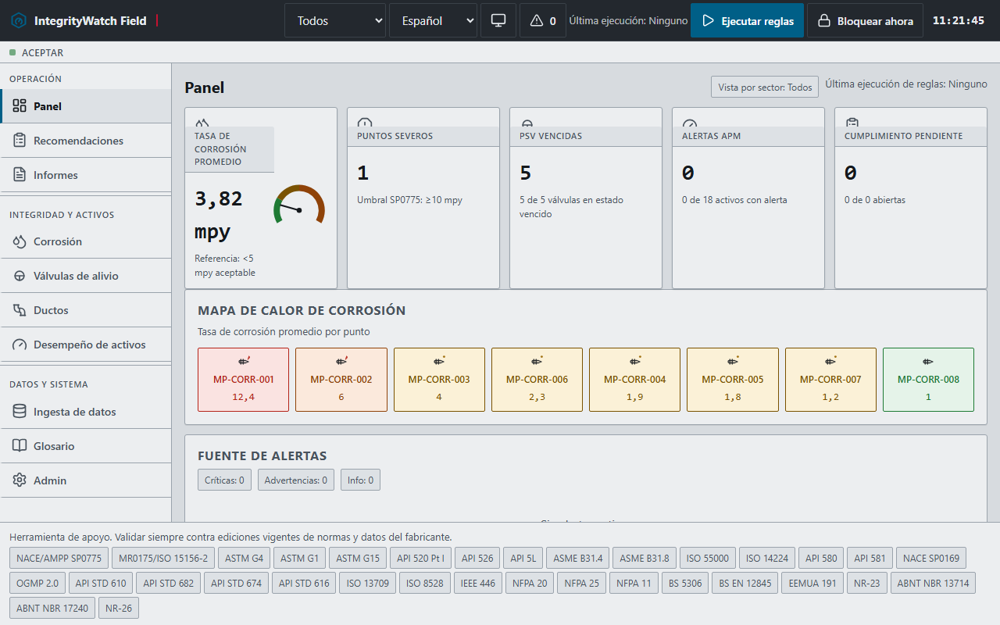

### 3.2 Crear el perfil de operador

**Admin → Usuarios y acceso → Crear usuario**: usuario, contraseña (mínimo 6) y rol *Operador*.

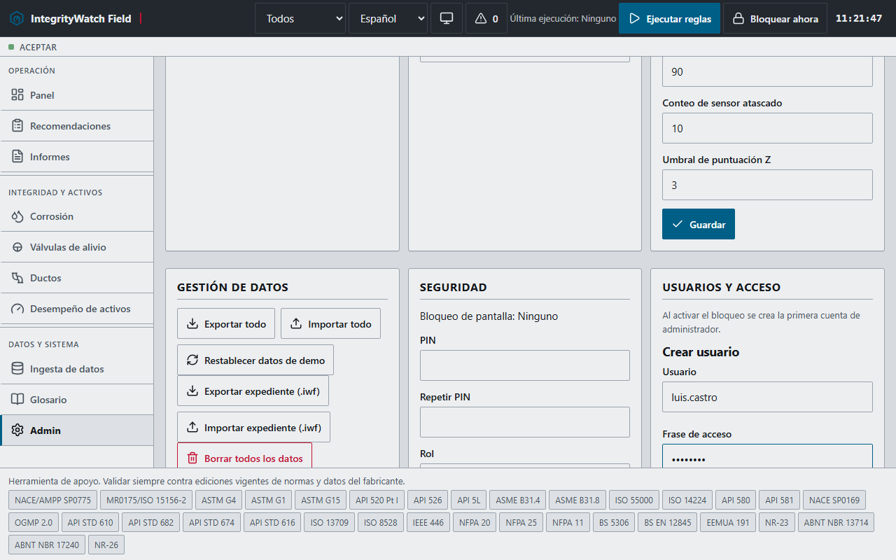

### 3.3 Crear el perfil de ingeniero

Mismo formulario con rol *Ingeniero*: podrá crear y editar activos, y firmar informes.

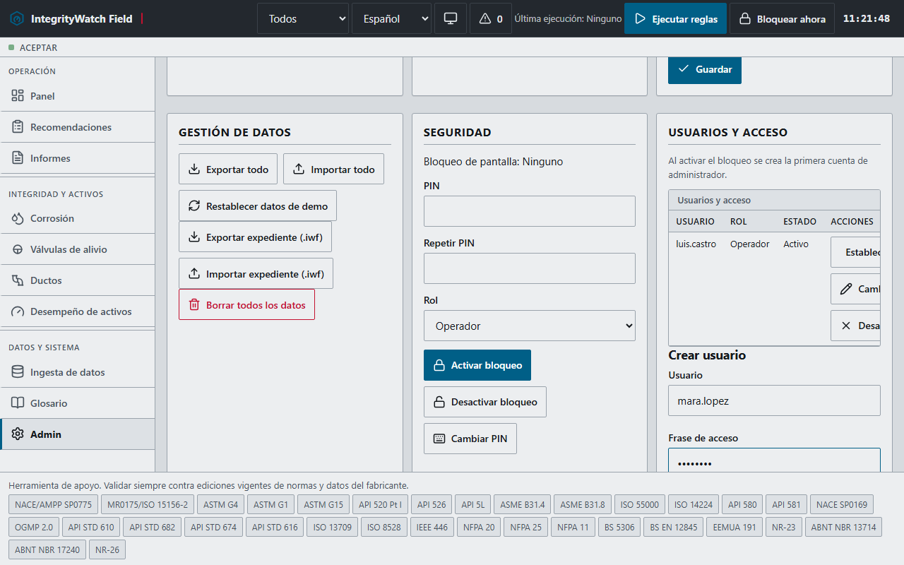

### 3.4 Restablecer una contraseña

El administrador localiza al usuario en la tabla y usa **Establecer contraseña**; la sesión
del usuario se invalida y su próxima entrada será con la nueva contraseña.

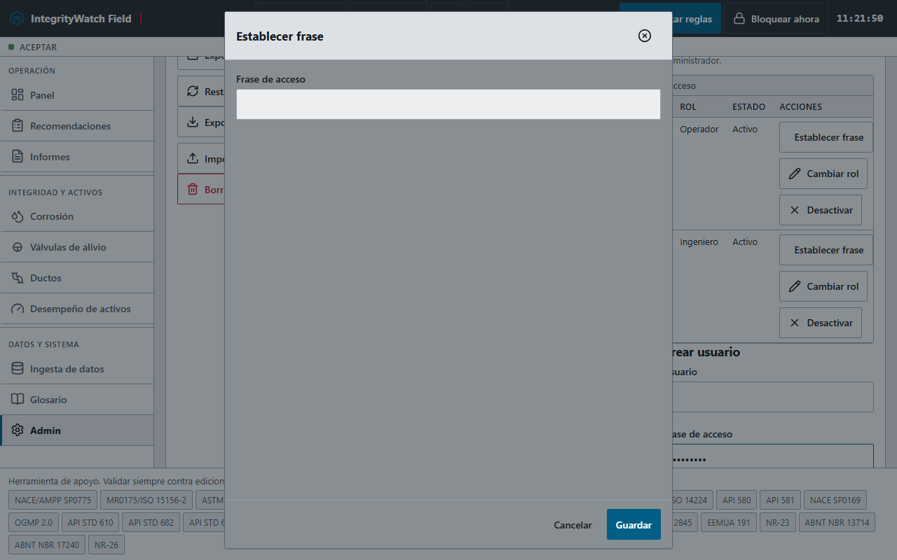

---

## 4. Rutina diaria del operador de oleoducto

### 4.1 Arrancar el turno

Al iniciar sesión como operador, el **panel** resume el estado del oleoducto: alarmas activas,
heatmap de puntos de corrosión con su pictograma de equipo, y recomendaciones abiertas.

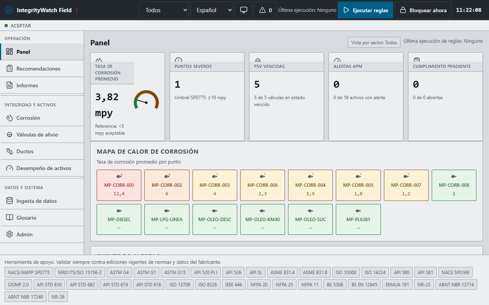

### 4.2 Chec list diario (referencia de campo)

| # | Verificación | Referencia | Unidad |
|---|---|---|---|
| 1 | Presión de succión estación 1 | ≥ 1,8 | bar |
| 2 | Presión de descarga estación 1 | 58–64 | bar |
| 3 | Presión de línea km 40 | 40–44 | bar |
| 4 | Presión línea LPG (terminal) | 15–17 | bar |
| 5 | Vibración P-101 / P-201 (multietapa) | ≤ 4,5 | mm/s RMS |
| 6 | Temperatura de sello mecánico | ≤ 80 | °C |
| 7 | Fugas en múltiples y bridas | Sin fugas | — |
| 8 | Nivel esfera LPG | 40–70 | % |
| 9 | Corrosión (cupones / probes) | < 5 | mpy |
| 10 | Generador de respaldo | Listo en automático | — |

El archivo `datos-prueba/oleoductos/checklist-diario.json` contiene esta lista en formato
máquina, lista para integrarse a tu CMMS.

### 4.3 Registrar el punto de corrosión de la línea

**Corrosión → Nuevo punto**: código, nombre, sector *Midstream*, material API 5L X52 y las
condiciones de proceso del tramo.

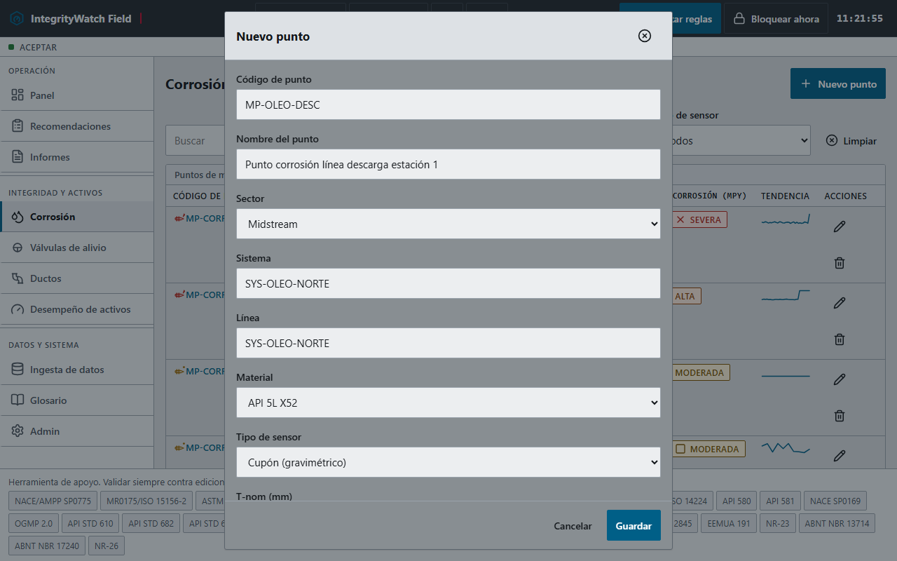

### 4.4 Consultar el punto de descarga de estación

Cada punto abre su detalle con tendencia y clasificación.

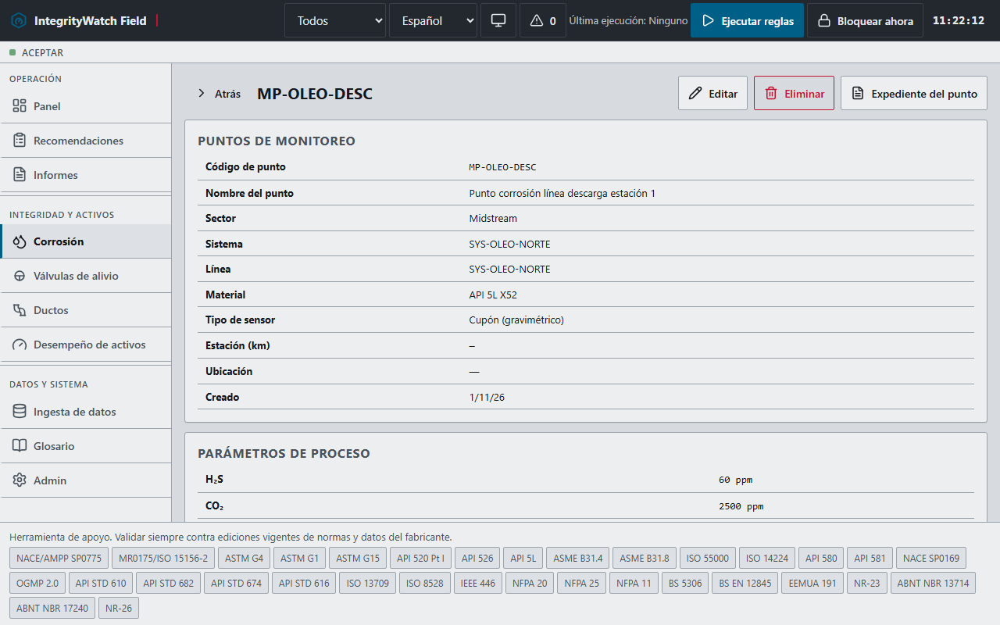

---

## 5. Alta de activos del oleoducto

### 5.1 Bomba centrífuga multietapa (crudo)

**Asset performance → New asset**. Código, nombre, sector *Midstream*, categoría
*Bomba centrífuga (API 610)*, criticidad A, estado en marcha.

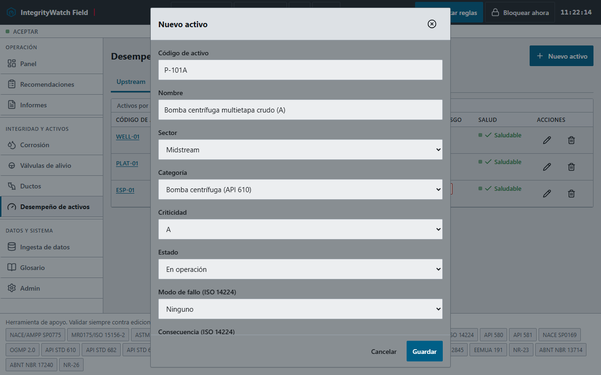

Datos de referencia del escenario: 6 etapas, sello mecánico, succión 2,1 bar,
descarga 61,8 bar.

### 5.2 Bomba LPG

Mismo formulario para la bomba de LPG del terminal: criticidad A e intervalo de 6 meses
por severidad de servicio.

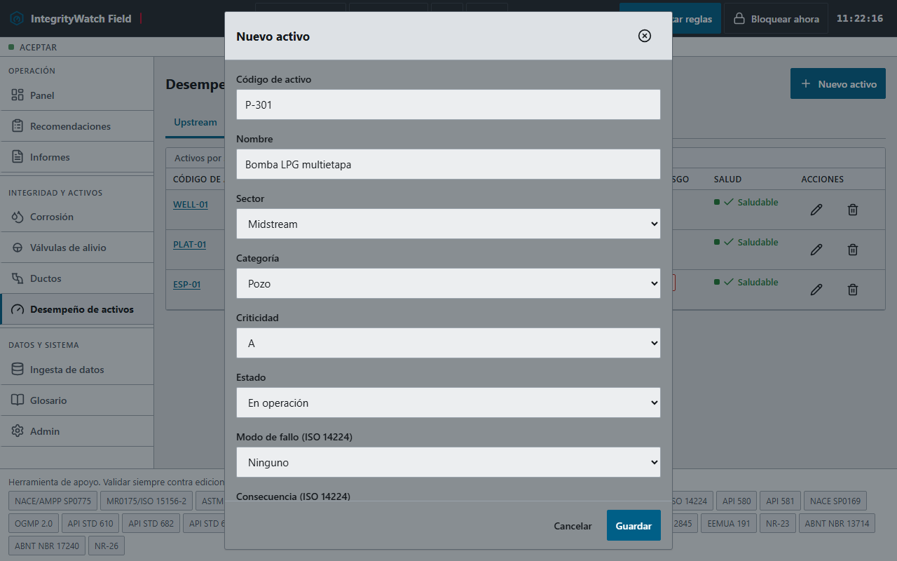

### 5.3 Registro general de activos

El registro mezcla estaciones, bombas y generador; cada categoría lleva su pictograma IFS-24.

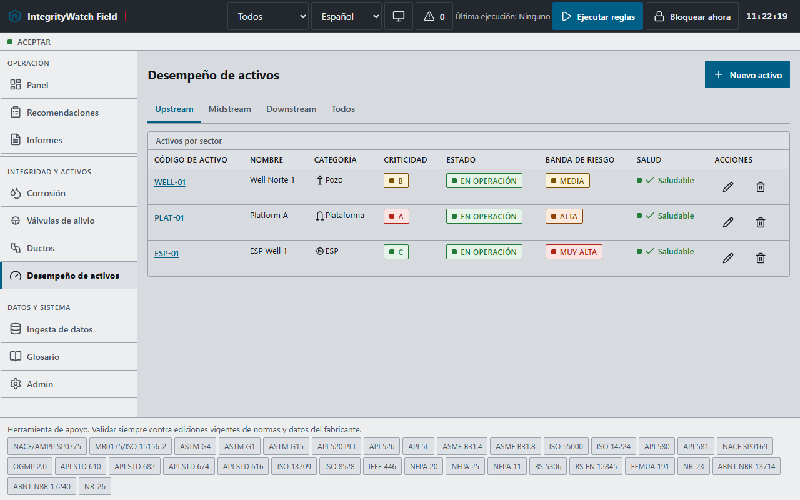

---

## 6. Válvulas de alivio (PSV)

**Relief valves → New PSV**: tag, ubicación (descarga de la estación), presión de tarado,
temperatura, contrapresión, capacidad certificada y fechas de prueba. Las vencidas se marcan
en rojo automáticamente.

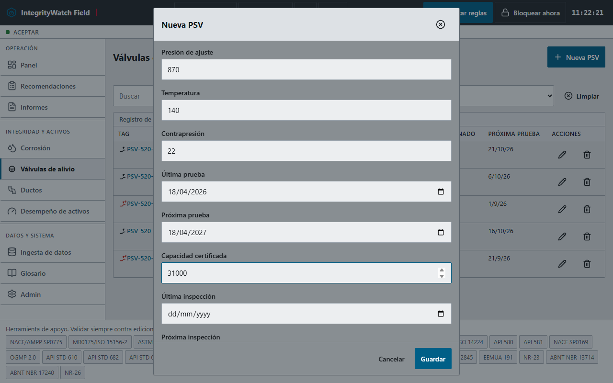

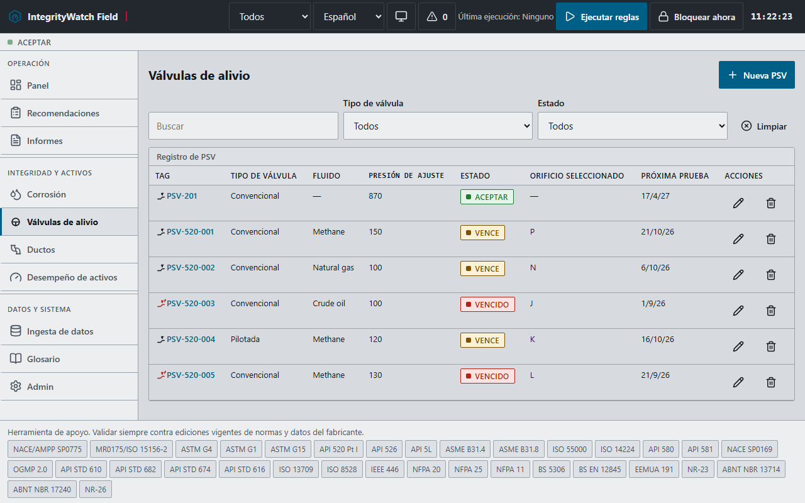

---

## 7. El oleoducto como barra de kilómetros

### 7.1 Alta del sistema

**Pipelines → New system** con los atributos reales del tramo (diámetro, espesor, MAOP,
longitud). El nombre del operador puede anonimizarse.

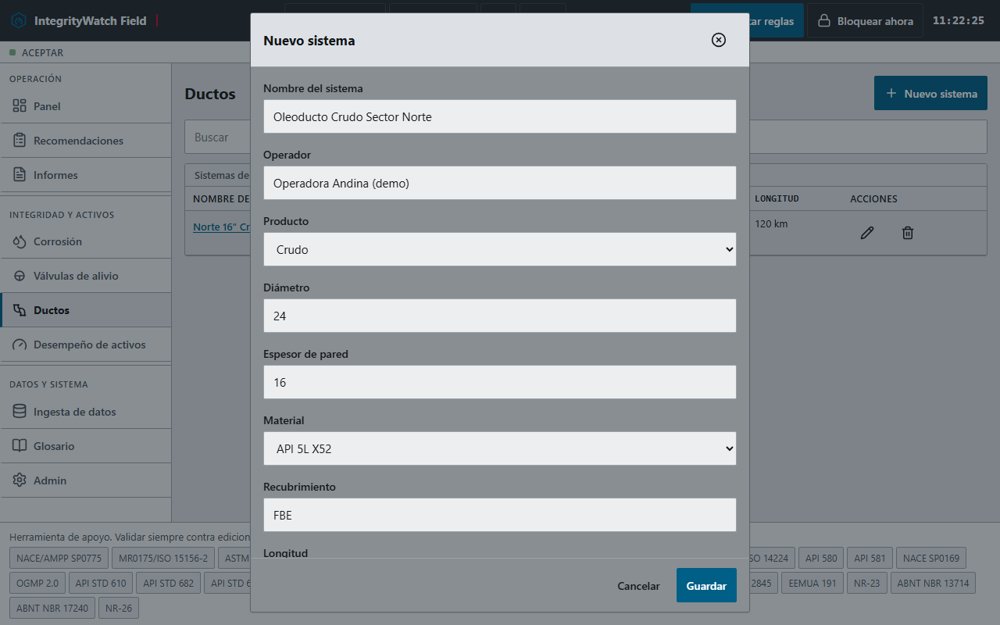

### 7.2 Ronda diaria como inspección

Cada ronda se registra como inspección del activo de línea revisitado: tipo, fecha, km
desde/hasta, severidad y hallazgo. Desde v1.3.0 la evidencia fotográfica toma **GPS y
metadatos EXIF** de la propia foto, y en los formularios de APM, PSV y sistemas de línea
hay **lectura QR de placa** (con alternativa manual cuando no hay cámara).

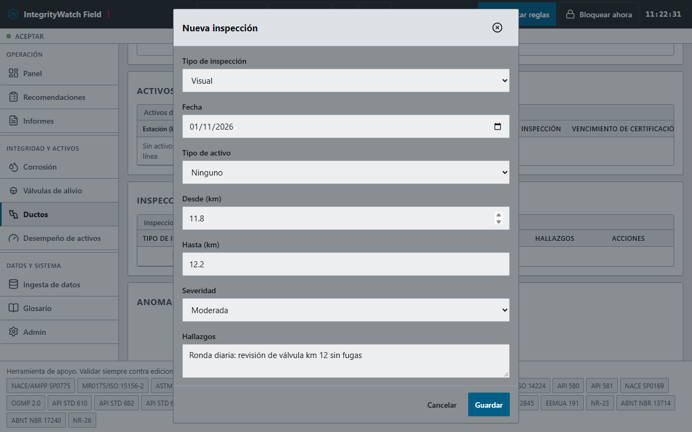

### 7.3 Mapa de kilómetros

El detalle del sistema dibuja la barra por km con la severidad por segmento y los activos
en su estación.

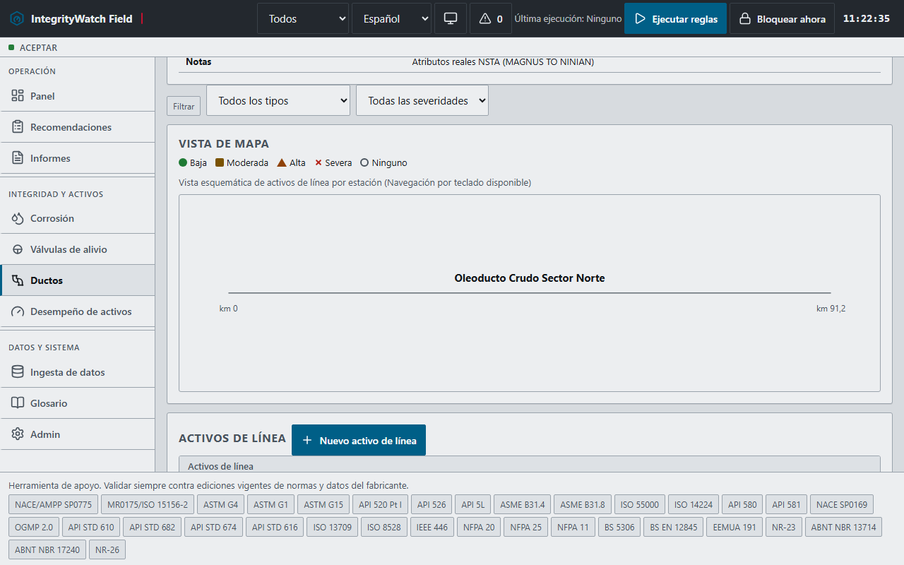

---

## 8. Ingesta de la ronda (lecturas diarias)

**Data ingest → Archivos**. Desde v1.3.0 la ingesta acepta **CSV, XLSX, JSON, JSONL, XML
genérico y WITSML** en una **cola de varios archivos con arrastrar y soltar**, sobre las 9
entidades del expediente (puntos, lecturas, cupones, PSV, sistemas, activos de línea,
inspecciones, activos y eventos APM). La app mapea las columnas sola, previsualiza, valida
cada fila, deduplica por clave natural y permite **retroceder el lote completo (rollback)**
o reanudar una importación interrumpida. La ronda diaria se entrega como archivo
(42 lecturas, 6 puntos × 7 días).

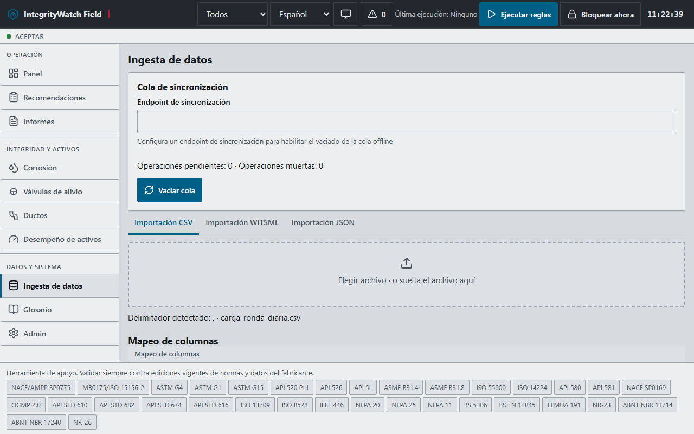

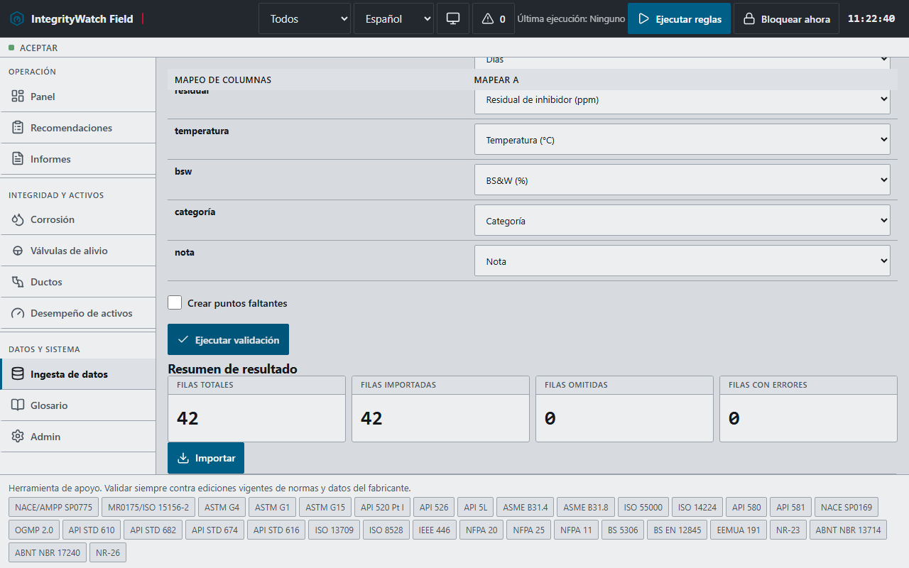

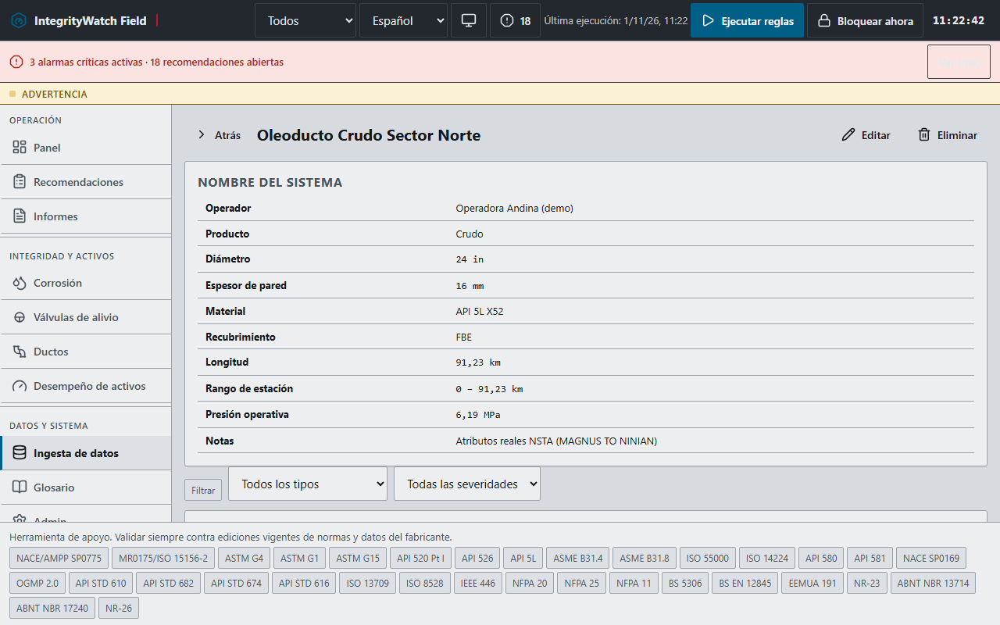

En esta corrida: **42/42 lecturas válidas** y el almacén creció de 120 a **162**.

---

## 9. Reglas y recomendaciones

**Run rules** ejecuta el barrido R1–R17 (picos de corrosión, duplicación de tendencia,
inhibidor, PSV vencidas, MTBF, disponibilidad…). En la validación generó **27 recomendaciones**
a partir de los datos del oleoducto.

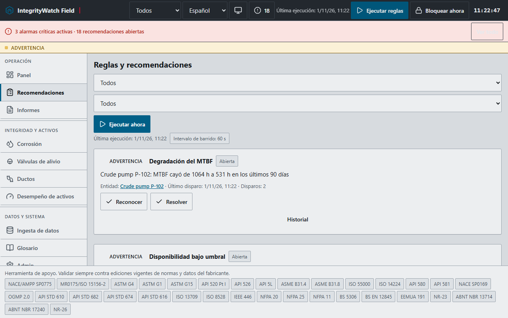

> **Nota v1.4.1:** el panel **Admin → Acerca de** muestra ahora la versión real de la app
> (antes aparecía un número fijo desactualizado). Las alarmas se anuncian **solo en
> pantalla** (banner rojo + toast cuando nace una crítica nueva): el sonido opcional que
> se probó en la 1.4.0 fue **retirado por decisión del cliente**. Al reconocer, aceptar o
> eliminar una crítica, el banner y el contador se actualizan **al instante**.

---

## 10. Informes en el dispositivo

Desde v1.3.0 el catálogo completo son **15 plantillas**: los tres clásicos **dossier del
punto** (con tendencia, ASTM y clasificación), **informe trimestral** y **ficha de PSV**,
más los 12 informes tipo T-01…T-12 (matriz de riesgo, tendencia, cupones, PSV vencidas,
etc., incluido el handover de campaña T-12). Todos se generan sin conexión y se exportan en
**seis formatos** (PDF, CSV, XLSX, DOCX, JSON, XML); además puede armarse un **paquete de
evidencia** ZIP con manifiesto SHA-256 verificable en campo. Las plantillas de CMMS (SAP PM,
IBM Maximo, ISO 14224 y PHMSA B31.8S) salen de la misma pantalla.

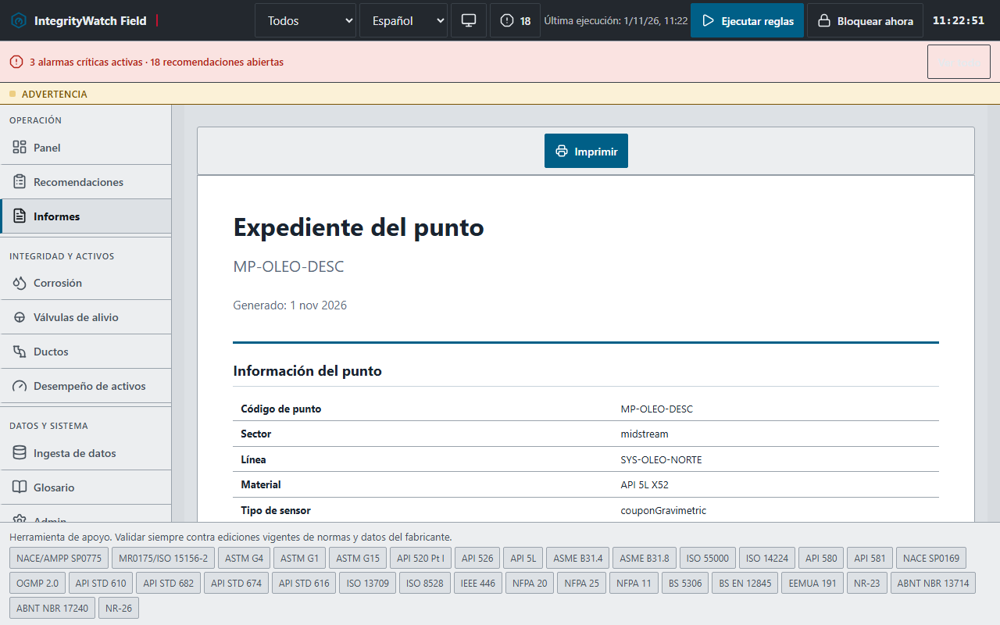

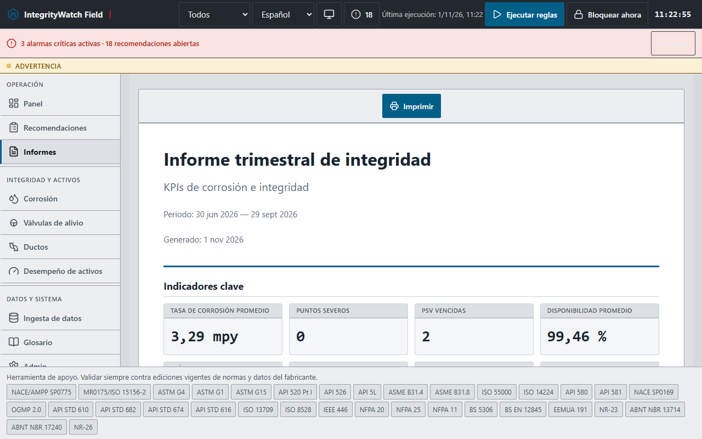

---

## 11. Cierre de campaña

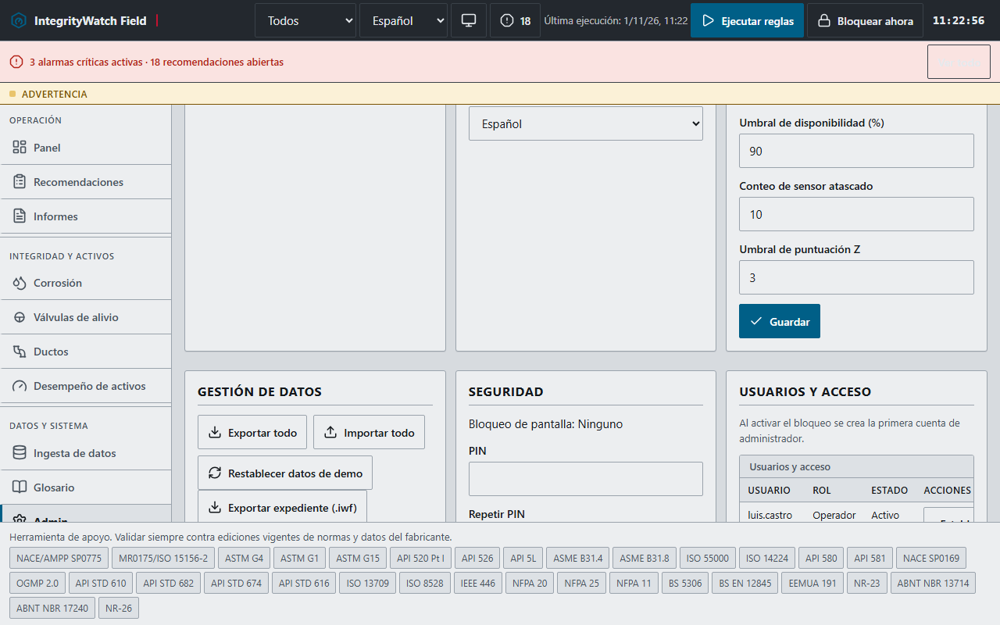

El expediente completo (JSON + evidencia) se exporta desde Admin. Desde v1.3.0 Admin también
muestra la **bitácora inmutable encadenada con SHA-256**: botón *Verificar cadena*, consulta
por rango de fechas y exportación en cinco formatos; la cadena resiste incluso varias pestañas
abiertas a la vez. La validación de esta campaña quedó registrada en
`docs/manual-tablet-es-2026-11-01/evidence.json`.

---

## 12. Vídeo del recorrido

El vídeo **«Oleoducto: recorrido del operador e ingeniero»** (español latino, ~2 min) muestra
esta misma secuencia con notas de equipo y tarea en pantalla:

- `docs/evidence/video/integritywatch-field-oleoducto-es.mp4`
- Sin subtítulos; las notas inferiores identifican el equipo y la tarea de cada escena.

---

## 13. Referencias normativas aplicadas

| Norma | Uso en la app |
|---|---|
| ISO 14224 | Taxonomía de activos y modos de falla |
| NACE/AMPP SP0775 | Clasificación de tasas de corrosión |
| MR0175 / ISO 15156-2 | Screening de servicio ácido |
| ASTM G1 / G4 | Cálculo de cupones |
| API 610 / ISO 13709 | Bombas centrífugas (categoría de activo) |
| API 520 / 526 | Sizing y ficha de PSV |
| ASME B31.4 / B31.8S | Integridad de líneas por amenazas |
| ISA-101 / EEMUA 191 | Estilo de HMI y gestión de alarmas |
| ISA/IEC 62443-3-3 | Modelo de acceso por roles (SR 1.1, 2.1) |

---

## 14. Soporte

- Acta de validación: `docs/manual-tablet-es-2026-11-01/evidence.json`
- Dataset del escenario: `datos-prueba/oleoductos/dataset.json`
- Procedencia: `docs/FIELD-DATA-SOURCES-OPERATORS.md` y `docs/FIELD-DATA-SOURCES.md`
- Reproducir: `python tools/qa/run_tablet_oleoducto_tour.py` (servidor en :8419)
